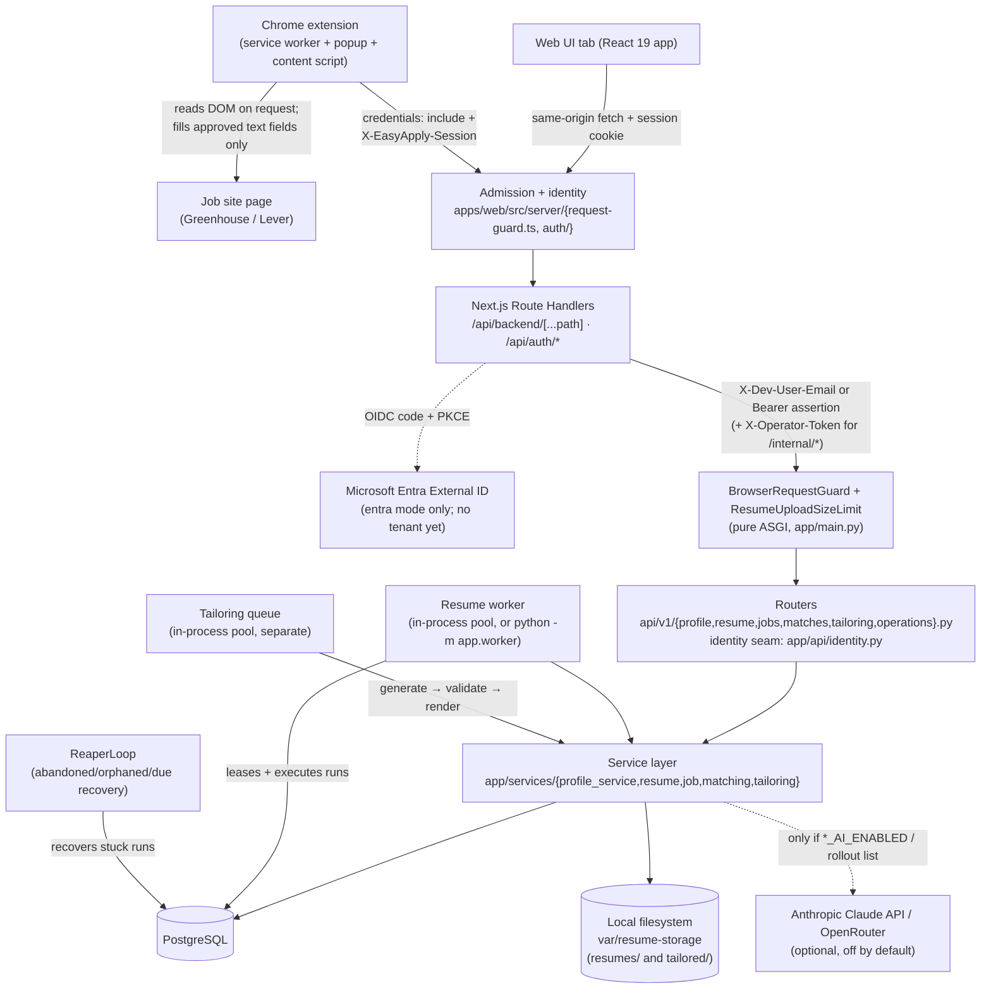
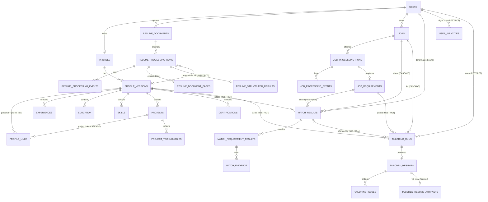

# EasyApply — Project Documentation

> Master technical reference for the EasyApply monorepo. Written from the actual code and configuration at `C:\dev\Easyapply` (not a git repository at the time of writing — no `.git` directory, no CI config, no LICENSE file were found; these are stated as observed facts, not gaps to guess at). Anything not directly verifiable in the code is marked `UNKNOWN / NEEDS VERIFICATION`.
>
> **Last brought up to date: 2026-09-26 (evening)**, from a read-only inventory of the code (routes from `app.openapi()`, the Alembic chain, an ORM-vs-migration diff, `pytest --collect-only`) plus the dated reports it cites: `docs/production-readiness-2026-09-26.md`, `docs/chrome-extension-workflow-2026-09-26.md`, `docs/entra-authentication-2026-09-26.md`, and `docs/authentication.md`. Pass/fail counts are the last verified full runs recorded in those reports (the Entra report's final sequential runs are the newest) — none were re-run for this document.

---

## 1. Executive Summary

**EasyApply** is a job-application intelligence platform being built in vertical slices. Today it is a monorepo containing:

- A **FastAPI backend** (`services/api`) implementing five domains: a versioned **candidate profile**, **resume ingestion** (upload a PDF/DOCX, extract it, structure it into candidate data, materialize it as a draft profile version), **job intelligence** (ingest a scraped job posting, normalize it, structure its requirements), a **deterministic matching engine** (compare a confirmed profile version against a job's structured requirements and produce an explainable, evidence-backed verdict per requirement), and **resume tailoring** (turn a confirmed profile version into a Word document aimed at one job, and withhold the file unless an independent grounding check proves every line against the profile).
- A **Next.js web app** (`apps/web`) — dashboard, profile and versions, resume upload and review, job capture and requirements, matching with evidence, tailoring with grounding review, and `.docx` download. Its server side is also where identity is decided for every client (`src/server/auth/identity.ts`) and where every request is admitted or refused (`src/server/request-guard.ts`) before the one backend proxy route forwards it.
- A **Chrome extension** (`apps/extension`, Manifest V3; V1 capture and V2 workflow, both 2026-09-26) for Greenhouse-hosted boards and `jobs.lever.co`: it captures a posting for review and saves it, then shows the job's requirements, the backend's match against the current confirmed profile version, starts and links a tailored resume, and on the application form proposes answers from the profile for the person to approve. It fills only approved, empty text fields, never answers a sensitive question, and **never submits** — see `docs/chrome-extension.md`.
- A **shared TypeScript package** (`packages/shared`): contract types generated mechanically from the API's OpenAPI schema, so a backend field rename becomes a TypeScript compile error in both clients rather than a runtime surprise, plus one hand-written module of user-facing wording (`presentation.ts`) that the web app and the extension both render.
- One **not-yet-built** placeholder the architecture is already shaped for: Azure infrastructure-as-code (`infrastructure/terraform`, currently just a `.gitkeep`).

**Problem it solves:** job seekers maintain their qualifications in an unstructured document (a resume) and evaluate postings by eye. EasyApply turns both sides into structured, comparable data — a versioned, auditable "profile" on one side and structured, provenance-cited "requirements" on the other — judges the match deterministically and explains every verdict rather than producing an opaque score, and then produces a job-specific resume that is not allowed to claim anything the profile does not support.

**Target users:** an individual job seeker (the only real end-user role today), plus an internal **operator** (a person operating the system, not a customer) who monitors resume-processing health through a minimal, intentionally locked-down internal dashboard.

**Current status** (2026-09-26; `README.md` "Status" and `docs/production-readiness-2026-09-26.md` §23): profile, resume intelligence with reliable asynchronous processing, job intelligence, deterministic matching (`matching_v5_1`), and resume tailoring end to end through a downloadable, grounding-approved `.docx` artifact, all usable from the web app and — from requirements through form preparation — from the Chrome extension. The readiness report judged the deterministic product ready for a controlled **single-user or internal** deployment and **not** releasable as a multi-user production service, for one reason: no real authentication. **Real sign-in with Microsoft Entra External ID (`AUTH_MODE=entra`, both tiers) was added the same day: technically implemented and locally verified — every suite green against a local OpenID provider shaped like External ID, plus a security review whose 19 confirmed findings were fixed (17) or documented (2) — but not integration-verified (no real tenant exists) and not production-ready** (§16; `docs/entra-authentication-2026-09-26.md`). The remaining production blockers are a real tenant and the flows run by hand against it, source control and CI, durable file storage, managed PostgreSQL, secrets in a vault with the API reachable only from the web app, edge protection and monitoring, and a Web Store identity for the extension (`docs/production-infrastructure-2026-09-26.md`). The default remains the development identity (`AUTH_MODE=development`, or the web-only `dev-session` sign-in form that accepts any address), which the API refuses outright under `ENVIRONMENT=production`. AI tailoring (`tailoring_ai_v6`) is built but **not released**: its evaluation gate has not been passed, so `TAILORING_AI_ENABLED` stays `false`.

**High-level architecture:** a browser — a web-app tab or the extension's service worker — talks only to the Next.js app, which admits the request, decides who it is for (a development identity, or under `entra` the session it issued after a Microsoft sign-in), and forwards it server-side through one route (`apps/web/src/app/api/backend/[...path]/route.ts`) to the FastAPI service. The FastAPI service guards itself as well (`BrowserRequestGuard`: loopback/allowed hosts only, no cross-site writes), owns a PostgreSQL database, and is the only thing that talks to an AI service — the Anthropic Claude API, plus OpenRouter as an evaluation-only second provider for tailoring. (Under `entra` the web app, not the API, also talks to Microsoft's OpenID endpoints.) Every AI switch is off by default (`RESUME_AI_ENABLED`, `JOB_AI_ENABLED`, `TAILORING_AI_ENABLED` = `false`), so a clean checkout runs entirely deterministically with no network calls and no API key.

```
Browser: web UI tab (same origin)   ·   Chrome extension service worker (host permission, credentials: "include")
  │  both present the same HttpOnly session cookie (dev-session / entra) — neither holds a credential
  ▼
Next.js app (apps/web)             — pages + /api/auth/* + /api/backend/* proxy      (entra: ⇄ Microsoft OIDC)
  │  1. admission  src/server/request-guard.ts   (Host; same-origin writes, or the extension's 3 workflow writes)
  │  2. identity   src/server/auth/identity.ts   (AUTH_MODE → who; upstream headers built fresh)
  │  X-Dev-User-Email, or under entra Authorization: Bearer <60 s assertion>  (+ X-Operator-Token on /internal/*)
  ▼
FastAPI service (services/api)     — BrowserRequestGuard → routers (identity seam app/api/identity.py) → services → models
  │
  ├─▶ PostgreSQL (all domain data, plus the resume-processing "queue")
  ├─▶ Local filesystem (resume bytes and tailored-resume artifacts, content-addressed)
  └─▶ Anthropic Claude API / OpenRouter (optional, off by default; OpenRouter for tailoring evaluation only)
```

---

## 2. Problem Statement

- **Existing problem:** a resume is unstructured prose. Deciding whether a candidate meets a job's requirements today means a human reading both documents and forming a judgment, which does not scale and is not explainable after the fact.
- **Why the problem exists:** resumes and job postings are written for humans, in free text, with no shared vocabulary, no citations, and no versioning.
- **Limitations of the manual/ad hoc approach:** no audit trail of what a "match" was actually based on; no way to reproduce a judgment later; skill and experience phrasing varies so much between documents that even a keyword search is unreliable (`"Kubernetes"` vs `"k8s"`, `"Python"` vs `"Django"`).
- **What this system solves:** it converts both sides into structured, versioned data with per-field provenance (a citation back to the exact sentence a claim came from), it judges the match with a rule engine whose every verdict can be traced to specific evidence rows and re-derived on demand, and it writes a job-specific resume whose every line cites the profile text it came from.
- **Expected outcome:** a candidate can see, for any job, precisely which requirements are met, missing, or unclear, and why — and that judgment is reproducible because it pins the exact profile version, requirements snapshot, and rule version it was computed from. They can then download a tailored resume that leads with what the posting asks for and that the system will only hand over if it can prove every sentence against their own confirmed profile — because, unlike every other output here, that document leaves the system under the candidate's name (`docs/resume-tailoring.md`).

---

## 3. Goals and Non-Goals

### Goals

- A versioned, immutable-once-confirmed candidate profile that anything (a resume upload, a future manual edit) can draft new versions of.
- Turning an uploaded resume into a reviewable, provenance-cited draft profile version without losing user control (nothing is written as a confirmed fact automatically).
- Turning a scraped job posting into structured, provenance-cited requirements, deterministically by default.
- An **explainable** matching engine: every verdict is `matched` / `missing` / `uncertain`, with evidence, never a bare score.
- Reliable asynchronous processing for the parts that are slow (resume OCR/AI, tailoring generation and rendering), without requiring a message broker, Kubernetes, or Temporal to get there — the seam is a single function (`process_run(db, run_id=...)`) that a queue, a worker, or eventually a hosted broker can all call identically.
- A tailored resume that **cannot** state what the profile does not support: a deterministic default generator that selects verbatim clauses rather than writing sentences, and an independent grounding validator that withholds the file on any error, whichever generator ran.
- A browser workflow (the Chrome extension) that goes from a posting to a prepared application form with the backend as the only source of truth, leaving every sensitive answer and the final submit to the person.
- A structured evaluation framework (separate from the pytest suite) that measures structuring, matching and tailoring quality on realistic and rule-derived datasets, tracked over algorithm and prompt versions, with release criteria frozen before a run.

### Non-Goals (explicitly, per the code's own docs)

- **No semantic/embedding-based matching.** `docs/matching.md`: "no LLM here, no embedding, no vector store, no similarity threshold" — the deterministic engine exists to be a baseline that a later semantic approach can be honestly compared against.
- **No automatic applying.** The extension never clicks, focuses or submits anything on a job site; it never sets a choice control (select, radio, checkbox, combobox), never attaches a file, and never answers a sensitive question (work authorization, sponsorship, demographics, pay, …) — those are listed as "Review required" (`docs/chrome-extension.md` §13).
- **No invented resume content.** Tailoring may select, order, and (only with AI explicitly enabled) reword the profile's own text; a line that adds a number, a name, a seniority word or a negation its source lacks is a grounding error, and the document ships no file. No cover letters and no PDF output yet.
- **No ranking of candidates or suitability verdicts.** `MatchDetail.has_unmet_required` reports what the counts say, never a hire/no-hire judgment; a `MISSING` requirement is deliberately not styled as a failure in the UI.
- **Job capture covers two sites.** `POST /api/v1/jobs` accepts an already-scraped, already-normalized-ish payload; the Chrome extension produces one from a live Greenhouse-hosted posting or a `jobs.lever.co` posting and from no other site, and the web app's job form posts the same payload by hand (`docs/chrome-extension.md` §18).
- **No production authentication yet, no rate limiting, no CORS handling** — Entra External ID sign-in is implemented and locally verified but not yet run against a real tenant; the `dev-session` mode is a development convenience, not authentication (`docs/authentication.md` §2). Authorization is ownership scoping plus, under `entra`, one operator app role.
- **No Kubernetes, no Temporal, no Event Hubs, no message broker, no Docker in actual use today** — `docker-compose.yml` is a documented placeholder with everything commented out.

---

## 4. Users and Actors

| Actor | Responsibility / capability |
|---|---|
| **Job seeker (the user)** | Uploads a resume, reviews and confirms AI-drafted profile data, saves jobs (web form or extension) and views their structured requirements, triggers a match, reads the explained result, generates a tailored resume, reviews it line by line against its sources, downloads the `.docx`, and — in the extension — approves proposed answers on an application form and submits it themselves. Identified by a development identity by default (`DEV_USER_EMAIL`, or the address typed into the `dev-session` sign-in form); under `AUTH_MODE=entra` by a Microsoft Entra External ID sign-in (locally verified, no tenant yet), keyed by the immutable Entra object id, never by email. |
| **Operator** | A person monitoring resume-processing health via `/internal/resume-processing` and `GET /api/v1/internal/resume-processing/*`. Reads across **all** users' processing state (never resume content) to see which documents need a human. Not a customer-facing role; the page has no navigation link — "you arrive by typing the URL." Open without a token only under `ENVIRONMENT=development`; otherwise `OPERATOR_API_TOKEN` is required, and under `entra` also the Entra app role `EasyApply.Operator`. |
| **System (background workers/reaper)** | Not a human actor: the resume processing worker (`python -m app.worker`, or the default in-process thread pool) claims and executes processing runs; the reaper (`ReaperLoop`) recovers abandoned/orphaned/due runs. Tailoring runs on its own in-process queue, separate from the resume pool. Acts under its own `worker_id`, never a user identity. |
| **Anthropic Claude (external service)** | Optional, off by default. When `RESUME_AI_ENABLED` / `JOB_AI_ENABLED` are true, it structures a resume or job posting into schema-validated candidate data via `messages.parse()`; when `TAILORING_AI_ENABLED` is true (or a user is in `TAILORING_AI_USER_IDS`), it proposes a tailored resume. Never trusted blindly — every claim it returns is re-verified against the source text server-side before being shown, stored as authoritative, or rendered into a file. The account was out of credit at the last evaluation attempt (an external blocker, `docs/production-readiness-2026-09-26.md` §21). |
| **OpenRouter (external service)** | An evaluation-only second provider for the tailoring domain (`TAILORING_AI_PROVIDER=openrouter`), added so the AI tailor could be measured while Anthropic was unavailable. Not a production setting. |
| **Chrome extension (V2)** | Reads a posting from a Greenhouse-hosted board or `jobs.lever.co`, shows exactly what will be saved and as whom, saves it through the web app's proxy, then drives requirements → match → tailored resume → application-form preparation from the popup. Holds no credential: its requests carry the browser's web-app session cookie, and the proxy attaches identity. Never submits. See `docs/chrome-extension.md`. |

---

## 5. Major Features

### 5.1 Profile domain (versioned candidate profile)

**Purpose:** hold a candidate's career facts (contact details, summary, personal links, experience, education, skills, projects with their own links, certifications) as a sequence of immutable, numbered versions, at most one of which is the current one at a time.

**User:** the job seeker, directly (create a draft, edit it, confirm it) or indirectly (a resume upload creates a draft on their behalf).

**Input:** a `Snapshot` (`contact` {full_name, email, phone, location}, `summary`, personal `links`, experiences, education, skills, projects — each with `technologies` and project `links` — and certifications) submitted wholesale via `PUT /api/v1/profile/versions/{n}/snapshot`.

**Processing:** a version starts `draft` (fully editable) and can be `confirmed` exactly once, after which PL/pgSQL triggers make the version row (every column except `is_current`, including the contact and summary columns) and every child row (links included) immutable — enforced at the database level, not just in application code. A confirmed version can be made current later (`POST …/make-current`; `409` for a draft).

**Output:** `ProfileVersionRead` (version metadata + full snapshot) or `ProfileVersionSummary` (listing).

**Relevant files:** `app/models/profile.py`, `profile_version.py`, `profile_link.py`, `education.py`, `experience.py`, `skill.py`, `project.py`, `certification.py`; `app/schemas/profile.py`, `snapshot.py`; `app/services/profile_service.py`; `app/api/v1/profile.py`; frontend: `apps/web/src/app/profile/**`, `src/components/profile/**`.

**Database tables:** `profiles`, `profile_versions` (contact and summary are columns here), `profile_links` (personal or project-owned, `owner_type`), `experiences`, `education`, `skills`, `projects`, `project_technologies`, `certifications`.

**APIs:** see §13.1.

**Dependencies:** none (this is the foundation domain everything else drafts into or reads from).

**Failure cases:** confirming a version twice, editing a confirmed version, or violating a snapshot CHECK constraint (e.g. an end date before a start date) all surface as `409`/`422` via the constraint-name-based error mapping in `app/api/errors.py`, never a raw database error.

### 5.2 Resume Intelligence (upload → draft profile version)

**Purpose:** turn an uploaded PDF/DOCX resume into a reviewable **draft** profile version, with per-field provenance, without ever silently inventing data.

**User:** the job seeker, via `/resume`.

**Input:** a PDF or DOCX file (`POST /api/v1/resumes`, multipart).

**Processing pipeline** (`app/services/resume/pipeline.py:process_run`): validate bytes (magic-byte sniffing, never trusting filename/Content-Type) → store (content-addressed, local filesystem today) → extract text per page (`pypdf`/`python-docx`) → OCR any page that reads as image-only (`pypdfium2` render + `pytesseract`) → structure into candidate data (deterministic heuristics by default, or Claude via `messages.parse()` if `RESUME_AI_ENABLED=true`) → verify every provenance quote against the actual extracted text → validate the mapping into profile-shaped rows → materialize a **draft** `ProfileVersion` in the same transaction as its snapshot.

Processing is **asynchronous**: the upload request returns as soon as the file is stored and a `ResumeProcessingRun` row exists; a worker (in-process thread pool by default, or a separate `python -m app.worker` process) claims the run via a **database lease** and executes the pipeline. See §19 for the full lease/reaper/retry design.

**Output:** `ResumeDocumentDetail` (status), `StructuredResultRead` (the review screen: structured candidate data with page-cited provenance, plus anything that couldn't be mapped and why).

**Relevant files:** all of `app/services/resume/*`, `app/services/storage.py`, `app/services/ai/*`; `app/models/resume_document.py`, `resume_processing.py`; `app/schemas/resume.py`, `resume_candidate.py`; `app/api/v1/resume.py`, `app/worker.py`; frontend: `apps/web/src/app/resume/**`, `src/components/resume/**`.

**Database tables:** `resume_documents`, `resume_processing_runs`, `resume_processing_events`, `resume_document_pages`, `resume_structured_results`.

**APIs:** see §13.2.

**Dependencies:** the profile domain (a completed run creates a draft `ProfileVersion` through `profile_service.create_draft_version_with_snapshot`).

**Failure cases:** every failure records a code from a fixed, non-PII vocabulary (`app/services/resume/failures.py`) and is classified transient (auto-retried up to `RESUME_MAX_ATTEMPTS`, default 3, with exponential backoff + jitter) or permanent (never retried automatically — the document itself is the problem). An unrecognized code defaults to permanent, deliberately: "a new failure mode retried three times is three times the damage."

### 5.3 Job Intelligence (ingest → structured requirements)

**Purpose:** turn a scraped job posting into a canonical, deduplicated `Job` row and structured, provenance-cited requirements.

**User:** the job seeker, through the web app's "Add a job" form (`/jobs/new`, which posts the same `JobIngestionRequest` payload) or the Chrome extension (Greenhouse and Lever postings); also `POST /api/v1/jobs` directly, or tests.

**Input:** `JobIngestionRequest` — title, company, description text (≤50,000 chars), source metadata, optional salary — validated at the schema boundary (`extra="forbid"`, closed vocabularies for `source_type`, URL scheme checks, control-character stripping).

**Processing:** normalize (`app/services/job/normalization.py` — deterministic alias tables, URL canonicalization, content hashing) → deduplicate by a two-tier identity policy (external id if the source gave one, else a canonicalized URL, both scoped per user) → structure into `JobCandidate` (nine requirement categories: required/preferred skills, required/preferred experience, education, certifications, responsibilities, technologies, qualifications) via a deterministic heading/regex parser by default, or Claude if `JOB_AI_ENABLED=true` → verify every provenance quote against the actual description.

Processing is **synchronous** today (`POST /jobs` runs the pipeline inline) — deliberately, because deterministic structuring is a sub-millisecond regex pass with nothing to wait on; the run/event tables are already shaped the way the resume domain's lease/reaper machinery could attach to them later.

**Output:** `JobDetail`, `JobRequirementsResponse` (structured requirements, each item cited).

**Relevant files:** `app/services/job/*` (`STRUCTURER_VERSION = "2026-09-26.2"`); `app/models/job.py`; `app/schemas/job.py`, `job_candidate.py`; `app/api/v1/jobs.py`; frontend: `apps/web/src/app/jobs/**`, `src/components/job/**`.

**Database tables:** `jobs`, `job_processing_runs`, `job_processing_events`, `job_requirements`.

**APIs:** see §13.3.

**Dependencies:** none required to run (feeds the matching domain).

**Failure cases:** malformed payloads are rejected at `422` before normalization runs; a genuinely untrusted job description is treated as hostile content — never rendered as HTML, never concatenated into an AI prompt without delimiting, with the prompt-injection boundary documented in `structuring.py`'s own docstring ahead of there being a real prompt to audit against.

### 5.4 Matching (deterministic, explainable evaluation)

**Purpose:** given one **confirmed** profile version and one job's **completed** structured requirements, produce a per-requirement verdict (`matched` / `missing` / `uncertain`) with evidence, plus a coverage score, with zero AI, embeddings, or thresholds involved in the judgment itself.

**User:** the job seeker, from a job's detail page (`/jobs/[id]/match`), an explicit action ("Match my profile") rather than something computed on page load.

**Input:** `MatchRequest{profile_version_id: int | None}` — omitted means "my current confirmed version."

**Processing:** `app/services/matching/engine.py:evaluate(candidate, version, as_of, posting)` builds a `ProfileIndex` over the profile snapshot (indexing declared skills, project technologies, and every sentence of every job description into graded evidence tiers, with clause-level negation — `negation.py` — and span splitting — `span_split.py` — deciding what a sentence actually affirms) and dispatches one `judge_*` rule per requirement category (`app/services/matching/rules.py`). The shipped rules are `matching_v5_1` (`ALGORITHM_VERSION` in `engine.py`). Evidence is graded in four tiers (`declared_corroborated` > `employment_described` > `declared_only` > `mentioned`), and the bar a requirement sets (`any_evidence` vs `professional_use`) is read from the requirement's own wording. The score is `0.8 × required_coverage + 0.2 × preferred_coverage`, computed with `Decimal` for determinism, where an `UNCERTAIN` verdict dilutes the denominator but never counts as a match.

**Output:** `MatchDetail` — per-category, per-requirement judgments with cited evidence, plus the coverage summary.

**Relevant files:** all of `app/services/matching/*`; `app/models/match.py`; `app/schemas/match.py`; `app/api/v1/matches.py`; frontend: `apps/web/src/app/jobs/[id]/match/**`, `src/components/match/**`.

**Database tables:** `match_results`, `match_requirement_results`, `match_evidence`.

**APIs:** see §13.4.

**Dependencies:** the profile domain (must be `confirmed`) and the job domain (must have a completed structuring run).

**Failure cases:** `409` if the profile version is a draft or the job has not been structured — states where a match would be meaningless. Re-requesting an identical evaluation (same profile version + same requirements row + same algorithm version) is idempotent and returns the existing row rather than erroring or recomputing.

### 5.5 Resume Tailoring (confirmed profile version + job → grounded `.docx`)

**Purpose:** turn one confirmed profile version into a Word document aimed at one job, and refuse to hand over the file unless every entry and line can be proved against that version. The one domain whose output leaves the system under the user's name (`docs/resume-tailoring.md`).

**User:** the job seeker, from `/jobs/[id]/tailor` (start, follow the stages) and `/tailored-resumes/[runId]` (review line by line — ORIGINAL → TAILORED — then grounding findings, then download), or from the extension's "Tailor my resume".

**Input:** `TailoringRequest {profile_version_id?, match_result_id?}` on `POST /api/v1/jobs/{job_id}/tailored-resumes` — omitted version means the current confirmed one; a supplied match must be for the same job, the same profile version and the same requirements reading (else `409`).

**Processing** (`app/services/tailoring/pipeline.py:process_run(db, run_id=...)`, run on the tailoring queue — in-process thread pool by default, separate from the resume pool): `queued → generating → validating → rendering → completed`, or `completed` with `grounding_status='failed'` (no file), or `failed`.
- *generate* — `get_tailor(run.generator)`: `DeterministicTailor` (the default) **selects** verbatim clauses from the snapshot and orders them by `relevance.py`'s posting signal (and a supplied match's verdicts); `ProviderTailor` (AI, `PROMPT_VERSION_AI = "tailoring_ai_v6"`) rewords within a fenced prompt. The generator is chosen once per run by `service.select_generator(user_id)` (`TAILORING_AI_ENABLED`, else `TAILORING_AI_USER_IDS`) and recorded on the row; nothing downstream re-reads the flag.
- *validate* — `reconciliation.settle(...)`: grounding (`grounding.py`) judges the document against the snapshot alone; for the AI generator only, a repair pass may remove a line, restore a copied field or permute entries, and grounding runs again. Errors withhold the file; warnings (every repair among them) are shown.
- *render* — only on a pass: `rendering.render` (python-docx) → `rendering.verify` (re-open and check) → `storage.put` under a content-addressed `tailored/{user_id}/{sha256}.docx` key → a `tailored_resume_artifacts` row.

**Output:** `TailoringRunDetail` (the run, the validated `TailoredResumeDocument`, its issues, and artifact metadata — never a `storage_key`), `TailoringRunSummary` lists, and the DOCX bytes from `GET /api/v1/tailored-resumes/{run_id}/artifact`.

**Relevant files:** `app/services/tailoring/{service,pipeline,generation,relevance,grounding,reconciliation,rendering,queue,worker,failures}.py`, `app/services/tailoring/providers/`; `app/models/tailoring.py`; `app/schemas/tailored_resume.py`, `tailoring.py`; `app/api/v1/tailoring.py`; frontend: `apps/web/src/app/jobs/[id]/tailor/**`, `src/app/tailored-resumes/**`, `src/components/tailoring/**`.

**Database tables:** `tailoring_runs`, `tailored_resumes`, `tailoring_issues`, `tailored_resume_artifacts`.

**APIs:** see §13.5.

**Dependencies:** the profile domain (a confirmed version), the job domain (completed requirements), optionally the matching domain (a match for that version and reading), and the storage backend.

**Failure cases:** a generation or render problem is a `failed` run with a code from `app/services/tailoring/failures.py` (transient: `worker_abandoned`, `artifact_storage_failed`, `unexpected_error`, plus the AI transient codes; permanent: `document_schema_invalid`, `empty_profile_version`, `render_failed`, `generation_failed`, plus the AI permanent codes). A grounding failure is **not** a failure: the run is `completed`, the document is returned with its findings, no artifact exists, and `can_retry` is false — "Generate again" is a fresh action. A run that stalls past `TAILORING_STALE_AFTER_SECONDS` and that no worker holds is failed as `worker_abandoned` the next time it is seen, so it can never block Generate. Downloading anything without a passed, stored artifact is `409`.

### 5.6 Operator view (internal resume-processing dashboard)

**Purpose:** answer "which resume processing needs a person" without a separate, driftable status column — every state is derived live from `resume_processing_runs`.

**User:** an operator, via `/internal/resume-processing` (no nav link) or directly against `GET /api/v1/internal/resume-processing/*`.

**Input:** none beyond optional query params (`limit`, `include_all`).

**Processing:** `derive_state()` (`app/services/resume/operations.py`) computes one of six states (`completed`, `processing`, `waiting_retry`, `exhausted`, `failed_permanent`, `stalled`) purely from a run's own columns and the current time.

**Output:** counts + a table of documents needing attention; drilling into one document shows every attempt.

**Relevant files:** `app/services/resume/operations.py`; `app/schemas/operations.py`; `app/api/v1/operations.py`; `app/api/operator_identity.py`; frontend: `apps/web/src/app/internal/**`.

**APIs:** see §13.6.

**Dependencies:** the resume domain only.

**Failure cases / security note:** this boundary is explicitly **not production-secure** (§16.4) — a shared token, no accounts, no audit trail. Because of that, every response is hand-built field-by-field from an allowlist that excludes filenames, storage keys, content hashes, emails, page text, and structured payloads.

### 5.7 Chrome extension (posting → saved job → prepared application form)

**Purpose:** carry a job posting from the page the person is reading into EasyApply and through the rest of the workflow without leaving the page — while the backend stays the only source of truth and the person stays the only one who submits (`docs/chrome-extension.md`).

**User:** the job seeker, in Chrome, on a Greenhouse-hosted board (`job-boards.greenhouse.io`, `job-boards.eu.greenhouse.io` — posting and its on-page `form#application-form`) or `jobs.lever.co` (posting, and its separate `/<company>/<uuid>/apply` page).

**Input:** the page's DOM, read only when the popup asks (no observers, no scraping in the background).

**Processing:**
1. **Capture and review** — the site adapter extracts title, company, location, description and posting id; the popup shows exactly what will be saved and as whom ("Saving as …", from `GET /api/auth/session`); Save posts a `JobIngestionRequest` (`201` new / `200` "Already in EasyApply").
2. **Requirements** — `GET /jobs/<id>/requirements`, classified (ready / processing, polled 7 times over ~1 min / still processing / failed / unavailable).
3. **Match** — the current confirmed profile version from `GET /profile/versions`; the newest stored match for this job *and* version is shown read-only; **Match my profile** is an explicit `POST /jobs/<id>/matches`. Rendered exactly as stored — nothing is computed in the extension.
4. **Tailor** — **Tailor my resume** posts `POST /jobs/<id>/tailored-resumes` (with the on-screen match if it is this version's), follows the stages (12 re-reads over ~3 min), and links "Open in EasyApply" and "Download (.docx)" — the download is a link to the proxy's artifact route, never fetched by the extension.
5. **Application form** — the form adapter reports field descriptors (never values); **Prepare answers from my profile** reads the current confirmed snapshot once and proposes values with a confidence (`exact` / `derived` / `none`); sensitive questions (16 categories — work authorization, sponsorship, demographics, pay, …) are classified first and never filled; **Fill N selected fields** writes only approved values into empty, visible, enabled text fields, re-checking each on the page at fill time.

**Output:** a saved job, a match, a tailored-resume run in the person's account; approved values in the page's text fields. **Never** a submit, a click, a choice, a file, or an answer to a sensitive question.

**Relevant files:** `apps/extension/src/{adapters,extraction,forms,profile,api,workflow,jobs,matching,review,popup,background,content,shared}/`; the web app's `src/server/request-guard.ts` (`isAllowedExtensionWrite`); `packages/shared/src/presentation.ts`.

**Database tables:** none of its own — it holds only a per-tab record of its last save in `chrome.storage.session`, keyed by account.

**APIs:** only through the web app — `GET /api/auth/session`; `GET` requirements, profile versions, current version, matches, match, tailored-resume runs; `POST /jobs`, `/jobs/<id>/matches`, `/jobs/<id>/tailored-resumes` (§16.1).

**Dependencies:** the web app (admission, identity, proxy) and through it the job, matching and tailoring APIs. Identity is the browser's web-app session; the extension holds no credential and has no `cookies` permission.

**Failure cases:** every failure is its own sentence and next step — `session_required` (the session ended: nothing more is sent), `session_changed` (another account signed in: all state is discarded), `not_found`, `conflict`, `refused`, `api_unreachable`, `network`, `timeout`, `unexpected_response`; an unsupported site or a non-posting page says so; a site markup change fails capture or detection explicitly until the adapter is updated.

---

## 6. Technology Stack

| Layer | Technology | Purpose | Why used (as evidenced in code/docs) |
|---|---|---|---|
| Language (backend) | Python 3.13 (the API venv runs 3.13.5) | API, services, workers, evaluation | `.cpython-313.pyc` artifacts and the venv interpreter confirm the version. |
| Language (frontend/extension) | TypeScript 5.9, strict mode | Web app, extension, shared contracts | `tsconfig.json` `strict: true` everywhere. |
| Backend framework | FastAPI (0.141 installed) on Starlette | HTTP API, dependency injection, OpenAPI generation | Thin routers, automatic OpenAPI schema consumed by `packages/shared`; two pure-ASGI middlewares (`BrowserRequestGuard`, `ResumeUploadSizeLimit`). |
| Validation | Pydantic v2 (`pydantic-settings` for config) | Request/response schemas, settings, AI structured-output contracts | `messages.parse(output_format=<PydanticModel>)` — the same models validate HTTP I/O and AI output. |
| ORM | SQLAlchemy 2.0 (declarative, `DeclarativeBase`) | Domain models, query building | No naming-convention metadata — every constraint/index name is hand-chosen, which is what lets `app/api/errors.py` map on exact constraint names. The engine is built with `hide_parameters=True` so bound values never reach logs. |
| Database | PostgreSQL | System of record for every domain | Chosen specifically for features the app depends on: partial unique indexes, expression indexes (`lower(name)`), CHECK constraints, and PL/pgSQL triggers enforcing immutability/state machines that plain ORM code could not guarantee against a direct SQL write. |
| Migrations | Alembic (14 revisions, linear) | Schema evolution, including raw-SQL trigger functions | `alembic/env.py` reads `DATABASE_URL` from the same `app.core.config.settings` the app uses; `alembic check` reports no model drift. |
| Web framework | Next.js 15 (App Router), React 19 | Pages, layouts, the backend-proxy and auth Route Handlers | Server Components/Route Handlers keep identity, session secrets and the operator token server-side, never in browser JS. `next dev -H 127.0.0.1` binds loopback only. |
| Data fetching | TanStack Query v5 | Caching, polling, mutation invalidation | Global default: don't retry `401`/`404`/`409` ("answers, not transport failures"); domain hooks poll every 2 s while a resume, job or tailoring run is active. |
| Forms | React Hook Form + `useFieldArray` | The whole-snapshot profile editor | One form for contact, summary, links and variable-length lists of experiences/education/skills/projects/certifications. |
| UI components | Radix UI primitives + shadcn/ui pattern + `class-variance-authority` | Accessible interactive primitives (`AlertDialog`, `Select`, `Label`) styled consistently | Thin wrappers in `components/ui/`, composed by domain components — no hand-rolled colors outside the design tokens. |
| Styling | Tailwind CSS v4 (CSS-first/PostCSS, no `tailwind.config.js`) | Utility styling, dark mode | Tokens defined once as CSS variables in `globals.css`, overridden under `prefers-color-scheme: dark` — no manual theme toggle. |
| Shared contracts | `openapi-typescript` (generates `packages/shared/src/api-schema.ts` from `services/api`'s OpenAPI schema) | Compile-time backend↔client contract, for the web app and the extension | `npm run api:types` = `python services/api/export_openapi.py` (writes `packages/shared/openapi.json`) + `openapi-typescript` generation. Never hand-edited. User-facing wording shared by both clients lives beside it in `presentation.ts`. |
| AI / structured output | Anthropic Claude via the official `anthropic` SDK's `messages.parse(output_format=...)`; OpenRouter via `httpx` (`response_format` `json_schema` strict) | Optional resume/job structuring and tailoring | Off by default in every domain (`RESUME_AI_ENABLED`, `JOB_AI_ENABLED`, `TAILORING_AI_ENABLED` = `false`); the only module that imports the `anthropic` SDK is `app/services/ai/providers/anthropic.py`; OpenRouter (`providers/openrouter.py`) is wired for tailoring only, for evaluation. |
| Document parsing | `pypdf`, `python-docx`, `pypdfium2`, `pytesseract` | Resume text extraction and OCR fallback | `pypdfium2` chosen specifically to avoid shelling out to a `poppler` binary with an untrusted file path. |
| Document rendering | `python-docx` | Tailored resume `.docx` artifacts | DOCX rather than PDF because applicants edit before sending and ATS parse DOCX more reliably; fixed zip timestamps make one document render to identical bytes (`docs/resume-tailoring.md`). |
| File storage | Local filesystem (`LocalFilesystemStorage`), swappable via a `StorageBackend` Protocol | Resume bytes and tailored-resume artifacts, content-addressed | `InMemoryStorage` exists for tests; an Azure Blob adapter is a documented, not-yet-written migration path. |
| Auth (web) | `AUTH_MODE` in `apps/web/src/server/auth/` — `development`, `dev-session` (HMAC-signed cookie via Web Crypto), `entra` (OIDC code + PKCE with `jose` 6.2.12; locally verified, no tenant yet) | Deciding who a request is for, for both the web UI and the extension | One seam, fail-closed on misconfiguration (`docs/authentication.md`). |
| Auth (API) | `app/api/identity.py` → `dev_identity.py` (`X-Dev-User-Email`) or `assertion_identity.py` (HS256 assertion from the web app, verified with `PyJWT`) | Resolving the user for every request | The service layer only ever sees a plain `user_id: int`. |
| Auth (operator) | A shared secret header, `X-Operator-Token`, resolved by `app/api/operator_identity.py` (plus the `EasyApply.Operator` app role under `entra`) | Internal-admin gate | Constant-time comparison; open without a token only under `ENVIRONMENT=development`; explicitly **not** production-secure on its own. |
| Chrome extension | Manifest V3, TypeScript bundled by `esbuild` (`scripts/build.mjs`, iife, target chrome120), no framework in the popup | Capture, workflow and form preparation on job sites | Permissions `storage` only, plus host permissions for the job sites and the web app; the web origin is fixed at build time (`EASYAPPLY_WEB_URL`). |
| Testing (backend) | pytest, against a **real** migrated PostgreSQL test database | 86 test files; 2,754 passed, 13 skipped in the last full run (§24.1) | `conftest.py`'s own docstring: "almost everything worth testing here — check constraints, partial unique indexes, expression indexes, the immutability triggers — exists only in the database." |
| Testing (web) | Vitest, Testing Library, MSW (Mock Service Worker); Playwright + `@axe-core/playwright` for e2e | Component/page/hook/route tests; browser journeys against the real stack | MSW mocks only the network boundary — real fetch client, real React Query, real components run. The e2e suite starts its own API, web servers and database. |
| Testing (extension) | Vitest (jsdom) with a fake Chrome API; Playwright driving a persistent Chromium with the built extension | Unit/flow tests; real-browser tests against a stub web app and against the real stack | The browser suites count submit events on the page (0) and assert the web app's cookie on the wire. |
| Deployment | None configured yet | — | `docker-compose.yml` is a documented placeholder (everything commented out); `infrastructure/terraform/` is an empty placeholder directory. See §25–26. |
| Monitoring | Python `logging` (structured `extra=` fields) + dedicated DB tables (`resume_processing_events`, `job_processing_events`) for stage timing | Observability | No external APM/metrics system wired up (`UNKNOWN / NEEDS VERIFICATION` beyond stdlib logging). |

---

## 7. System Architecture



The system is a **layered monolith with decoupled workers**, not microservices. Every server-side component below runs from the same codebase; the only process boundaries that matter operationally are the browser ↔ web app hop, the web app ↔ API hop, and the optional split between the API process and a standalone resume worker process — and even that last boundary communicates through nothing but a shared database table (§19).

### 7.1 Components

**Browser (web UI)** — no application code of its own beyond what Next.js ships; never holds a credential (the session cookie is HttpOnly), never calls the FastAPI service directly (no CORS is configured anywhere in `main.py`, and the API's own guard refuses cross-site writes and non-loopback hosts).

**Chrome extension (`apps/extension`)**
- *Responsibility:* capture a posting, drive the saved job's workflow from a popup, and prepare the application form for the person to review and submit.
- *Inputs:* the active tab's DOM (content script, on request only); the web app's answers.
- *Outputs:* requests to the web app's proxy — reads, plus exactly three writes; approved values written into empty text fields on the page.
- *Dependencies:* `@easyapply/shared` (generated types and `presentation.ts` wording); the web app.
- *Communication:* popup ⇄ service worker by `chrome.runtime` messages (a closed call list, `src/api/calls.ts`); service worker → web app over `fetch` with `credentials: "include"`; popup ⇄ content script by `chrome.tabs` messages (bounded, shape-checked).
- *Key files:* `src/adapters/*`, `src/api/{calls,client}.ts`, `src/workflow/job-flow.ts`, `src/forms/{classify,fill}.ts`, `src/popup/*`, `src/background/service.ts`, `src/manifest.json`.

**Next.js app (`apps/web`)**
- *Responsibility:* render every page; admit or refuse every request (`src/server/request-guard.ts`); decide who it is for (`src/server/auth/identity.ts`); run sign-in (`/api/auth/*`, and under `entra` the OIDC flow); proxy every backend call through one Route Handler with upstream headers built fresh, so identity, session secrets and the operator token stay server-side.
- *Inputs:* browser and extension requests; `API_BASE_URL`, `AUTH_MODE`, `DEV_USER_EMAIL`, `SESSION_SECRET`, `PROXY_ALLOWED_HOSTS`, `PROXY_ALLOWED_EXTENSION_IDS`, `OPERATOR_API_TOKEN`, and the `ENTRA_*`/`APP_ORIGIN`/`IDENTITY_ASSERTION_SECRET` set under `entra` (all server-only, §17.2).
- *Outputs:* rendered HTML/React trees; forwarded HTTP requests to the API; session cookies.
- *Dependencies:* `@easyapply/shared`, TanStack Query, Radix/shadcn components, `jose` (entra).
- *Communication:* same-origin `fetch` from the browser; plain HTTP to FastAPI, server-side only; HTTPS to Microsoft's discovery, token and JWKS endpoints under `entra`.
- *Key files:* `src/server/request-guard.ts`, `src/server/auth/*`, `src/app/api/backend/[...path]/route.ts` (the proxy), `src/app/api/auth/*`, `src/app/layout.tsx` (identity-gated shell), `src/app/providers.tsx` (React Query + session handling), `src/lib/api/*` (typed clients + query hooks).

**FastAPI service (`services/api`)**
- *Responsibility:* own every domain's business rules, validation, persistence, and the AI integrations; resolve identity from what the web app attached.
- *Inputs:* HTTP requests via the proxy. The API guards itself too (`BrowserRequestGuard`: Host allowlist, no cross-site writes), because a page could otherwise skip the proxy and post to `:8000` directly.
- *Outputs:* JSON responses and DOCX bytes; rows in PostgreSQL; files on the local filesystem; optionally, requests to Anthropic or OpenRouter.
- *Dependencies:* PostgreSQL (required), local filesystem (required), AI providers (optional).
- *Communication:* synchronous HTTP in and out; the async resume and tailoring pipelines communicate with their workers only through the database.
- *Key files:* `app/main.py` (composition root, middleware, lifespan), `app/api/identity.py` (the identity seam), `app/api/v1/*` (routers), `app/services/*` (business logic), `app/models/*` (ORM), `app/schemas/*` (Pydantic I/O contracts).

**Resume worker / reaper** — see §19 for full detail. Not a separate deployable artifact by necessity: `RESUME_QUEUE_BACKEND=thread` (the default) runs the same `ResumeWorker` class inside the API process's own thread pool; `RESUME_QUEUE_BACKEND=external` moves execution into a second `python -m app.worker` process that shares nothing with the API except the database.

**Tailoring queue / worker** — `TAILORING_QUEUE_BACKEND=thread` (default) or `inline`, a pool separate from the resume one, inside the API process; `TailoringWorker` has no lease or heartbeat, and a stalled run is detected on read (§19.6). There is no external tailoring worker process.

**PostgreSQL** — the system of record for all five domains, and also the mechanism that makes resume processing "asynchronous" without a broker: a non-terminal, unleased `resume_processing_runs` row *is* outstanding work; there is no separate queue table.

**Local filesystem (`RESUME_STORAGE_ROOT`, default `var/resume-storage`)** — resume bytes under `resumes/{user_id}/{sha256}.{ext}` and tailored-resume artifacts under `tailored/{user_id}/{sha256}.docx`, addressed by content hash, never by filename. Abstracted behind a `StorageBackend` Protocol so Azure Blob Storage is a drop-in replacement (§12 of `docs/resume-intelligence.md`).

**AI providers** — Anthropic Claude (resume, job and tailoring domains) and OpenRouter (tailoring only, evaluation), both opt-in per domain and off by default. Every call goes through the shared provider boundary (`app/services/ai/providers/`) that validates the reply against a Pydantic model before anything downstream sees it.

**Microsoft Entra External ID** (`AUTH_MODE=entra` only; no real tenant configured yet) — reached by the web app alone: discovery, the authorization redirect, the token endpoint and JWKS. The API never talks to Microsoft; it trusts a 60-second assertion signed with a secret only the web server holds (§16).

### 7.2 Why these boundaries

- **Clients never talk to the backend directly** — this is what lets `main.py` skip CORS middleware entirely and keeps identity, secrets and the operator token out of browser and extension JavaScript. The API's own Host and cross-site guard makes that true even when a page tries.
- **Admission before identity** — a request passes the Host and origin rules before anything asks who it is for, so a cross-site page cannot even learn whether a session exists (`docs/authentication.md`).
- **One identity seam per tier** — `resolveIdentity()` in the web app, `app/api/identity.py` in the API; every mode (development, dev-session, entra) is a branch inside them, and the service layer below only ever sees `user_id: int`.
- **Service layer commits, `deps.py`'s `get_db` never does** — FastAPI runs a yield-dependency's teardown *after* the response is already sent, so committing there could fail silently after a 200 was returned. Every service function that mutates data calls `db.commit()` itself, so a failure can still become an HTTP error response.
- **The resume and tailoring pipelines are each one function taking only an integer (`run_id`)** — this is deliberately the entire seam between "runs inline," "runs in a thread pool," "runs in a separate worker process," and (documented, not built) "runs as a Temporal activity or an Event Hubs consumer." Nothing about `process_run` changes across any of those.
- **Job processing has none of that machinery** — because today it is a synchronous regex pass with no I/O to wait on. The run/event tables exist in the same *shape* a lease could attach to, so adding a slow AI-based job structurer later does not require a schema redesign, only new columns.
- **The extension holds no domain logic** — it arranges and renders what the backend stored (verdicts, counts, stages, grounding) and computes nothing, so the web app and the extension cannot disagree about a result.

---

## 8. Directory / Folder Structure

```text
Easyapply/
├── apps/
│   ├── extension/            # Chrome extension (MV3): capture, requirements, match, tailor, form prep — Greenhouse + Lever
│   │   ├── src/              # adapters/{greenhouse,lever}, extraction/, forms/, profile/, api/, workflow/,
│   │   │                     #   jobs/, matching/, review/, popup/, background/, content/, shared/, manifest.json
│   │   ├── scripts/build.mjs # esbuild bundle → dist/ (web origin fixed at build time: EASYAPPLY_WEB_URL)
│   │   ├── test/             # Vitest unit/flow tests (25 files) + HTML fixtures of live Greenhouse/Lever markup
│   │   └── e2e/              # Playwright: stub web app suite + real-stack runner (real-stack.mjs)
│   └── web/                  # Next.js 15 app — pages, sign-in, the backend proxy
│       ├── src/
│       │   ├── app/          # App Router pages, /api/backend proxy route, /api/auth/* routes
│       │   ├── server/       # request-guard.ts (admission), auth/ (identity, sessions, OIDC — server-only)
│       │   ├── components/   # domain components (job/match/profile/resume/tailoring/shell) + ui/ primitives
│       │   ├── lib/          # api/ (typed clients + TanStack Query hooks per domain), session.ts, utils
│       │   └── test/         # MSW server, fixtures, custom render(), a fake Entra tenant
│       └── e2e/              # Playwright suite against the real stack (specs/, support/ incl. db_admin.py, mock-entra.mjs)
├── services/
│   └── api/                  # FastAPI backend — all business logic and persistence
│       ├── app/
│       │   ├── api/          # routers (v1/), identity seams (identity, dev_identity, assertion_identity,
│       │   │                 #   operator_identity), error mapping, deps
│       │   ├── core/         # settings (config.py)
│       │   ├── db/           # engine/session/declarative base
│       │   ├── models/       # SQLAlchemy ORM models, one file per entity family
│       │   ├── schemas/      # Pydantic request/response contracts
│       │   └── services/     # profile_service.py, storage.py, ai/, resume/, job/, matching/, tailoring/
│       ├── alembic/          # migrations (14 revisions, linear; head f1a9d3c5b7e2)
│       ├── evaluation/       # "reports rather than asserts" — structuring/matching/tailoring quality measurement
│       ├── tests/            # 86 pytest files (2,754 passed + 13 skipped), against a real migrated Postgres test DB
│       ├── .env.example      # every API setting, documented
│       └── var/              # local data, NOT code: resume-storage/ (resumes/ + tailored/),
│                             #   tailoring-eval/ (AI run captures), tailoring-smoke/
├── packages/
│   └── shared/                # @easyapply/shared — generated OpenAPI→TS contract types + shared wording
│       ├── openapi.json       # generated by `python export_openapi.py`
│       └── src/
│           ├── api-schema.ts  # generated by `openapi-typescript` — never hand-edited
│           ├── index.ts       # curated, hand-written aliases, value sets, WebSession/session constants
│           └── presentation.ts # user-facing labels and failure help, rendered by the web app AND the extension
├── infrastructure/
│   └── terraform/             # Azure infrastructure-as-code — NOT BUILT (placeholder, .gitkeep only)
├── docs/                      # 21 design docs and dated reports (see "docs/" below)
├── tests/                     # placeholder (.gitkeep only) — the real suites live beside each app/service
├── docker-compose.yml          # placeholder — everything commented out (see §25)
├── package.json                # npm workspaces root: apps/*, packages/*
├── .gitignore
├── PROJECT.md                  # this file
└── README.md
```

### Purpose of each top-level directory

```text
apps/web/
    Purpose:  the user-facing web application, and the server side both browser clients go through.
    Contains: Next.js App Router pages, the backend proxy, the sign-in routes, admission and identity
              (src/server/), typed API clients, UI components, Vitest and Playwright suites.
    Depends on: packages/shared (types, wording); services/api (via HTTP, through its own proxy);
              Microsoft Entra External ID under AUTH_MODE=entra.
    Used by: the browser; the Chrome extension (through the proxy and /api/auth/session).

apps/extension/
    Purpose:  carry a job posting from the page being viewed through save → requirements → match →
              tailored resume → a prepared application form, for the person to review and submit.
    Contains: a Manifest V3 extension — content script, site and form adapters (Greenhouse, Lever),
              popup, service worker — plus its Vitest and Playwright suites.
    Depends on: packages/shared (types, wording); apps/web's proxy and session route, and through
              them services/api's job, matching and tailoring APIs.
    Used by: the person, in Chrome.

services/api/
    Purpose:  owns every domain's data model, business rules, and the AI integrations.
    Contains: the FastAPI app, all services, all ORM models/migrations, the test suite, the
              evaluation framework.
    Depends on: PostgreSQL, local filesystem, optionally Anthropic / OpenRouter.
    Used by: apps/web (via the proxy); apps/extension, through the same proxy.

packages/shared/
    Purpose:  make a backend schema change a TypeScript compile error in both clients, and give both
              clients one copy of the words they show.
    Contains: a generated OpenAPI TS module; hand-written type aliases, value sets (e.g. MATCH_STATUSES,
              TAILORING_GROUNDING_STATUSES) and the WebSession/session-tag constants; presentation.ts.
    Depends on: services/api's OpenAPI schema (export_openapi.py writes packages/shared/openapi.json).
    Used by: apps/web and apps/extension.

infrastructure/terraform/
    Purpose:  will hold Azure infrastructure-as-code.
    Contains: nothing yet (.gitkeep: "Azure infrastructure — deliberately empty. We build the application first.").
    Depends on: nothing yet.
    Used by: nobody yet.

docs/
    Purpose:  the authoritative design rationale for each vertical slice — WHY, not just WHAT — and
              dated engineering reports of what was verified.
    Contains: domain designs — resume-intelligence.md, async-resume-processing.md, job-intelligence.md,
              matching.md, resume-tailoring.md, llm-tailoring.md, tailoring-quality.md, authentication.md,
              chrome-extension.md; matching analysis history — matching-v5-{architecture-analysis,
              implementation-design,results,release}.md, matching-v6-{declared-only-analysis,
              evidence-architecture,exposure-wording-collision,s1-s2-representation-gap}.md; reports —
              web-application-validation.md, tailoring-ai-v3-selection-forensics.md,
              production-readiness-2026-09-26.md, chrome-extension-workflow-2026-09-26.md.
    Depends on: nothing (documentation only).
    Used by: developers; this PROJECT.md draws heavily on it for rationale that isn't visible
              from reading the code alone.

tests/ (root-level)
    Purpose:  reserved location for cross-cutting tests, currently unused.
    Contains: only a .gitkeep.
    Used by: nobody — the real suites live under services/api/tests/, apps/web/src/, apps/web/e2e/,
              apps/extension/test/ and apps/extension/e2e/.
```

---

## 9. File-by-File Codebase Map

This section documents every architecturally significant file. Purely mechanical/repetitive files (one ORM model per entity, one schema per entity, one UI primitive per shadcn component, one test file per concern) are covered as tables rather than individually, with exact file paths so any one of them can be opened directly. Full function/class-level detail beyond what's below can be found by opening the named file — every name here was read from the source, not inferred.

### 9.1 Backend composition root and cross-cutting seams

#### `services/api/app/main.py`
**Responsibility:** the FastAPI composition root. **Why it exists:** the one place startup/shutdown, middleware, router registration, and exception-handler registration happen. **Depends on:** `app.api.errors.HANDLERS`, `app.api.v1.api_router`, `app.core.config.settings` (and `identity_configuration_problems`), `app.services.resume.queue.build_queue`, `app.services.resume.reaper.ReaperLoop`, `app.services.tailoring.queue.build_tailoring_queue`. **Used by:** `uvicorn app.main:app`, `export_openapi.py`, every test via `TestClient`.

- `lifespan(app)` (`@asynccontextmanager`) — the *only* startup/shutdown hook (no `@app.on_event`). On startup, in order: `check_identity_configuration()` (raises `RuntimeError("Identity is misconfigured: …")` — so uvicorn exits — if `identity_configuration_problems(settings)` finds anything; logs `identity.production_without_sign_in` at error level when `ENVIRONMENT=production` and `AUTH_MODE != "entra"`; logs `identity.mode`), then `app.state.processing_queue = build_queue()`, `app.state.tailoring_queue = build_tailoring_queue()`, `app.state.reaper = ReaperLoop(queue=processing_queue)` and `.start()`, and logs `processing.started` with both queue backends. On shutdown: `reaper.stop()`, then `processing_queue.shutdown(wait=True)`, then `tailoring_queue.shutdown(wait=True)`. Deliberately not run at import time, so importing the app for Alembic/tests/`--help` never starts background threads.
- App construction: `FastAPI(title="EasyApply API", version="0.1.0", lifespan=lifespan)` — no CORS middleware and no rate limiting anywhere in this file.
- **Two pure-ASGI middlewares**, `add_middleware(ResumeUploadSizeLimit)` then `add_middleware(BrowserRequestGuard)`, so the guard runs first:
  - `BrowserRequestGuard` — every method: the Host (port stripped, lower-cased) must be `localhost`, `127.0.0.1`, `[::1]`, `::1`, `testserver` or listed in `API_ALLOWED_HOSTS`, else `403 host_not_allowed`. Non-safe methods (anything but GET/HEAD/OPTIONS): refused `403 cross_site_request` if `Sec-Fetch-Site` is present and not `same-origin`/`none`, or `Origin` is present and is `null`, has no scheme, or names a different host:port than `Host`. A request with neither header (the Next proxy, curl, workers) passes.
  - `ResumeUploadSizeLimit` — only `POST /api/v1/resumes`: a declared `Content-Length` over `RESUME_MAX_UPLOAD_BYTES` + 64 KiB of multipart overhead is `413 file_too_large` before the body is read; a chunked body is counted as it streams and cut off.
- Exception handlers registered via `for exception_type, handler in HANDLERS: app.add_exception_handler(...)`.
- `app.include_router(api_router)` — the single aggregate router from `app/api/v1/__init__.py` (profile, resume, jobs, matches, tailoring, operations, under `/api/v1`).
- `GET /health` — defined directly here, outside `/api/v1`, no dependencies: `{"status": "ok", "service": "easyapply-api"}`.

#### `services/api/app/core/config.py`
**Responsibility:** the single `Settings(BaseSettings)` class (module-level singleton `settings = Settings()`, 59 fields), reading `.env` (`extra="ignore"`), plus `identity_configuration_problems(settings)` — the identity checks run at startup and on every request under `entra`. **Used by:** literally every service module and router. Full field listing is in §17.

#### `services/api/app/api/deps.py`
- `get_db() -> Generator[Session, None, None]` — yields a `SessionLocal()`, always `rollback()` then `close()` in `finally`. **Never commits** — by design (see §7.2).
- `DbSession = Annotated[Session, Depends(get_db)]` — the alias every router parameter uses.
- `get_processing_queue(request)` / `get_tailoring_queue(request)` — return `request.app.state.processing_queue` / `.tailoring_queue` (dependencies, not module globals, specifically so tests can substitute a fake queue via `app.dependency_overrides`).
- `ProcessingQueueDep`, `TailoringQueueDep` — used by the resume upload/reprocess and tailoring start handlers.

#### `services/api/app/api/identity.py` — the identity seam
- `current_user` branches on `settings.AUTH_MODE`, read per request: `entra` → `assertion_identity.asserted_user`; anything else → `dev_identity.current_user`. It reads only the `Authorization` and `X-Dev-User-Email` headers.
- `CurrentUser = Annotated[User, Depends(current_user)]` — used by every user-facing router. The service layer downstream only ever sees a plain `user_id: int`, confining identity to this seam.

#### `services/api/app/api/dev_identity.py` — the development identity (`AUTH_MODE=development`)
- `ENVIRONMENT=production` → `401` on every request, before any header or database read, logged at error level.
- Any `Authorization` header → `401` (a web app in `entra` mode in front of an API left in development would otherwise merge every Microsoft account into `DEV_USER_EMAIL`), logged `dev_identity.refused`.
- Header: **`X-Dev-User-Email`**, absent → `settings.DEV_USER_EMAIL`; stripped and lower-cased; blank, over 255 characters, or containing non-printable characters → `401` with one fixed sentence (the value is never echoed).
- Looks up `User` by email and **just-in-time provisions** one if none exists, in a SAVEPOINT; a race on `ix_users_email` is absorbed by re-reading the winner.

#### `services/api/app/api/assertion_identity.py` — the Entra identity (`AUTH_MODE=entra`)
- Expects `Authorization: Bearer <HS256 JWT>` minted by the web app per request, signed with `IDENTITY_ASSERTION_SECRET` (or `_PREVIOUS` during a rotation): `iss="easyapply-web"`, `aud="easyapply-api"`, `exp`/`iat`/`nbf`/`sub`/`jti` required; ≤ 4096 bytes; lifetime ≤ 300 s (the web app mints 60 s); 30 s leeway; `idp` = `ENTRA_ISSUER`; `tid` = `ENTRA_TENANT_ID`; `sub` a GUID (the Entra object id); `jti` of `[A-Za-z0-9_-]{16,128}`, single-use per process (replay guard, capacity 200,000; **full means refuse** — `replay_guard_full`, logged at error level — rather than evicting unexpired ids). `alg` other than HS256 is refused before any key is used.
- `X-Dev-User-Email` present → refused. Every failure is one generic `401 unauthenticated` ("The request did not carry a valid EasyApply sign-in."), with a reason category logged (`missing`, `malformed`, `bad_algorithm`, `bad_signature`, `expired`, `not_yet_valid`, `too_long_lived`, `wrong_issuer`, `wrong_audience`, `wrong_idp`, `wrong_tenant`, `bad_subject`, `replayed`, `dev_header`, `misconfigured`).
- Maps the person through `user_identities` — issuer `entra:<tenant GUID lower>`, subject = lower-cased `oid` — **never by email**; first sight creates `User(email=None)` and its mapping and commits; a concurrent first sight loses `uq_user_identities_issuer_subject` and reads the winner. Email and name are display metadata, refreshed only when they change.

#### `services/api/app/api/operator_identity.py` — the internal-admin seam
- Header: **`X-Operator-Token`**. `OPERATOR_API_ENABLED=false` → every operator route is a **404**, not 403 ("a disabled admin surface should not confirm it exists"). `OPERATOR_API_TOKEN` unset → open (returns `Operator(authenticated=False)`, logs `operator.unauthenticated_access`) **only under `ENVIRONMENT=development`**, `403` under `test`/`production`. Token set → UTF-8 bytes compared with `secrets.compare_digest`, else `403`. Under `AUTH_MODE=entra` there is **no open posture**, whatever `ENVIRONMENT` says: the token **and** a valid assertion carrying `ENTRA_OPERATOR_ROLE` (default `EasyApply.Operator`) are required, checked before the development branch (the security review's one high finding was that branch opening the operator API under entra). A bearer assertion at a development-mode operator route is `403` (the mode mismatch).
- `class Operator` — no principal identity beyond that (a token proves "someone is allowed," never "who"). `require_operator(...) -> Operator`; `CurrentOperator = Annotated[Operator, Depends(require_operator)]`.
- Explicitly documented as **not production-secure** on its own: no accounts, no revocation, no per-operator audit trail. This is *why* every operator-facing schema in `app/schemas/operations.py` is a hand-built allowlist rather than a reused domain schema.

#### `services/api/app/api/errors.py` — the constraint-name-based error convention
The core rule (stated in the module docstring and verified against Postgres behavior): map on the **pair** `(SQLSTATE, constraint_name)`, never on message text, because SQLSTATE alone is not a sufficient discriminator — an immutability trigger's `restrict_violation` (`23001`) has `constraint_name IS NULL`, while an `ON DELETE RESTRICT` FK violation is *also* `23001` but *does* carry a constraint name.

- `_CONSTRAINT_ERRORS: dict[(sqlstate, constraint_name), (status, message)]` — e.g. `("23001", None) → 409 version_immutable` ("This profile version is confirmed and cannot be modified."), `23505` on `uq_profiles_user_id`, `uq_profile_versions_profile_id_version_number`, `uq_profile_versions_current` → `409`; `23505` on `uq_skills_profile_version_id_name_lower` or `project_technologies_pkey` → `422` (a duplicate inside one submitted snapshot is the client's input, not a conflict).
- `_CHECK_MESSAGES: dict[constraint_name, message]` — every profile-domain CHECK constraint (date ordering, precision pairing) mapped to a human sentence, surfaced as `422` with the constraint name as `code`.
- `service_error_handler` — dispatches `NotFoundError→404`, `ConflictError→409`, `ForbiddenError→403`; anything else is **re-raised** (becomes a `500`) rather than silently swallowed. `UnauthenticatedError → 401 unauthenticated`.
- `integrity_error_handler` — reads `exc.orig.sqlstate` / `exc.orig.diag.constraint_name` (psycopg-style attributes), looks up the two dicts above, falls back to a generic `23514`→422 / `23001`-with-constraint→409 ("still referenced") response, and **re-raises anything unrecognized** — a deliberate choice: "a comfortable lie would mask schema bugs." It never echoes PostgreSQL's DETAIL (which quotes row values).
- Response envelope for every error: `{"detail": <message>, "code": <constraint name or "not_found"/"conflict"/"forbidden"/"unauthenticated">}`.

#### `services/api/app/services/errors.py`
`ServiceError(Exception)` base, with `NotFoundError`, `ConflictError`, `ForbiddenError` subclasses — deliberately **not** `HTTPException`; HTTP mapping is centralized in `api/errors.py`, not scattered through service code.

#### `services/api/app/worker.py` — standalone resume worker process entry point
`python -m app.worker`. `main()`: configures logging, builds a `ResumeWorker()` and a second `ReaperLoop()`, registers `SIGINT`/`SIGTERM` handlers that request a graceful stop (finish the in-hand run — a mid-run kill is still survivable via lease expiry), then loops `worker.poll_once()` until stopped, sleeping `RESUME_WORKER_POLL_SECONDS` only when a poll found nothing. **The API never imports this module and this module never imports the API** — they share only a database table, which is the proof that the worker/API split is a real seam and not an accidental coupling. Resume processing only; tailoring has no external worker.

#### `services/api/app/db/session.py`
`build_engine()` always sets `hide_parameters=True`, so SQLAlchemy never writes bound values (resume text, emails) into a log or exception message.

#### `services/api/alembic/env.py`
Reads `settings.DATABASE_URL` (only if nothing has already set a URL on the Alembic `Config`, so a test harness can override it) and sets `target_metadata = Base.metadata` after importing `app.models` — a model that is never imported would be a table `autogenerate` proposes dropping. `run_migrations_online()` uses `poolclass=pool.NullPool` (no pooling for a one-shot migration run).

#### `services/api/export_openapi.py`
`python services/api/export_openapi.py` (or `npm run api:types` from the repo root). Imports `app.main.app` (after `sys.path`/`chdir` setup so relative `.env` resolution still works), writes `app.openapi()` to `packages/shared/openapi.json`. This is the upstream half of the shared-types pipeline (§6).

### 9.2 ORM models (`services/api/app/models/`) and Pydantic schemas (`services/api/app/schemas/`)

Full column/constraint/trigger detail is in §14 (Database Architecture); this table is the file-level index. Base class: `app.db.base.Base(DeclarativeBase)` — no naming-convention metadata, so every constraint/index name in the database is exactly what appears in the model source.

| Model file | Table(s) | Schema file(s) | Notes |
|---|---|---|---|
| `models/user.py` | `users` | — (no dedicated schema; referenced via `id`/`email`) | Root of every ownership chain. `email` is unique but **nullable** since `f1a9d3c5b7e2` — an Entra-provisioned user has none; it remains the development identity's key. |
| `models/user_identity.py` | `user_identities` | — | Maps an external sign-in `(issuer, subject)` — `entra:<tenant GUID>`, lower-cased `oid` — to a user; email and display name are metadata, never the key (§16). |
| `models/profile.py` | `profiles` | `schemas/profile.py` | 1:1 with `users` via `UniqueConstraint(user_id)`. |
| `models/profile_version.py` | `profile_versions` | `schemas/profile.py`, `schemas/snapshot.py` | The draft/confirmed state machine, plus the contact (`full_name`, `email`, `phone`, `location`) and `summary` columns (exposed as `.contact`); carries the `trg_profile_versions_immutable` trigger. `.links` holds every link row, `.personal_links` filters to `owner_type='personal'`. |
| `models/profile_link.py` | `profile_links` | `schemas/snapshot.py` (`LinkItem`) | One link, `owner_type` `personal` (on the version) or `project` (with `project_id`); a trigger requires a project link's project to belong to the same version. |
| `models/experience.py` | `experiences` | `schemas/snapshot.py` (`ExperienceItem`) | Only snapshot entity with a **required** `start_date`. |
| `models/education.py` | `education` | `schemas/snapshot.py` (`EducationItem`) | |
| `models/skill.py` | `skills` | `schemas/snapshot.py` (`SkillItem`) | Case-insensitive uniqueness via an expression index on `lower(name)`. |
| `models/project.py` | `projects`, `project_technologies` | `schemas/snapshot.py` (`ProjectItem`/`ProjectItemRead`) | `project_technologies` has a composite PK `(project_id, name)`, no surrogate id (each name ≤ 128 characters). `Project.links` holds the project's own `profile_links`. |
| `models/certification.py` | `certifications` | `schemas/snapshot.py` (`CertificationItem`) | Only snapshot entity with no date-precision columns. |
| `models/date_precision.py` | (shared helpers) | — | `precision_values_check` / `precision_pairing_check` — the two CHECK-constraint builders every date+precision column pair reuses. |
| `models/resume_document.py` | `resume_documents` | `schemas/resume.py` | Immutable once inserted (`trg_resume_documents_immutable` unconditionally rejects UPDATE). |
| `models/resume_processing.py` | `resume_processing_runs`, `resume_processing_events`, `resume_document_pages`, `resume_structured_results` | `schemas/resume.py`, `schemas/resume_candidate.py`, `schemas/operations.py` | The 10-state processing state machine, `ALLOWED_TRANSITIONS`, lease columns, retry columns. |
| `models/job.py` | `jobs`, `job_processing_runs`, `job_processing_events`, `job_requirements` | `schemas/job.py`, `schemas/job_candidate.py` | The 4-state job processing state machine (no DB trigger — CHECK constraints + Python-level `ALLOWED_TRANSITIONS` only). |
| `models/match.py` | `match_results`, `match_requirement_results`, `match_evidence` | `schemas/match.py` | Algorithm version constants `ALGORITHM_V1`..`ALGORITHM_V5_1` (`matching_v1`..`matching_v5_1`) retained forever, never deleted, so historical rows stay interpretable; the comment beside `V5_1` records why the safety release is not called v6. |
| `models/tailoring.py` | `tailoring_runs`, `tailored_resumes`, `tailoring_issues`, `tailored_resume_artifacts` | `schemas/tailoring.py`, `schemas/tailored_resume.py` | The 6-state tailoring run machine (enforced by `trg_tailoring_runs_transition` as well as Python), the validated document as JSONB, one row per grounding finding, and the rendered file's metadata by storage key. |
| — | — | `schemas/operations.py` | Deliberately does **not** reuse resume schemas; every field hand-listed to avoid accidentally serializing PII via `from_attributes`. |

**Cross-cutting schema conventions** (visible across every file in `app/schemas/`):
- Untrusted-input schemas (`JobIngestionRequest`, `MatchRequest`, `TailoringRequest`, `ConfirmVersionRequest`, `Snapshot`) all set `extra="forbid"` — a client cannot smuggle in a field like `status` or `user_id` the server is supposed to derive itself.
- Output-only schemas set `from_attributes=True` so they can be built directly from ORM instances — **except** everything in `schemas/operations.py`, which deliberately does not, precisely so a future column named e.g. `pages` or `payload` on a resume model can never be lazy-loaded and serialized into a cross-user operator response by accident.
- AI-facing schemas (`resume_candidate.py`, `job_candidate.py`) mirror the confirmed-data schemas field-for-field but make everything optional and add `provenance`/`Provenance` to every item — the distinction between "what the AI is allowed to claim" and "what a confirmed profile asserts" is enforced by having two different types, not by a flag.
- `schemas/tailored_resume.py` is what a tailoring generator is **allowed to say**: every entry names a `source_id` in the version being tailored, every line carries `source_quote` and `source_field`, and there is deliberately no field nothing could check (no `years_of_experience`, no `seniority`) — `TailoredContact` exists because contact values are columns grounding can compare exactly. Schema versions in force: `CANDIDATE_SCHEMA_VERSION = "3"` (resume, with contact/summary/links), `JOB_CANDIDATE_SCHEMA_VERSION = "1"`, `TAILORED_RESUME_SCHEMA_VERSION = "2"`.
- No tailoring schema exposes a `storage_key`; `TailoringRunSummary` carries server-computed `is_terminal`, `is_stalled`, `can_retry`, `grounding_status`, counts and `has_artifact`, so neither client derives state itself.

### 9.3 Resume services (`services/api/app/services/resume/`, `app/services/storage.py`, `app/services/ai/`)

| File | Responsibility |
|---|---|
| `service.py` | `upload_resume()` (validate → content-hash dedup → store bytes → insert `ResumeDocument`, racing a duplicate via `db.begin_nested()`) and `start_run()` (open the next processing attempt, enqueue it) — the two entry points the API router calls. Also `get_document`, `list_documents`, `latest_run`, `require_retryable`. |
| `pipeline.py` | `process_run(db, *, run_id)` — the entire state machine in one function: validate&extract → (OCR if needed) → structure → validate result → materialise, each stage timed and recorded as a `ResumeProcessingEvent`, with `advance()` enforcing `ALLOWED_TRANSITIONS` in Python (mirrored by a DB trigger). Any stage failure becomes a `ProcessingFailed(stage, code, message)` with a message from a fixed vocabulary — never a raw exception, since parser libraries quote document content. |
| `validation.py` | `validate_upload()` — magic-byte sniffing (PDF `%PDF-`; DOCX = ZIP containing `word/document.xml`, checked via the ZIP central directory only — no decompression, so it's zip-bomb-safe), filename safety, size limit. Called **twice**: once at upload, again at the start of every processing attempt (bytes re-read from storage may be processed days later). |
| `extraction.py` | `extract()` dispatches to `extract_pdf` (`pypdf`, one page per `ExtractedPage`, empty pages kept — never renumbered) or `extract_docx` (`python-docx`, headings/tables preserved in order, always exactly one page — "pagination is a Word rendering decision, not a property of the file"). |
| `ocr.py` | `OcrEngine` Protocol; `TesseractOcrEngine` (real) and `UnavailableOcrEngine` (so the pipeline never branches on `None`); `render_pdf_pages()` via `pypdfium2` (no external binary, no subprocess on an untrusted path); `apply_ocr()` replaces only the pages that needed it. |
| `structuring.py` | `ResumeStructurer` Protocol; `DeterministicResumeStructurer` (regex/heading state machine, the default, zero network); `ProviderResumeStructurer` (Claude via the shared provider boundary). `verify_provenance()` re-checks every quote against the actual extracted text and marks unverified ones rather than trusting or deleting them. |
| `mapping.py` | `to_snapshot(candidate) -> (Snapshot, list[UnmappedItem])` — converts AI/deterministic candidate data into profile-shaped rows, **never fabricating a missing required field** (an experience with no start date is reported as unmapped, not inserted with an invented date). |
| `queue.py` | `ProcessingQueue` Protocol; `InlineQueue` (executes synchronously, for tests), `ThreadPoolQueue` (the default — in-process `ThreadPoolExecutor`), `ExternalQueue` (a no-op enqueue; the run row itself is the real queue, polled by a separate worker process). `build_queue()` factory keyed on `RESUME_QUEUE_BACKEND`. |
| `worker.py` | `ResumeWorker.execute(run_id)` — acquire lease → start a `Heartbeat` thread → run the pipeline → release lease → schedule a retry if the run failed. `poll_once()` — the standalone-process polling loop. |
| `lease.py` | The whole claim mechanism as one atomic `UPDATE ... WHERE status NOT IN (terminal) AND (lease expired OR owned by me)`; `acquire`, `renew`, `release`, plus the three read queries the worker/reaper use (`claimable_run_ids`, `expired_runs`, `unclaimed_runs`, `due_retry_runs`). |
| `reaper.py` | `recover_abandoned_runs()` — three independent sweeps: **abandoned** (lease expired → fail + schedule retry), **orphaned** (never leased, past a grace period → just re-enqueue, nothing was attempted), **due** (a scheduled retry whose backoff elapsed → offer it to the queue). `ReaperLoop` runs this on a timer thread. |
| `failures.py` | The transient/permanent classification: two frozensets plus `is_retryable()`/`classification()`. An unrecognized code is treated as **permanent** — the deliberate fail-safe direction. |
| `backoff.py` | `BackoffPolicy` — `delay = min(BASE × MULTIPLIER^(attempt-2), MAX)`, jitter **subtractive** so `MAX` is a real ceiling, never exceeded regardless of jitter setting. |
| `retry.py` | `open_next_attempt()` (the next-attempt number is `failed_run.attempt + 1`, not `MAX()+1` — the property that makes concurrent retry scheduling race-safe via a unique constraint rather than a lost-update bug) and `schedule_retry()` (the automatic-retry entry point called by both the worker and the reaper). |
| `operations.py` | The internal operator view: `derive_state()` (pure function computing one of six states from a run's own columns — no separate status column to drift), `document_states()`, `SAFE_PROVIDER_METADATA_KEYS` (an explicit allowlist for what AI metadata the operator surface may show). |
| `providers/` | The resume domain's thin binding of the shared AI provider boundary to `RESUME_AI_*` settings (`get_provider()`, `AnthropicProvider` subclass). |
| `app/services/storage.py` | `StorageBackend` Protocol (`put`/`get`/`exists`/`delete`); `LocalFilesystemStorage` (atomic write via `.partial` + `rename`, path-traversal-safe key resolution) and `InMemoryStorage`; content-addressed keys, never derived from an uploaded filename — `resumes/{user_id}/{sha256}.{ext}` for uploads and `tailored/{user_id}/{sha256}.docx` for tailored-resume artifacts, both under `RESUME_STORAGE_ROOT`. |
| `app/services/ai/providers/base.py` | The vendor-agnostic `StructuredOutputProvider` Protocol, the shared `PROVIDER_*` error-code vocabulary, and `resolve_provider()` — the one function every domain's `get_provider()` calls into. `anthropic` always; `openrouter` only when the caller passes an OpenRouter factory (only tailoring does); `""`/`none`/`disabled` → an unconfigured provider that fails as `ai_not_configured`. |
| `app/services/ai/providers/anthropic.py` | **The only file in the entire codebase that imports the `anthropic` SDK.** `complete()` calls `client.messages.parse(output_format=<pydantic model>, thinking={"type":"adaptive"} if enabled)`, maps every vendor exception type to one of the shared codes (never passing a vendor message through — "a vendor's message quotes the request, and the request is the candidate's resume"), and checks `stop_reason == "refusal"` explicitly (a policy decline arrives as HTTP 200). The SDK is imported lazily inside `complete()`, so a wrong interpreter fails only at call time. |
| `app/services/ai/providers/openrouter.py` | The evaluation-only second vendor, over `httpx` against `OPENROUTER_BASE_URL`: `response_format` `json_schema` with `strict`, `provider.require_parameters` so an endpoint that cannot honour the schema is never chosen; the reply is validated against the same Pydantic model; the same shared error codes. |
| `app/services/ai/failures.py` | `AI_TRANSIENT_CODES` / `AI_PERMANENT_CODES` — shared by the resume, job and tailoring domains so they agree on AI retryability without duplicating the list. |
| `app/services/profile_service.py` | Not resume-specific, but on the resume pipeline's hot path via `create_draft_version_with_snapshot()` — opens a draft version and writes its snapshot in **one transaction**, specifically so a failure between "create the draft" and "fill it in" can never leave a permanently burnt version number with no data. |

### 9.4 Job and matching services (`services/api/app/services/job/`, `app/services/matching/`)

| File | Responsibility |
|---|---|
| `job/service.py` | `ingest_job()` (normalize → two-tier identity lookup → insert-or-return-existing, racing via `db.begin_nested()` → run the pipeline inline), `list_jobs`, `get_job`, `open_next_attempt`, `reprocess`. |
| `job/pipeline.py` | `process_run()` — two stages only (`structure`, `materialise`), run synchronously in the request. |
| `job/normalization.py` | Pure functions: `normalize_employment_type/workplace_type/salary_period` (alias-table lookups against closed vocabularies), `canonicalize_url` (lowercases host, strips tracking params/fragment), `compute_content_hash`. No I/O anywhere in this file. |
| `job/structuring.py` | `JobStructurer` Protocol; `DeterministicJobStructurer` (heading-based line classifier, `STRUCTURER_VERSION = "2026-09-26.2"` — section boundaries, degree forms, duty/values/pay/benefits headings and typographic variants were widened with guards in the 2026-09-25/26 reviews; `_LOCATION_LEAD`/`_LOCATION_HEADINGS` specifically fix a real bug where "Based in Berlin" was misfiled as a required skill); `ProviderJobStructurer` (Claude, off by default, `PROMPT_VERSION = "2026-09-25.1"`); `verify_job_provenance()`. |
| `job/providers/` | The job domain's binding of the shared AI provider boundary to `JOB_AI_*` settings — a real, working adapter, not a stub. |
| `matching/service.py` | `create_match()` — resolves and authorizes both inputs (profile version must be `confirmed`; job must have completed requirements), checks the idempotency key, calls `engine.evaluate()`, persists three levels of rows (`MatchResult` → `MatchRequirementResult` → `MatchEvidence`) in one nested transaction. `get_match`, `list_matches_for_job`. |
| `matching/engine.py` | `evaluate(candidate, version, as_of, posting) -> MatchEvaluation` — a **pure function**, no database, no clock read internally. Dispatches one `judge_*` call per requirement across 8 candidate lists, in a fixed order, then calls `scoring.score()`. |
| `matching/rules.py` | Every `judge_*` function: `judge_token_requirement` (skills/technologies), `judge_experience` (the 4-path duration dispatcher — subject resolution, technology-attributed duration, total-employment asymmetry, or `UNCERTAIN`), `judge_education` (level × field, two independent questions), `judge_certification` (exact / more-specific / less-specific / expired), `judge_location` (city/country only, **never returns `MISSING`** — enforced, not just intended), `judge_qualification` (always `UNCERTAIN` — free text the profile schema cannot answer). |
| `matching/evidence.py` | The four evidence tiers and two evidence standards as string constants (never ints, so a stored row is self-describing); `satisfies()`, `why_qualifies()`/`why_not()`, `demonstrates_title`. Also the additive `matching_v6` Phase 1 representation (`Evidence.setting`, `TokenEvidence.corroborations`/`.disclaimers`) — recorded, not yet consulted by any verdict. |
| `matching/scoring.py` | `AxisCounts`/`Score` — `Decimal`-based, `0.8×required_coverage + 0.2×preferred_coverage`, an empty axis scores `1.0` by construction, `UNCERTAIN` dilutes the denominator but never the numerator. |
| `matching/normalization.py` | `canonical()` — the skill-token pipeline (casefold → strip punctuation except `+`/`#` → collapse whitespace → strip trailing version → alias lookup); `phrase_variants()` (1–3 word windows, never arbitrary subsets). |
| `matching/vocabulary.py` | `TECHNOLOGIES` (~280 curated entries), `is_technology()`, `GENERIC_WORK_WORDS`/`is_generic()`, and `NON_DOING_MARKERS`/`is_non_doing()` — the clause-level check that "evaluated React Native, but the project was cancelled" grades as weaker evidence than actually using it. |
| `matching/geography.py` | The location vocabulary: `CITY_COUNTRY` (~200 curated cities), `AMBIGUOUS_CITY_NAMES` (cities excluded on purpose — Cambridge, Birmingham, Perth, etc. — because their referent is genuinely contested), `places_in_text()`, `parse_location_field()`. Runs `assert_vocabulary_is_unambiguous()` **at import time** — a fail-fast integrity check, not just a test. |
| `matching/morphology.py` | `ACTION_LEMMAS` — a small, hand-curated work-verb inflection table (leading/leads/led→lead) consulted from exactly one call site, deliberately **not** a general stemmer (a stemmer was measured and rejected: it turns `spring`→`spr`, `redis`→`redi`, destroying real technology names). |
| `matching/negation.py` | `negation_fires` — 10 clause-level negation patterns ("unfamiliar with", "didn't use", "never had the chance to use", "lacks X experience", …); the four added in `matching_v5_1` yield when a subordinator ("which", "that", "because", …) precedes them, so paid work described in a subordinate clause is not demoted. |
| `matching/span_split.py` | `split_into_spans` / `find_marker_span` — splits a sentence into the spans a marker (negation, non-doing) actually governs, so one clause cannot demote or credit a whole sentence. |
| `matching/profile_index.py` | `ProfileIndex` — builds two token indexes from a profile snapshot (surface-form and work-action-lemma), grades every mention into the evidence tiers, and answers `current_location()` purely from employment history (there is no residence field anywhere in the schema). |

### 9.5 Tailoring services (`services/api/app/services/tailoring/`)

A namespace package (no `__init__.py`). Pipeline order: relevance → generation → grounding (via reconciliation) → rendering.

| File | Responsibility |
|---|---|
| `service.py` | Resolve and authorize the inputs (job, confirmed version, optional match — all the caller's; a match for another job, version or requirements reading is `409`), `select_generator(user_id)` (the whole AI rollout policy: `TAILORING_AI_ENABLED`, else membership of `TAILORING_AI_USER_IDS` → `"ai"`, otherwise `"deterministic"`; called once per run and recorded on the row), open-or-join a run (`201` new / `200` one already in flight; the attempt-number race is retried and then `409`), `_abandon_if_unattended` (a stalled run no worker holds — `SELECT … FOR UPDATE SKIP LOCKED` — is failed as `worker_abandoned` instead of blocking Generate forever), `is_stalled`, `can_retry`, and `get_artifact` — the byte gate: owner, finished, grounding passed, artifact row present, stored object present, else `ArtifactUnavailable` (`409`). |
| `pipeline.py` | `process_run(db, *, run_id)` — `queued → generating → validating → rendering → completed`, or `completed` with grounding failed (no render), or `failed`. *generate*: `get_tailor(run.generator).generate(TailoringInputs(version, job, requirements, emphasise, requirement_verdicts))`; *validate*: `reconciliation.settle(..., repair_allowed = run.generator == "ai")`, then persist `TailoredResume` + `TailoringIssue` rows; *render*: only on a pass. **Known issue:** stages are flushed, not committed, so the transaction stays open across a provider call (review-1 M5). |
| `relevance.py` | What the posting wants and what answers it — a requirement-kind-weighted signal used to select and order lines; never consulted by grounding. |
| `generation.py` | `DeterministicTailor` (default; selects verbatim clauses, `model=None`, `prompt_version = PROMPT_VERSION_DETERMINISTIC = "tailoring_v2"`) and `ProviderTailor` (AI; `SYSTEM_PROMPT` with fenced untrusted blocks `profile_data`, `job_requirements`, `requirement_support`, `job_posting`; `_fence_safe` neutralises closing-tag look-alikes; `PROMPT_VERSION_AI = "tailoring_ai_v6"`). Caps: 4 bullets per experience (2 for an irrelevant one), 3 per project, 3 summary lines, 4 projects, 8 additional skills, 4 contact links; the lead skill group is "Relevant to this role". `GenerationResult` carries provider token counts and latency; a provider returning the wrong type is a `GenerationError`. |
| `grounding.py` | `validate()` → `GroundingReport` of `Finding`s, from the document and the snapshot alone. Per line: `source_id` resolves in this version; copied fields exact; `source_quote` really in the named column; no number (by quantity — "four" ≡ "4"), seniority word, invented name or introduced negation beyond the line's own quote. Whole page: every job once and in order, none bulletless while it has quotable text, every stored contact column present, headline a stored job title, skill headings stored categories (or "Relevant to this role"/a neutral heading), no duplicate or empty lines. Errors withhold; warnings do not. |
| `reconciliation.py` | `repair()` and `settle()` → `Settlement`: for the AI generator only, remove a claim, restore a copied field, reorder experience entries, or refile a skill under its stored category — never write text; every repair becomes a WARNING; grounding then runs again and decides. A repair that would not produce a sendable document is not applied. `errors_before` is measured and logged, not stored. |
| `rendering.py` | python-docx rendering (`DOCX_MEDIA_TYPE`); `build_filename()` → `"{company}-{title}-v{N}.docx"` (sanitised, stem ≤ 80 characters); real hyperlinks for contact links; single dates print as themselves; XML-illegal control characters cleaned; core properties carry the candidate's name only; one fixed zip timestamp so the same document renders to the same bytes. `verify()` re-opens the file and fails it (`render_failed`) as `does_not_open`, `no_paragraphs`, `empty_paragraph`, `name_missing`, `hyperlink_not_external` or `hyperlink_unresolved`. |
| `queue.py`, `worker.py` | `InlineTailoringQueue` and `ThreadPoolTailoringQueue`; `build_tailoring_queue()` accepts only `inline` or `thread`. `TailoringWorker` runs `process_run` — no lease, no heartbeat (the stall check lives on the read side). |
| `failures.py` | Transient: `worker_abandoned`, `artifact_storage_failed`, `unexpected_error`, plus the shared AI transient codes. Permanent: `document_schema_invalid`, `empty_profile_version`, `render_failed`, `generation_failed`, plus the AI permanent codes. A grounding failure is in neither list — it is a verdict, not a failure. |
| `providers/` | `get_provider()` resolves `TAILORING_AI_PROVIDER` to the Anthropic binding (`TAILORING_AI_*`) or `OpenRouterProvider`. The OpenRouter binding refuses the default model: it uses `TAILORING_AI_MODEL` only if it was set explicitly, otherwise the run fails as `ai_not_configured`. The resume and job domains cannot select OpenRouter. |

### 9.6 Frontend (`apps/web/src/`)

| File / area | Responsibility |
|---|---|
| `server/request-guard.ts` | **Admission**, before identity: `isAllowedHost` (loopback `localhost`/`127.0.0.1`/`[::1]` on any port, plus `PROXY_ALLOWED_HOSTS`; the header is shape-checked first) → `403 host_not_allowed`; `isSameOrigin` for every method but GET/HEAD (`Sec-Fetch-Site`, if present, must be `same-origin`; `Origin`, if present, must name the request's host, `null` refused; at least one must be present) → `403 cross_site_request`; `isAllowedExtensionWrite` (exactly `POST` `jobs`, `jobs/<id>/matches`, `jobs/<id>/tailored-resumes`, `<id>` = `^[1-9]\d{0,17}$`, `Sec-Fetch-Site` `none` or absent, `Origin` = `chrome-extension://<32 a–p>` listed in `PROXY_ALLOWED_EXTENSION_IDS`). |
| `server/auth/config.ts` | `readAuthConfig(env)` per request: `AUTH_MODE` `development` (default) / `dev-session` / `entra`; anything else, or a mode missing what it needs, is `misconfigured`. dev-session needs `SESSION_SECRET` ≥ 32 characters and a lifetime of 60–2,592,000 s (default 43,200); entra needs `ENTRA_TENANT_ID` (GUID), `ENTRA_AUTHORITY`, `ENTRA_ISSUER` (defaulted from the tenant), `ENTRA_CLIENT_ID`, `ENTRA_CLIENT_SECRET`, `APP_ORIGIN` (https unless loopback; its host loopback or in `PROXY_ALLOWED_HOSTS`), `SESSION_SECRET` (+ optional `SESSION_SECRET_PREVIOUS`), `IDENTITY_ASSERTION_SECRET` (≥ 32, distinct from both session secrets), lifetime default 28,800 s, `ENTRA_OPERATOR_ROLE` (default `EasyApply.Operator`). |
| `server/auth/identity.ts` | `resolveIdentity(cookies)` → `authenticated` / `signed_out` / `misconfigured`, with `upstreamHeaders()` and an `accountTag` (SHA-256 over mode + the account's stable key — the normalised email, or `tid:oid` under entra — 22 characters, not a secret). development: no cookie read, `X-Dev-User-Email: DEV_USER_EMAIL`; dev-session: verifies the v1 cookie; entra: verifies the v2 cookie (current or previous secret, issuer/tenant match, lifetime from the current config) and mints `Authorization: Bearer <assertion>` per request. Cookie `easyapply_session` (`__Host-easyapply_session` over https, so a sibling subdomain cannot plant one): `Path=/; HttpOnly; SameSite=Lax`, `Secure` over https, no `Domain`. Everyone is an operator in the development modes; under entra only holders of the app role. |
| `server/auth/session-token.ts`, `entra-session.ts` | The v1 (`{sub, iat, exp}`) and v2 (`{typ:"entra", iss, aud, tid, oid, email, name, op, sid, iat, exp}` — `aud` is the client id, binding a session to one deployment) session tokens — HMAC-SHA256 via Web Crypto, exact key sets, version prefix inside the MAC, bounded lengths. |
| `server/auth/{oidc,sign-in-flow,transaction,assertion}.ts` | Entra: discovery (cached 1 h, `issuer` must equal `ENTRA_ISSUER`), authorization code + PKCE S256 with `prompt=select_account`, a per-transaction sealed cookie (AES-256-GCM under an HKDF key from `SESSION_SECRET`, 10 min; `__Host-easyapply_oidc_<hash>` with `Path=/` over https, `easyapply_oidc_<hash>` on `Path=/api/auth/callback` on loopback http), ID-token validation with `jose` (RS256, JWKS, `aud`/`azp`/nonce/tenant/`oid` checks), `safeReturnTo`, and `mintAssertion` (HS256, `iss easyapply-web`, `aud easyapply-api`, `sub = oid`, 60 s, random `jti`, `roles` only for operators). Access and refresh tokens are dropped unread. |
| `server/auth/{email,next,responses}.ts` | Address normalisation (trim, lower-case, ≤ 255), cookie readers for Route Handlers and Server Components, the no-store session response and the `500 auth_misconfigured` helper (logs setting names, never values). |
| `app/api/backend/[...path]/route.ts` | **The only place either client talks to the backend.** In order: admission → identity (`500 auth_misconfigured`, `401 session_required`) → consistency (an `X-EasyApply-Session` tag that is not the cookie's account → `409 session_changed`, never forwarded) → operators (`internal/*` for a non-operator → `404`) → path shape (any segment that is not plain letters/digits/`-_.~`, or only dots — e.g. a decoded `..%2Finternal` — is `404`, never forwarded) → forward `GET`/`POST`/`PUT` to `{API_BASE_URL}/api/v1/{path}` with headers built fresh (`identity.upstreamHeaders()`, `X-Operator-Token` only for `internal/*` when configured, the caller's `Content-Type` for bodies — required for multipart uploads). A non-JSON OK answer (the DOCX) is passed through as bytes with only `content-type`, `content-disposition`, `content-length`, `cache-control`. A fetch failure is `502 api_unreachable`. Every extension-origin request logs `proxy.extension {extension, method, route, status, ms}`. |
| `app/api/auth/{session,sign-in,sign-out,callback}/route.ts` | `GET session` → `WebSession {mode, authenticated, email, name, sessionTag}` (Host check only, no-store); `POST sign-in` (Host + same-origin; entra → 303 to Microsoft, dev-session → `{"email"}` → cookie, development → `404 sign_in_not_available`); `POST sign-out` (Host + same-origin; clears the cookie; entra adds Microsoft's `logoutUrl`); `GET callback` (entra only). |
| `app/layout.tsx` | `dynamic = "force-dynamic"`; calls `resolveIdentity` itself, so the header's name, the extension's "Saving as" and the API's user cannot disagree. Signed out, every page body is replaced by the sign-in (`DevSignIn` or `MicrosoftSignIn`); misconfigured, by an alert. `internal/layout.tsx` answers `notFound()` for a non-operator. |
| `app/providers.tsx` | `makeQueryClient()` — staleTime 10 s, no refetch on focus, no retry of `401`/`404`/`409` (answers, not transport failures), mutations never retry. Session handling: a `409 session_changed` (or another account seen on a re-check) clears the cache and reloads for that account; signing out in another tab reloads to the sign-in, saying so; an **expired** session keeps the page — it may hold unsaved edits — and says "Your EasyApply session expired. Sign in again." with sign-in in a new tab; `/api/auth/session` is re-checked on focus, visibility, back-forward restore and BroadcastChannel messages from other tabs; session failures are never retried. |
| `app/**/page.tsx` | Dashboard `/`; `/profile`, `/profile/versions`, `/profile/versions/[n]`, `/profile/versions/[n]/edit`; `/resume`, `/resume/[documentId]`; `/jobs`, `/jobs/new`, `/jobs/[id]`, `/jobs/[id]/match` (`?match=`, `?version=`), `/jobs/[id]/tailor` (`?match=`, `?version=`); `/tailored-resumes`, `/tailored-resumes/[runId]`; `/internal/resume-processing` (no nav link); `/signed-out` (Entra's post-logout target). Every route sets its own `<title>` (`lib/use-page-title.ts`). |
| `lib/api/client.ts` | `apiFetch(path)` — the one way `src/` reaches `/api/backend` (a test fails otherwise), adding `X-EasyApply-Session`; `request<T>()`/`requestWithStatus`; `ApiError` (with `.isNotFound`/`.isConflict`/`.isValidation`); `parseBody()` never throws on unparsable JSON (an HTML error page becomes a clean `ApiError`, not a crash); a FastAPI `422` list becomes code `request_validation`. |
| `lib/api/{profile,resume,jobs,matches,tailoring,operations}.ts` | One typed client function per backend endpoint, typed against `@easyapply/shared` — see §13 for the endpoint list. `tailoring.ts` downloads the artifact as a blob, naming it from `Content-Disposition`. |
| `lib/api/{queries,resume-queries,job-queries,match-queries,tailoring-queries,operations-queries}.ts` | TanStack Query hooks per domain: key factories, `useX`/`useCreateX`/`useSaveX`, polling every 2 s while a resume, job or tailoring run is active, invalidating the right cache subtree on success; `isDownloadable` reads the server's `has_artifact`; object URLs are revoked after 10 s. |
| `lib/session.ts` | The rendered session tag and `sessionTagHeaders()`, the `?session=` / `?auth_error=` notice parameters, the `easyapply-session` BroadcastChannel. |
| `components/{job,match,profile,resume,tailoring,shell}/*` | Domain rendering: `JobRequirementsReview`, `MatchResultView`, `SnapshotEditor` (the whole-snapshot React Hook Form, contact/summary/links included), `CandidateReview` (resume review with page-cited provenance), `VersionPicker`, `TailoredResumeView` and `GroundingSummary` (ORIGINAL → TAILORED, then findings), `TailoringStatusBadge`; `shell/` holds `AppNav`, `DevSignIn`, `MicrosoftSignIn`, `SignOutButton` and `SignInNotice`. Every one of these renders provenance/citations and flags unverified quotes rather than hiding them; none shows a run's `error_message`. |
| `components/ui/*` | shadcn/ui-pattern primitives (`Button`, `Card`, `Badge`, `Alert`, `AlertDialog`, `Select`, `Input`, `Textarea`, `Skeleton`, …) — thin wrappers over Radix + `cva` + the shared `cn()` helper. |
| `test/*` | MSW handlers for every `/api/backend/*` path used by the app, a custom `render()` wrapping RTL in a real (retry-disabled) `QueryClientProvider`, fixture factories per domain (profile, resume, job, match, operations, tailoring), and `entra.ts` — a fake External ID tenant with a real RS256 key. |

### 9.7 Chrome extension (`apps/extension/`)

| File / area | Responsibility |
|---|---|
| `src/manifest.json` | MV3, `name "EasyApply"`, version 0.2.0, `minimum_chrome_version 120`, a fixed `key` (pins the development id `jjhciekcmhmngciccfgignmmlgjknakk`). Content script `content.js` at `document_idle` on `https://job-boards.greenhouse.io/*`, `https://job-boards.eu.greenhouse.io/*`, `https://jobs.lever.co/*`; `permissions: ["storage"]` only; host permissions for those sites plus the web origin, appended at build time. |
| `scripts/build.mjs` | esbuild (iife, chrome120, source maps) for `background`, `content`, `popup`; defines `__EASYAPPLY_WEB_URL__` from `EASYAPPLY_WEB_URL` (default `http://localhost:3000`); writes `dist/`. |
| `src/adapters/{greenhouse,lever}/{site,job,application}.ts` | All site knowledge — hosts and match patterns, posting extraction, the application form (`FormAdapter {handles, detect, resolve, describe}`). Greenhouse keys controls by `id`, Lever by `name`; Lever's `/apply` page is an `application_page`. Nothing outside an adapter knows a site's markup. |
| `src/extraction/{types,registry,text}.ts` | `ExtractionResult` (`extracted` / `not_job_page` / `application_page` / `failed` / `unsupported`), the adapter registry, and text cleaning that mirrors the API's rules. |
| `src/forms/{types,registry,classify,fill,visibility}.ts` | Field descriptors (never values); `classify` asks *sensitive?* before *what?* over 16 categories (anything in a demographic section is always sensitive); `fill` re-checks each approved value on the page at fill time (present, same label, not sensitive, visible enabled text control, empty, fits) and sets it through the native setter plus `input`/`change` — never clicks, focuses or submits. |
| `src/profile/mapping.ts` | Descriptors + the current confirmed snapshot → proposals with confidence (`exact`/`derived`/`none`) and an action (`fill`/`review`/`attach`/`leave`); personal links only, host-exact; ambiguity refused. |
| `src/api/{calls,client,guards,jobs,session,links}.ts` | The closed list of backend calls (`isApiCall` refuses unknown ops, extra keys, non-integer ids); one transport (`credentials: "include"`, `redirect: "error"`, timeouts, `X-EasyApply-Session`) with a failure taxonomy (`session_required`, `session_changed`, `not_found`, `conflict`, `refused`, `api_unreachable`, `network`, `timeout`, `unexpected_response`); runtime shape guards; links into the web app (the artifact link is opened as a tab, never fetched). |
| `src/workflow/{job-flow,poll}.ts` | The explicit state machine for one saved job (requirements, profile, match, tailoring, session), keyed by account tag + tab + job (+ profile version); stale answers dropped. Bounded, backing-off polls (`REQUIREMENTS_POLL` 7, `TAILORING_POLL` 12). |
| `src/jobs/requirements.ts`, `src/matching/present.ts`, `src/review/payload.ts` | Arrangement only — required/preferred groups, verdict and tier labels from `@easyapply/shared`, no scoring; `buildPayload` is the only path to a `JobIngestionRequest`. |
| `src/popup/*` | `app.ts` (capture and review), `job-panel.ts`/`job-view.ts` (requirements, match, tailoring), `application-panel.ts` (proposals, review, fill), `describe.ts` (every user-facing sentence), `dom.ts` (no `innerHTML`). |
| `src/background/{index,service,diagnostics}.ts` | The service worker: answers only its own popup, joins identical in-flight calls per account, remembers the last save per tab in `chrome.storage.session` (with its account), logs one PII-free line per request. |
| `src/content/{index,handler}.ts` | Passive: answers `extract`, `detect-form` and `fill-form` only; no network. |
| `test/`, `e2e/` | Vitest (jsdom, a fake Chrome API, HTML fixtures reproducing live Greenhouse and Lever markup; `testTimeout` 15 s on purpose); Playwright with a persistent Chromium loading the built extension — `capture.spec.ts` and `workflow.spec.ts` against a recording stub (`stub-server.ts`), and `real-stack.mjs`, which runs the same specs against a real API, database and production web build. |

### 9.8 Shared package (`packages/shared/`)

| File | Responsibility |
|---|---|
| `src/api-schema.ts` | Generated by `openapi-typescript` from `openapi.json` (never hand-edited): 24 `/api/v1` paths plus `/health`. |
| `src/index.ts` | Hand-written aliases over the generated schemas for every domain (profile, resume, operator, job, match, tailoring), value sets (`MATCH_STATUSES`, `MATCH_EVIDENCE_TIERS`, `TAILORING_GROUNDING_STATUSES`, `TAILORING_GENERATORS`, …), `ApiErrorBody`, and the web-session contract that is not the API's: `WEB_AUTH_MODES`, `WebSession`, `sessionLabel()`, `SESSION_TAG_HEADER = "X-EasyApply-Session"`, `SESSION_CHANGED_CODE`, `SESSION_REQUIRED_CODE`. |
| `src/presentation.ts` | The words both clients show, moved verbatim out of the web app: job and tailoring stage labels, failure help by `error_code`, "failed while …" phrases, verdict labels (`missing` = "Not found"), evidence-tier labels, match category order and labels. Not part of the generated contract; changing it changes both UIs. |
| `package.json` | `@easyapply/shared`; `main`/`types`/`exports` point at `src/index.ts` (source, transpiled by Next via `transpilePackages` and bundled by esbuild); script `generate`. |

### 9.9 Evaluation framework and Python test suite (`services/api/evaluation/`, `services/api/tests/`)

Covered in depth in §24 (Testing) — summarized here for the file map:

| Area | Files |
|---|---|
| Structuring evaluation | `evaluation/runner.py` (resumes), `evaluation/job_runner.py` (jobs) — recall/precision/fabrication against hand-authored cases in `evaluation/datasets/{v1,jobs_v1}/`. |
| Matching regression evaluation | `evaluation/match_runner.py` — rule-level cases in `evaluation/datasets/{matching_v1,matching_v2}/`, written *from* the rules (a perfect score means "no regression," not "good matching"). |
| Independent matching benchmark | `evaluation/benchmark/{runner,adapter,schema,groundtruth,metrics,failures}.py` — human-authored ground truth in `evaluation/datasets/matching_real_v1/` (and `declared_only_v1`), structurally/textually/behaviorally isolated from the matcher it measures (enforced by `tests/test_benchmark_independence.py`). `evaluation/nondoing/` is the same shape for the non-doing marker benchmark (`non_doing_v1` retired, `non_doing_v2` active). |
| Tailoring evaluation | `evaluation/tailoring_runner.py` (delivered, safety, selection, repairs, shape against `tailoring_v1`, gated by the frozen `ai_release_criteria.json`), `evaluation/tailoring_smoke.py` (exactly one AI call, end to end to a DOCX), `evaluation/tailoring_repairs.py` (offline repair breakdown of a `--capture` JSONL). |
| pytest suite | 86 `test_*.py` files under `services/api/tests/` (2,754 passed + 13 skipped in the last full run), plus `conftest.py`, `factories.py` and per-domain `*_fixtures.py`, against a real migrated Postgres database — never `Base.metadata.create_all()`, because constraint/trigger/index behavior only exists at the database layer. |

---

## 10. Dependency Graph

```text
Chrome extension (apps/extension)
    depends on: packages/shared (types + presentation wording, bundled from source)
    depends on: apps/web (HTTP: /api/auth/session and /api/backend/* only — never the API directly)

Web app (apps/web)
    depends on: packages/shared (types + presentation wording, consumed as TS source)
    depends on: services/api (HTTP, via its own proxy route)
    depends on: Microsoft Entra External ID (HTTPS, AUTH_MODE=entra only; no tenant yet)

packages/shared
    depends on: services/api's generated openapi.json (one-way, build-time only)

services/api/app/api/v1/*            (routers)          + app/api/{identity,dev_identity,assertion_identity,operator_identity}.py
    ↓ depends on
services/api/app/services/*          (business logic: profile_service, resume/, job/, matching/, tailoring/)
    ↓ depends on
services/api/app/models/*            (SQLAlchemy ORM)      + app/schemas/* (Pydantic I/O)
    ↓ depends on
PostgreSQL (via app/db/session.py)   + local filesystem (via app/services/storage.py)

Within app/services/:
  resume/pipeline.py     → resume/{validation,extraction,ocr,structuring,mapping}.py → profile_service.py
  resume/worker.py       → resume/{lease,queue,pipeline,retry}.py
  resume/reaper.py       → resume/lease.py, resume/pipeline.py (STAGE_FOR_STATUS), resume/retry.py
  resume/structuring.py  → resume/providers/ → app/services/ai/providers/{base,anthropic}.py
  job/pipeline.py        → job/structuring.py → job/providers/ → app/services/ai/providers/{base,anthropic}.py
  job/normalization.py   → (no dependencies — pure functions)
  matching/service.py    → matching/engine.py → matching/{rules,scoring,profile_index}.py
  matching/rules.py      → matching/{evidence,normalization,vocabulary,geography,morphology,negation,span_split}.py
  matching/profile_index.py → matching/{normalization,morphology,evidence}.py
  tailoring/service.py   → tailoring/{failures,pipeline (STAGE_FOR_STATUS)}.py, job/service.py, storage.py, models (MatchResult among them)
  tailoring/queue.py     → tailoring/worker.py → tailoring/pipeline.py
  tailoring/pipeline.py  → tailoring/{generation,reconciliation,rendering}.py, storage.py, models/match.py (verdict statuses)
  tailoring/generation.py → tailoring/relevance.py, tailoring/providers/ → app/services/ai/providers/{base,anthropic,openrouter}.py
  tailoring/reconciliation.py → tailoring/grounding.py → matching/vocabulary.py (TECHNOLOGIES), generation._clauses (lazy)
                                 (grounding never imports relevance.py — ranking cannot relax a check)
```

**Core/shared modules** (imported from many places, own no business rules):
- `app/core/config.py` — every service and router.
- `app/db/session.py`, `app/db/base.py` — every model, `deps.py`, `alembic/env.py`.
- `app/services/errors.py` — every service module's exception types, consumed centrally by `app/api/errors.py`.
- `app/services/ai/providers/base.py` and `app/services/ai/failures.py` — the resume, job and tailoring AI-provider bindings.
- `app/services/storage.py` — resume ingestion and tailoring artifacts.

**Entry points:**
- `uvicorn app.main:app` — the API process (both in-process queues and the reaper live here).
- `python -m app.worker` — the standalone resume worker process (only meaningful with `RESUME_QUEUE_BACKEND=external`).
- `python -m evaluation.{runner,job_runner,match_runner,tailoring_runner,tailoring_smoke,tailoring_repairs}`, `python -m evaluation.benchmark.runner`, `python -m evaluation.nondoing.runner` — offline measurement, never imported by the app.
- `next dev` / `next start` (via `npm run dev`/`build` at the repo root) — the web app.
- `npm run build --workspace @easyapply/extension` — the extension bundle in `apps/extension/dist/`, loaded unpacked in Chrome.

**No circular dependencies were found** across the traced import graph. The job and matching domains deliberately **duplicate** rather than share two small pieces of logic across their boundary — `structuring._LOCATION_LEAD` (job) and `geography.LOCATION_LEAD` (matching) are two independently-maintained copies of the same regex, kept in sync by a dedicated test (`tests/test_matching_location.py`) rather than an import, specifically so the matching domain's internals don't leak into the job domain's. The benchmark packages (`evaluation/benchmark/`, `evaluation/nondoing/`) may reach the matcher only through their `adapter.py`, enforced by independence tests.

---

## 11. Application Startup Flow

### 11.1 API process (`uvicorn app.main:app`)

```text
Process starts
 ↓
`app.core.config` imported → Settings() reads .env (DATABASE_URL, ENVIRONMENT, AUTH_MODE, RESUME_*, JOB_AI_*,
   TAILORING_*, OPENROUTER_*, OPERATOR_*, ...). ENVIRONMENT must be development | test | production and AUTH_MODE
   development | entra — anything else (including the web-only "dev-session") is a validation error, so the process
   never starts half-configured
 ↓
`app.db.session` imported (transitively, via app.api.deps) → SQLAlchemy engine (hide_parameters=True) + SessionLocal
   created at import time — NOT deferred to a startup hook
 ↓
`app.main` builds `FastAPI(lifespan=lifespan)`; adds ResumeUploadSizeLimit, then BrowserRequestGuard (outermost)
 ↓
Exception handlers registered: ServiceError, IntegrityError, UnauthenticatedError
 ↓
`app.include_router(api_router)` — mounts profile, resume, jobs, matches, tailoring, operations routers under /api/v1
 ↓
ASGI server starts accepting connections; `lifespan` startup phase runs:
   check_identity_configuration()           (entra: secret length, tenant GUID, issuer shape → RuntimeError, uvicorn exits;
                                             production without entra → logged at error level: every request will be refused)
   processing_queue = build_queue()          (RESUME_QUEUE_BACKEND: thread | external | inline)
   tailoring_queue  = build_tailoring_queue() (TAILORING_QUEUE_BACKEND: thread | inline)
   reaper = ReaperLoop(queue=processing_queue); reaper.start()   (daemon thread, unless RESUME_REAPER_ENABLED=false)
   log "processing.started" (both queue backends, reaper on/off)
 ↓
Application is listening. GET /health answers immediately with no dependencies.
 ↓
(on shutdown) reaper.stop() → processing_queue.shutdown(wait=True) → tailoring_queue.shutdown(wait=True)
```

No database migration runs automatically on startup — `alembic upgrade head` is a separate, manual step (§28); a `500` with `UndefinedColumn` means the database is behind the code. No seed data is created except the just-in-time `User` row the identity seam provisions on first request.

### 11.2 Standalone resume worker (`python -m app.worker`)

```text
Process starts → logging configured → ResumeWorker() built (own worker_id: host/pid/random)
 ↓
SIGINT/SIGTERM handlers registered (request a graceful stop, do not kill mid-run)
 ↓
A second, independent ReaperLoop() is started (this process does NOT share the API's reaper thread)
 ↓
Loop: outcomes = worker.poll_once()   → claims up to RESUME_WORKER_BATCH runs via lease.claimable_run_ids()
      if outcomes empty: sleep RESUME_WORKER_POLL_SECONDS, else loop again immediately (a busy queue isn't throttled)
 ↓
(on stop signal) reaper.stop() → log "resume.worker.stopped" → exit 0
```

This process is only meaningful when the API was started with `RESUME_QUEUE_BACKEND=external` (otherwise the API's own in-process thread pool already does the work, and this second process would just compete for the same claimable runs — harmlessly, since the lease is what arbitrates, but redundantly).

### 11.3 Frontend (`next dev` / `next start`)

```text
Next.js reads apps/web/.env(.local) → API_BASE_URL, AUTH_MODE, DEV_USER_EMAIL, SESSION_SECRET, PROXY_ALLOWED_*,
   OPERATOR_API_TOKEN, and under entra APP_ORIGIN / ENTRA_* / IDENTITY_ASSERTION_SECRET (server-only, never bundled)
 ↓
App Router builds the route tree from apps/web/src/app/**   (`npm run dev` = next dev -H 127.0.0.1: loopback only)
 ↓
Every request: Root layout (app/layout.tsx, force-dynamic) calls resolveIdentity() →
   authenticated: header + nav + the page, wrapped in <Providers> (one shared QueryClient per tab)
   signed_out:    the sign-in form in place of every page (dev-session / entra)
   misconfigured: "Sign-in is misconfigured on this server" — never a fallback identity
 ↓
A page renders → its TanStack Query hooks fire → lib/api/client.ts apiFetch("/api/backend/...") with X-EasyApply-Session
 ↓
The catch-all Route Handler (app/api/backend/[...path]/route.ts): admission → identity → tag check → operator check →
   forward to the FastAPI service with upstream headers built fresh
```

There is no separate "build step wires up the API base URL at build time" concern — `API_BASE_URL` and the auth configuration are read at request time inside server-side modules, so the same build can point at different backends, or run in a different `AUTH_MODE`, via environment configuration alone. The build directory is configurable (`NEXT_DIST_DIR`, default `.next`), which is how the e2e suites (`.next-e2e`, `.next-ext-e2e`) build beside a running development server. The Chrome extension is the one exception: its web origin is fixed at **its** build time (`EASYAPPLY_WEB_URL`, default `http://localhost:3000`), because Chrome host permissions are declared in the manifest.

---

## 12. End-to-End Request Flows

### 12.1 Resume upload → draft profile version (the flagship async flow)

```text
User selects a file on /resume
 ↓
ResumeUpload component → useUploadResume() mutation → uploadResume() (lib/api/resume.ts)
 ↓  POST /api/backend/resumes  (multipart, raw bytes passed through, Content-Type preserved)
Next.js proxy → admission (same-origin) → resolveIdentity() → upstream identity header → POST {API_BASE_URL}/api/v1/resumes
 ↓
FastAPI: BrowserRequestGuard → ResumeUploadSizeLimit (413 at the edge on a declared or streamed oversize body)
   → resume.py:upload_resume()
   _read_limited() streams the body, enforcing RESUME_MAX_UPLOAD_BYTES before buffering it all
   service.upload_resume(): validate_upload() (magic bytes) → content_digest() → dedup lookup by
       (user_id, content_sha256) → storage.put() (content-addressed key) → insert ResumeDocument
   service.start_run(): retry.open_next_attempt() → INSERT ResumeProcessingRun(status='uploaded')
       → COMMIT → queue.enqueue(run.id)      (commit happens BEFORE enqueue, always)
 ↓  HTTP 201 (or 200 if identical bytes already existed) — request ends here; processing has not
    started yet, or has already started concurrently on the queue's own thread
 ↓ (asynchronously, on the queue's thread pool or a separate worker process)
lease.acquire(run_id, owner) → Heartbeat thread starts (renews the lease every RESUME_LEASE_HEARTBEAT_SECONDS)
 ↓
pipeline.process_run(db, run_id=...):
   advance → validating  → validate_upload() again (bytes re-read from storage)
   advance → extracting  → extract() (pypdf or python-docx) → persist ResumeDocumentPage rows
   [if a PDF page has too little text] advance → ocr_required → ocr_processing
       → render_pdf_pages() (pypdfium2) → TesseractOcrEngine.image_to_text()
   advance → structuring → DeterministicResumeStructurer (default) or ProviderResumeStructurer (Claude)
       → verify_provenance() checks every quote against the actual extracted text
   advance → validating_result → mapping.to_snapshot() (never fabricates a missing required field)
   advance → materialising → insert ResumeStructuredResult (COMMIT) → profile_service.get_or_create_profile()
       → profile_service.create_draft_version_with_snapshot()   (draft + snapshot, ONE transaction)
   advance → completed → run.profile_version_id set → COMMIT
 ↓
lease.release() (heartbeat stopped)
 ↓ (back on the frontend, polling every 2s via useResume(documentId))
/resume/[documentId] shows "Draft version N is ready" → user reviews CandidateReview (provenance-cited)
 ↓
User edits/confirms via /profile/versions/[n]/edit → /profile/versions/[n] → ConfirmVersionButton
 ↓
PUT .../snapshot (if edited) → POST .../confirm → PL/pgSQL trigger makes the version immutable
```

**If processing fails partway:** `fail_run()` records `failed_stage`/`error_code`; if the code is transient (`app/services/resume/failures.py`), `retry.schedule_retry()` opens a new attempt with a backoff-computed `next_retry_at`; the reaper's "due" sweep offers it to the queue once that time passes. A worker that dies mid-run is caught by the reaper's "abandoned" sweep (lease expired) rather than stranding the run forever.

### 12.2 Job ingestion → structured requirements (synchronous flow)

```text
POST /api/v1/jobs  { source_type, source_url, job_title, description_text, ... }
 ↓
JobIngestionRequest validated at the schema boundary (extra="forbid", closed vocabularies, URL scheme check)
 ↓
job/service.py:ingest_job()
   normalize_job_payload() → NormalizedJob (deterministic: alias tables, canonicalize_url, compute_content_hash)
   _find_existing() → Tier-1 (user_id, source_type, external_job_id) then Tier-2 (canonical_url)
   [if found] return (existing_job, created=False) — the FIRST-SEEN version wins, unchanged
   [else] INSERT Job(raw_payload=...) → INSERT JobProcessingRun(attempt=1) → COMMIT
       → job/pipeline.py:process_run() runs INLINE, in the same request:
            advance → processing
            "structure": DeterministicJobStructurer._read() (heading state machine) or ProviderJobStructurer (Claude)
                → verify_job_provenance() checks every quote against job.description_text
            "materialise": INSERT JobRequirements(payload=JobCandidate JSON)
            advance → completed
 ↓
Response: JobDetail (201 new / 200 existing) — requirements are already attached by the time it returns
```

### 12.3 Matching (deterministic evaluation)

```text
User clicks "Match my profile" on /jobs/[id]/match
 ↓
useCreateMatch(jobId).mutate() → POST /api/v1/jobs/{job_id}/matches  { profile_version_id?: int }
 ↓
matching/service.py:create_match()
   job_service.get_job() (404 if not owned)
   _load_requirements() — the newest completed JobRequirements row for this job
   resolve profile version: given id, or the caller's current CONFIRMED version (409 if none/draft)
   _find_existing(profile_version_id, job_requirements_id, ALGORITHM_VERSION) → idempotent return if found
   engine.evaluate(JobCandidate, ProfileVersion, as_of=today, posting) — PURE function:
       ProfileIndex(version) built (tokens graded into 4 evidence tiers)
       one judge_* dispatched per requirement across 8 candidate lists
       scoring.score(judgments) → Score(required, preferred) via Decimal arithmetic
   INSERT MatchResult → one MatchRequirementResult per judgment → one MatchEvidence per evidence item
   COMMIT (racing a duplicate via db.begin_nested(), losing side re-reads the winner)
 ↓
Response: MatchDetail — rendered by MatchResultView: coverage bars, then per-category groups of
   requirement rows, each with its cited evidence and a closing provenance line (algorithm version,
   profile version id, requirements id, as-of date)
```

### 12.4 Profile version confirm (immutability boundary)

```text
User clicks "Confirm" on /profile/versions/[n] (a draft)
 ↓
ConfirmVersionButton opens an AlertDialog ("this cannot be undone") with a "make current" checkbox
 ↓
POST /api/v1/profile/versions/{n}/confirm { make_current: true }
 ↓
profile_service.confirm_version(): sets status='confirmed', confirmed_at=now(), optionally clears
   is_current on the sibling that was current and sets it here → COMMIT
 ↓
PL/pgSQL trigger `trg_profile_versions_immutable` is now armed for this row: any future UPDATE to any
   column except is_current, or any DELETE, raises `restrict_violation` — mapped by app/api/errors.py
   to a 409 with message "This profile version is confirmed and cannot be modified."
```

### 12.5 Tailoring (confirmed version + job → grounded `.docx`, asynchronous)

```text
User clicks "Generate" on /jobs/[id]/tailor (version pre-selected; a match carried from /jobs/[id]/match if it is that version's)
 ↓
useStartTailoring(jobId) → POST /api/v1/jobs/{job_id}/tailored-resumes  { profile_version_id?, match_result_id? }
 ↓
tailoring/service.py:
   job_service.get_job() (404 if not owned) → newest completed JobRequirements (409 if none)
   resolve the version (409 if none confirmed / a draft); a match must be this job's, this version's, this reading's (409)
   a run already in flight for (job, version)? → return it (200) — after failing a stalled, unheld one as worker_abandoned
   select_generator(user_id) → "deterministic" | "ai"    (recorded on the row, never re-read)
   INSERT tailoring_runs(status='queued', attempt=n+1) → COMMIT → tailoring_queue.enqueue(run.id)
 ↓  HTTP 201 — the request ends here
 ↓ (asynchronously, on the tailoring thread pool)
pipeline.process_run(db, run_id=...):
   advance → generating  → get_tailor(run.generator).generate(inputs)        → a PROPOSAL (TailoredResumeDocument)
   advance → validating  → reconciliation.settle(...)                        → a VERDICT (grounding; repairs for AI only)
       INSERT tailored_resumes(payload, grounding_status, counts) + tailoring_issues(one per finding)
       [grounding failed] → advance → completed — no render, no artifact, can_retry=false
   advance → rendering   → rendering.render() → rendering.verify() → storage.put("tailored/{uid}/{sha}.docx")
       INSERT tailored_resume_artifacts → advance → completed
 ↓ (the frontend polls every 2 s via useTailoredResume(runId); stages: Queued → Writing → Checking against your
   profile → Preparing the file; a live region announces completion)
/tailored-resumes/[runId]: provenance (ORIGINAL → TAILORED per line) → grounding findings → document → Download
 ↓
GET /api/v1/tailored-resumes/{run_id}/artifact → service.get_artifact() re-checks owner + finished + passed + row + object
   → DOCX bytes (Content-Disposition: attachment; Cache-Control: private, no-store), passed through the proxy as bytes
```

### 12.6 Chrome extension workflow (posting → form prepared; the person submits)

```text
Person opens the popup on a Greenhouse / Lever posting
 ↓
popup → content script "easyapply/extract" → adapters/<site>/job.ts → ExtractionResult (extracted | application_page | …)
popup → worker "easyapply/session" → GET /api/auth/session → "Saving as <account>" (or Save disabled + sign-in link)
 ↓  person reviews the exact request and presses Save
worker → POST /api/backend/jobs (credentials: include, X-EasyApply-Session)
   web app: Host ✓ → isAllowedExtensionWrite ✓ (listed extension id, Sec-Fetch-Site none) → resolveIdentity(cookie)
            → tag ✓ → forward with the session's identity → API ingests (201 new / 200 "Already in EasyApply")
 ↓
job panel (workflow/job-flow.ts, keyed by account + tab + job [+ version]):
   GET jobs/:id/requirements (poll ≤ 7) · GET profile/versions → current confirmed version
   GET jobs/:id/matches → GET matches/:id  (newest for THIS version, read-only)
   "Match my profile"   → POST jobs/:id/matches {profile_version_id}          (re-reads the profile first)
   "Tailor my resume"   → POST jobs/:id/tailored-resumes {profile_version_id, match_result_id|null} → poll ≤ 12
   Ready → links: "Open in EasyApply", "Download (.docx)" (a tab on the proxy's artifact route — never fetched)
 ↓
application panel: content script "easyapply/detect-form" → FormAdapter.detect() → descriptors (never values)
   "Prepare answers" → GET profile/versions/current (once, not kept) → profile/mapping.ts proposals
   forms/classify.ts: sensitive first → "Review required"; choices/files never proposed for filling
   "Fill N selected fields" → content script "easyapply/fill-form" {key, value, label} → forms/fill.ts re-checks
   each on the page (present, same label, not sensitive, visible enabled empty text control, fits) → native setter
   + input/change events
 ↓
"Review the whole form on the page … and submit it yourself when you're ready. EasyApply hasn't submitted anything,
 and won't."
```

A `401 session_required` anywhere switches the panel to "Your EasyApply session has ended" and nothing more is sent; a `409 session_changed` (another account signed in, in another tab) discards every piece of the previous account's state.

### 12.7 Sign-in with Microsoft Entra External ID (`AUTH_MODE=entra`)

```text
"Sign in with Microsoft" → POST /api/auth/sign-in (same-origin form, return_to)
   host ≠ APP_ORIGIN's host? → 303 to APP_ORIGIN first
   discovery (cached 1 h; issuer must equal ENTRA_ISSUER) → state, nonce, PKCE verifier (32 random bytes each)
   sealed into cookie [__Host-]easyapply_oidc_<hash(state)> (10 min) → 303 to Microsoft
      (response_type=code, scope openid profile email, code_challenge S256, prompt=select_account)
 ↓
Microsoft → GET /api/auth/callback?code&state
   open this state's transaction cookie (else "expired" — nothing the provider sent is looked at)
   error=access_denied → "cancelled" · other error → "failed"
   redeem the code (client secret, code_verifier; 10 s; no redirects) → keep only id_token
   validate the ID token (RS256, JWKS, iss, aud, azp, nonce, tid, oid GUID, age ≤ 10 min)
   issue [__Host-]easyapply_session v2 {typ:"entra", iss, aud, tid, oid, email, name, op, sid, iat, exp} → 303 to return_to
 ↓
every later request: resolveIdentity() verifies v2 → mintAssertion() → Authorization: Bearer <HS256, 60 s, single-use jti>
 ↓
API: identity.py → assertion_identity.asserted_user() → user_identities (entra:<tid>, oid) → user_id
```

Failures land on `/?auth_error=cancelled|expired|unavailable|failed`. Sign-out (`POST /api/auth/sign-out`) clears the cookie and returns Microsoft's end-session URL, so the Microsoft session ends too; Microsoft returns to `/signed-out`. Design and limits: `docs/authentication.md` §3–§5; verified only against `apps/web/e2e/support/mock-entra.mjs`.

---

## 13. API Documentation

Base path for every domain router: `/api/v1` — 31 operations on 25 paths (from `app.openapi()`). Authentication for user-facing routes: `CurrentUser` (`app/api/identity.py`: the development header, or under `entra` the web app's assertion — §16.3). The health check is the only route outside `/api/v1`. All error bodies share one shape: `{"detail": string, "code": string}` (§21). Every route is also behind `BrowserRequestGuard` (`403 host_not_allowed` / `cross_site_request`) and, for clients, behind the web app's proxy (§13.9).

### 13.1 Profile (`app/api/v1/profile.py`, no additional path prefix)

| Method | Path | Purpose | Auth | Request | Response | Notable errors |
|---|---|---|---|---|---|---|
| POST | `/api/v1/profile` | Create the caller's profile | CurrentUser | — | `ProfileRead` (201) | `409` if one already exists (`uq_profiles_user_id`) |
| GET | `/api/v1/profile` | Read the caller's profile | CurrentUser | — | `ProfileRead` (200) | `404` if none yet |
| POST | `/api/v1/profile/versions` | Create a new draft version | CurrentUser | — | `ProfileVersionRead` (201) | |
| GET | `/api/v1/profile/versions` | List all versions | CurrentUser | — | `list[ProfileVersionSummary]` (200) | |
| GET | `/api/v1/profile/versions/current` | The current confirmed version | CurrentUser | — | `ProfileVersionRead` (200) | `404` if none current |
| GET | `/api/v1/profile/versions/{version_number}` | One version, full snapshot | CurrentUser | — | `ProfileVersionRead` (200) | `404` |
| PUT | `/api/v1/profile/versions/{version_number}/snapshot` | Replace the whole snapshot | CurrentUser | `Snapshot` | `ProfileVersionRead` (200) | `409` if confirmed (immutability trigger); `422` on CHECK violations (date ordering, precision pairing) |
| POST | `/api/v1/profile/versions/{version_number}/confirm` | Confirm a draft | CurrentUser | `ConfirmVersionRequest{make_current: bool=True}` | `ProfileVersionRead` (200) | `409` if already confirmed |
| POST | `/api/v1/profile/versions/{version_number}/make-current` | Make a confirmed version current | CurrentUser | — | `ProfileVersionRead` (200) | `409` for a draft |

### 13.2 Resume (`app/api/v1/resume.py`, prefix `/resumes`)

| Method | Path | Purpose | Auth | Request | Response | Notable errors |
|---|---|---|---|---|---|---|
| POST | `/api/v1/resumes` | Upload a resume | CurrentUser + ProcessingQueue | `multipart/form-data`, field `file` | `ResumeDocumentRead` (201 new / 200 duplicate bytes) | `413` `file_too_large` (refused by `ResumeUploadSizeLimit` before the body is read; its body is nested, `{"detail": {"detail", "code"}}`); `422` with `empty_file`, `extension_mismatch`, `file_too_large`, `filename_too_long`, `media_type_mismatch`, `missing_filename`, `unsafe_filename`, `unsupported_file_type` |
| GET | `/api/v1/resumes` | List the caller's documents | CurrentUser | — | `list[ResumeDocumentRead]` (200) | |
| GET | `/api/v1/resumes/{document_id}` | One document + latest run | CurrentUser | — | `ResumeDocumentDetail` (200) | `404` (cross-user access looks identical to nonexistence) |
| GET | `/api/v1/resumes/{document_id}/result` | The structured review data | CurrentUser | — | `ProcessingResultRead` (200) | `404` if never processed |
| POST | `/api/v1/resumes/{document_id}/reprocess` | Start a new attempt | CurrentUser + ProcessingQueue | — | `ResumeDocumentRead` (200) | `409` if a run is in flight, or the last failure is not retryable |

### 13.3 Jobs (`app/api/v1/jobs.py`, prefix `/jobs`)

| Method | Path | Purpose | Auth | Request | Response | Notable errors |
|---|---|---|---|---|---|---|
| POST | `/api/v1/jobs` | Ingest a job posting | CurrentUser | `JobIngestionRequest` | `JobDetail` (201 new / 200 existing identical identity) | `422` on schema violations (bad URL, oversized description, unknown source_type) |
| GET | `/api/v1/jobs` | List the caller's jobs | CurrentUser | — | `list[JobSummary]` (200) | |
| GET | `/api/v1/jobs/{job_id}` | One job, full description | CurrentUser | — | `JobDetail` (200) | `404` |
| GET | `/api/v1/jobs/{job_id}/requirements` | Structured requirements | CurrentUser | — | `JobRequirementsResponse` (200, `requirements: null` if not structured yet — never an error; `requirements` is the newest completed reading, and `run` can be an earlier attempt than `job.latest_run`) | `404` |
| POST | `/api/v1/jobs/{job_id}/reprocess` | Re-run structuring | CurrentUser | — | `JobDetail` (200) | `409` for a permanent, non-configuration failure; two concurrent calls: the losing request's insert fails on `UNIQUE(job_id, attempt)` and it reports the winner's run rather than double-driving the pipeline |

### 13.4 Matches (`app/api/v1/matches.py`, no additional path prefix)

| Method | Path | Purpose | Auth | Request | Response | Notable errors |
|---|---|---|---|---|---|---|
| POST | `/api/v1/jobs/{job_id}/matches` | Evaluate a match | CurrentUser | `MatchRequest{profile_version_id: int ≥ 1 \| None}` | `MatchDetail` (201 new / 200 existing identical evaluation) | `409` if the job isn't structured yet, there is no confirmed version, or the named/implied profile version is a draft (one `conflict` code for all three — clients read state rather than parse the message) |
| GET | `/api/v1/jobs/{job_id}/matches` | This caller's matches for a job | CurrentUser | — | `list[MatchSummary]` (200, newest first) | `404` if the job isn't the caller's |
| GET | `/api/v1/matches/{match_id}` | One result, full detail + evidence | CurrentUser | — | `MatchDetail` (200) | `404` |

### 13.5 Tailoring (`app/api/v1/tailoring.py`, no additional path prefix)

| Method | Path | Purpose | Auth | Request | Response | Notable errors |
|---|---|---|---|---|---|---|
| POST | `/api/v1/jobs/{job_id}/tailored-resumes` | Start (or join) a tailoring run | CurrentUser + TailoringQueue | `TailoringRequest{profile_version_id?: int, match_result_id?: int}` | `TailoringRunDetail` (201 run opened / 200 one already in flight for this job and version) | `404` for a job, version or match that is not the caller's; `409` if no confirmed version, the version is a draft, the job is not structured, the match is for another job/version/requirements reading, or the attempt-number race is lost three times |
| GET | `/api/v1/jobs/{job_id}/tailored-resumes` | This job's runs | CurrentUser | — | `list[TailoringRunSummary]` (newest first) | `404` if the job isn't the caller's |
| GET | `/api/v1/tailored-resumes` | All the caller's runs | CurrentUser | — | `list[TailoringRunSummary]` | |
| GET | `/api/v1/tailored-resumes/{run_id}` | One run: the document, its findings, artifact metadata | CurrentUser | — | `TailoringRunDetail` (`result`, `artifact` — never a `storage_key`) | `404` |
| GET | `/api/v1/tailored-resumes/{run_id}/artifact` | Download the `.docx` | CurrentUser | — | raw bytes, `application/vnd.openxmlformats-officedocument.wordprocessingml.document`, `Content-Disposition: attachment; filename="<company>-<title>-v<N>.docx"`, `Cache-Control: private, no-store` | `404` for a run that isn't the caller's; `409 conflict` (`ArtifactUnavailable`) when generation has not finished, grounding did not pass, there is no artifact row, or the stored object is missing |

`TailoringRunSummary` carries the server's own reading of the run — `is_terminal`, `is_stalled`, `can_retry`, `grounding_status`, `error_count`, `warning_count`, `has_artifact`, plus `profile_version_number`, `job_title`, `company_name` — so neither client derives state. `error_message` is returned but neither client shows it (it can quote the posting or the prompt); both map `error_code` through `packages/shared/src/presentation.ts`.

### 13.6 Internal operations (`app/api/v1/operations.py`, prefix `/internal/resume-processing`)

Cross-user by design; guarded by `CurrentOperator`, **not** `CurrentUser` (§16.4); under `entra` the proxy forwards these only for holders of the operator app role. Responses are hand-minimized (never filenames, storage keys, emails, page text, or structured payloads).

| Method | Path | Purpose | Auth | Request | Response | Notable errors |
|---|---|---|---|---|---|---|
| GET | `/api/v1/internal/resume-processing/attention` | Documents needing a person | CurrentOperator | query `limit` (1–500, default 100), `include_all` (bool) | `AttentionList {documents, counts, generated_at}` (200) | `404` if `OPERATOR_API_ENABLED=false`; `403` if a token is required (outside development, or once set) and wrong/missing, or under `entra` without the operator role |
| GET | `/api/v1/internal/resume-processing/documents/{document_id}` | Every attempt for one document | CurrentOperator | — | `DocumentProcessingDetail` (200) | same as above |
| GET | `/api/v1/internal/resume-processing/runs/{run_id}` | One attempt, with stage timings | CurrentOperator | — | `ProcessingRunDetail` (200) | same as above |

### 13.7 Health

| Method | Path | Purpose | Auth | Response |
|---|---|---|---|---|
| GET | `/health` | Liveness check | none | `{"status": "ok", "service": "easyapply-api"}` |

### 13.8 OpenAPI docs

FastAPI's auto-generated interactive docs are available at `http://127.0.0.1:8000/docs` (and `/redoc`, `/openapi.json`) while the API is running locally (no custom `docs_url`/`openapi_url` override in `main.py` — they stay on in every environment). The machine-readable schema this is built from is also what `export_openapi.py` writes to `packages/shared/openapi.json` for TypeScript generation.

### 13.9 Web-app routes (`apps/web/src/app/api/`) — what the browser and the extension actually call

Neither client calls the FastAPI service directly. These are the only HTTP endpoints they use; every `/api/backend/*` path maps one-to-one onto an `/api/v1/*` path above.

| Method | Path | Admission | Purpose / answers |
|---|---|---|---|
| GET, POST, PUT | `/api/backend/{path}` | Host; non-GET same-origin, or the extension's three writes (§16.1) | The proxy (§9.6). Own answers, never forwarded: `403 host_not_allowed`, `403 cross_site_request`, `401 session_required`, `409 session_changed`, `404` for `internal/*` without the operator role or for a non-plain path segment, `500 auth_misconfigured`, `502 api_unreachable`. Only GET, POST and PUT are exported — there is no DELETE or PATCH anywhere in the API. |
| GET | `/api/auth/session` | Host | `WebSession {mode, authenticated, email, name, sessionTag}`, `Cache-Control: no-store`; never a token. Read by the web UI and the extension. |
| POST | `/api/auth/sign-in` | Host + same-origin | `dev-session`: JSON `{"email"}` (≤ 1 KB) → session cookie (`422 invalid_email`); `entra`: form `return_to` → 303 to Microsoft; `development`: `404 sign_in_not_available`. |
| GET | `/api/auth/callback` | Host | `entra` only (else `404`): completes the OIDC sign-in (§12.7). |
| POST | `/api/auth/sign-out` | Host + same-origin | Clears the cookie; under `entra` also returns Microsoft's `logoutUrl`; `404` in `development`. |

---

## 14. Database Architecture

**Technology:** PostgreSQL, accessed via SQLAlchemy 2.0 (`app.db.base.Base(DeclarativeBase)`, no naming-convention metadata — every constraint/index name below is hand-chosen in the model or migration source, not autogenerated). **27 tables** across six families (identity, profile, resume ingestion, job intelligence, matching, tailoring); the ORM and the migrations agree column for column (`alembic check`: no drift). **Migrations:** Alembic, 14 revisions, applied linearly (no branches), head `f1a9d3c5b7e2`. **No native Postgres `ENUM` types are used anywhere** — every closed vocabulary is a `VARCHAR` + a `CHECK ... IN (...)` constraint, so adding a new allowed value is a migration that only touches the constraint, never a type-level `ALTER TYPE`.

### 14.1 Entity-relationship diagram



`MATCH_EVIDENCE.source_id` is a deliberately **non-foreign-key** polymorphic pointer into one of five tables (`skills`, `experiences`, `projects`, `education`, `certifications`), disambiguated by `source_type` — omitted from the diagram above since it isn't a real FK. The documented tradeoff: "five nullable columns and a check that exactly one is set buys referential integrity at the cost of a schema nobody can read."

### 14.2 Delete-behavior policy (why RESTRICT vs CASCADE)

| Rule | Applies to | Rationale (from code comments) |
|---|---|---|
| **RESTRICT** on every direct FK to `users` | `profiles.user_id`, `profile_versions.created_by_user_id`, `resume_documents.user_id`, `jobs.user_id`, `match_results.user_id`, `tailoring_runs.user_id`, `user_identities.user_id` | "Erasing a user is a deliberate procedure, not a side effect of a stray DELETE." |
| **CASCADE** on ownership-chain "container" FKs | `profiles→profile_versions`, `profile_versions→{experiences,education,skills,projects,certifications,profile_links}`, `projects→{project_technologies,profile_links}`, `resume_documents→resume_processing_runs`, `resume_processing_runs→{events,pages,structured_result}`, `jobs→job_processing_runs`, `job_processing_runs→{events,requirements}`, `match_results→match_requirement_results→match_evidence`, `tailoring_runs→tailored_resumes→{tailoring_issues,tailored_resume_artifacts}` | Deleting the parent naturally destroys rows meaningless without it. |
| **RESTRICT** on judgment-record FKs even though the parent isn't `users` | `resume_processing_runs.profile_version_id`, `match_results.profile_version_id`, `match_results.job_requirements_id`, `tailoring_runs.profile_version_id`, `tailoring_runs.job_requirements_id` | "A match/run is a record of a judgment that was made; deleting what it judged is a deliberate procedure," and for the run specifically, "a referential action would be a real UPDATE on this row, which the transition trigger refuses once it's terminal." |
| **CASCADE** for the job a record is about | `match_results.job_id`, `tailoring_runs.job_id` | "A match is meaningless without the job it is about, and jobs are user-owned rows a user may remove" — the same holds for a tailored resume aimed at that job. |
| **SET NULL** for an optional input | `tailoring_runs.match_result_id` | The match only steered selection; the run and its document stand on their own without it. |

### 14.3 Tables

#### Profile domain

| Table | Purpose | PK | Notable FKs | Notable columns | Constraints/indexes | Trigger |
|---|---|---|---|---|---|---|
| `users` | Identity root | `id` | — | `email` (unique, indexed, **nullable** since `f1a9d3c5b7e2` — Entra-provisioned users have none) | `ix_users_email` (unique) | — |
| `user_identities` | External sign-in → user (Entra) | `id` | `user_id→users` (RESTRICT) | `issuer` (`entra:<tenant GUID>`), `subject` (lower-cased `oid`), `email`/`display_name` (metadata only) | `uq_user_identities_issuer_subject`; `ck_user_identities_non_empty` | — |
| `profiles` | 1:1 owner of a version history | `id` | `user_id→users` (RESTRICT) | — | `uq_profiles_user_id` | — |
| `profile_versions` | One numbered snapshot generation | `id` | `profile_id→profiles` (CASCADE), `created_by_user_id→users` (RESTRICT, nullable) | `status` (`draft`/`confirmed`), `is_current`, `created_by_type` (`user`/`ai`/`system`); contact `full_name`/`email`/`phone`/`location` and `summary` (nullable) | `uq_profile_versions_profile_id_version_number`; partial unique `uq_profile_versions_current` (`WHERE is_current`, at most one per profile); CHECKs tying `confirmed_at`/`is_current`/`created_by_user_id` to the other columns | `trg_profile_versions_immutable` (BEFORE UPDATE OR DELETE; covers the contact and summary columns since `c3d9e1f47a20`) |
| `experiences` | Snapshot child | `id` | `profile_version_id→profile_versions` (CASCADE) | `start_date` **NOT NULL** (only mandatory-date entity), `end_date` NULL = current role | date-order + precision-pairing CHECKs, `employment_type` closed vocabulary | `trg_experiences_immutable` |
| `education` | Snapshot child | `id` | `profile_version_id→profile_versions` (CASCADE) | | date-order + precision-pairing CHECKs | `trg_education_immutable` |
| `skills` | Snapshot child | `id` | `profile_version_id→profile_versions` (CASCADE) | `proficiency`, `years_of_experience` (`Numeric(4,1)`) | expression unique index on `(profile_version_id, lower(name))` — case-insensitive dedup | `trg_skills_immutable` |
| `projects` | Snapshot child | `id` | `profile_version_id→profile_versions` (CASCADE) | | date-order + precision-pairing CHECKs | `trg_projects_immutable` |
| `project_technologies` | Snapshot grandchild | **composite** `(project_id, name)` | `project_id→projects` (CASCADE) | | no surrogate id — the composite PK *is* the uniqueness rule | `trg_project_technologies_immutable` (joins through `projects` for its version check) |
| `certifications` | Snapshot child | `id` | `profile_version_id→profile_versions` (CASCADE) | only entity with no date-precision columns | expiration-after-issue CHECK | `trg_certifications_immutable` |
| `profile_links` | Snapshot child: a personal or project link | `id` | `profile_version_id→profile_versions` (CASCADE), `project_id→projects` (CASCADE, nullable) | `url` (≤ 2048), `label` (≤ 100), `owner_type` (`personal`/`project`, default `personal`) | `ck_profile_links_url_not_empty`, `ck_profile_links_owner_type`, `ck_profile_links_project_id_matches_owner_type` (personal ⇔ no project) | `trg_profile_links_immutable`; `trg_profile_links_project_same_version` (a project link must name a project of its own version) |

#### Resume ingestion domain

| Table | Purpose | PK | Notable FKs | Notable columns | Constraints/indexes | Trigger |
|---|---|---|---|---|---|---|
| `resume_documents` | The uploaded artifact (immutable fact, no lifecycle) | `id` | `user_id→users` (RESTRICT) | `content_sha256`, `storage_key` (never returned by the API) | `uq_resume_documents_user_id_content_sha256`; `byte_size>0`; sha256 length check | `trg_resume_documents_immutable` (unconditionally rejects any UPDATE) |
| `resume_processing_runs` | One attempt at processing | `id` | `resume_document_id→resume_documents` (CASCADE), `profile_version_id→profile_versions` (**RESTRICT**, nullable) | `status` (10-state machine), `lease_owner`/`leased_until`/`heartbeat_at`, `next_retry_at` | `uq_...document_id_attempt`; partial indexes `ix_...claimable` (non-terminal, by `leased_until,id`) and `ix_...due_retry` (non-terminal + `next_retry_at` set); CHECKs tying `failed_stage`/`error_code`/`finished_at` to `status`, and `profile_version_id` to `status='completed'` | `trg_resume_processing_runs_transition` (BEFORE INSERT OR UPDATE — enforces the state machine and freezes terminal rows) |
| `resume_processing_events` | Per-stage timing/outcome | `id` | `resume_processing_run_id→resume_processing_runs` (CASCADE) | `stage`, `outcome`, `duration_ms`, `detail` (JSONB, codes only) | CHECKs on stage/outcome/duration | — |
| `resume_document_pages` | Extracted text, per run | `id` | `resume_processing_run_id→resume_processing_runs` (CASCADE) | `text` **nullable** (retention-purge-ready), `char_count` survives a purge | `uq_...run_id_page_number` | — |
| `resume_structured_results` | The validated AI/deterministic reading | `id` | `resume_processing_run_id→resume_processing_runs` (CASCADE, 1:1) | `payload` (JSONB `ResumeCandidate`), `unmapped` (JSONB), `provider_metadata` (JSONB, allowlisted keys only) | `uq_...run_id` | — |

#### Job intelligence domain

| Table | Purpose | PK | Notable FKs | Notable columns | Constraints/indexes | Trigger |
|---|---|---|---|---|---|---|
| `jobs` | Canonical posting (raw + normalized side by side) | `id` | `user_id→users` (RESTRICT) | `raw_payload` (JSONB, pre-normalization), `canonical_url`, `content_hash` (indexed hint, **not** unique — two postings may share boilerplate), `description_text` (≤50,000 chars, CHECK-enforced) | Two **mutually-exclusive partial unique** indexes: Tier-1 `(user_id, source_type, external_job_id)` WHERE not null, Tier-2 `(user_id, source_type, canonical_url)` WHERE external_job_id is null | none (no immutability/state-machine trigger — see rationale in §14.5) |
| `job_processing_runs` | One attempt (2-stage machine) | `id` | `job_id→jobs` (CASCADE) | `status` (`queued`/`processing`/`completed`/`failed`) | `uq_...job_id_attempt`; CHECKs on status/failed_stage pairing | none |
| `job_processing_events` | Per-stage timing | `id` | `job_processing_run_id→job_processing_runs` (CASCADE) | | CHECKs on stage (`structure`/`materialise`)/outcome | — |
| `job_requirements` | The validated structured reading | `id` | `job_processing_run_id→job_processing_runs` (CASCADE, 1:1) | `payload` (JSONB `JobCandidate`, **NOT NULL** — unlike the resume domain's nullable payload) | `uq_...run_id` | — |

#### Matching domain

| Table | Purpose | PK | Notable FKs | Notable columns | Constraints/indexes |
|---|---|---|---|---|---|
| `match_results` | One evaluation of one profile version against one requirements snapshot | `id` | `user_id→users` (RESTRICT, denormalized), `profile_version_id→profile_versions` (RESTRICT), `job_id→jobs` (**CASCADE**), `job_requirements_id→job_requirements` (RESTRICT) | `algorithm_version`, `as_of_date`, 8 count columns (required/preferred × total/matched/missing/uncertain), 3 `Numeric(5,4)` score columns | `uq_match_results_version_requirements_algorithm` (the idempotency key); count-sum CHECKs; score-fraction-range CHECKs |
| `match_requirement_results` | One requirement's verdict | `id` | `match_result_id→match_results` (CASCADE) | `category`, `status` (3 values only), `confidence`, `evidence_standard` | `uq_...result_category_index`; **deliberately no CHECK** enforcing "a MATCHED must have evidence" — enforced only in `engine.py` + tests, since it spans two tables |
| `match_evidence` | One cited piece of evidence | `id` | `match_requirement_result_id→match_requirement_results` (CASCADE) | `source_type`, `source_id` (**not an FK**, polymorphic), `tier`, `qualifies`, `note`, `quote` | CHECK on `tier`/`source_type`; non-unique index on `tier` |

#### Tailoring domain

| Table | Purpose | PK | Notable FKs | Notable columns | Constraints/indexes | Trigger |
|---|---|---|---|---|---|---|
| `tailoring_runs` | One generation attempt (append-only) | `id` | `user_id→users` (RESTRICT), `job_id→jobs` (CASCADE), `profile_version_id` (RESTRICT), `job_requirements_id` (RESTRICT), `match_result_id` (SET NULL, nullable) | `attempt`, `status` (6 states), `generator` (`deterministic`/`ai`, written once by policy), `model`, `prompt_version`, `provider`, `provider_metadata` (JSONB, scalars only), `failed_stage`, `error_code`, `error_message`, timestamps | `uq_tailoring_runs_job_version_attempt`; CHECKs tying `failed_stage`/`error_code` to `failed` and `finished_at` to terminal; partial `ix_tailoring_runs_active` (non-terminal) | `trg_tailoring_runs_transition` (BEFORE INSERT OR UPDATE — insert must be `queued`, transitions enforced, a terminal run's outcome frozen) |
| `tailored_resumes` | The validated document + the grounding verdict (1:1 with a run) | `id` | `tailoring_run_id` (CASCADE) | `payload` (JSONB `TailoredResumeDocument`), `schema_version` (`"2"`), `grounding_status` (`passed`/`failed`), `error_count`, `warning_count` (repairs included) | `uq_tailored_resumes_run_id`; **`ck_tailored_resumes_passed_has_no_errors`** (passed ⇔ zero errors) | — |
| `tailoring_issues` | One grounding finding | `id` | `tailored_resume_id` (CASCADE) | `severity` (`error`/`warning`), `section`, `field_path`, `claim` (≤ 600), `reason` (≤ 400) | `ix_tailoring_issues_severity`; non-empty CHECKs | — |
| `tailored_resume_artifacts` | The rendered file, by storage key — never bytes | `id` | `tailored_resume_id` (CASCADE, unique) | `storage_key` (`tailored/{uid}/{sha}.docx`, never exposed), `filename`, `media_type`, `byte_size` (> 0), `content_sha256` (length 64) | `uq_tailored_resume_artifacts_tailored_resume_id` | — |

A `tailored_resume_artifacts` row exists only for a document that passed, because the pipeline reaches the render stage only on a pass; together with `ck_tailored_resumes_passed_has_no_errors`, "an artifact exists" and "this document is trustworthy" are one fact rather than two that can drift. The payload is one JSONB column rather than relational section tables — the opposite choice from `match_requirement_results` — because a tailored resume is read whole and rendered whole and never queried by bullet; the issues *are* relational, because they are counted and filtered by severity.

### 14.4 Closed vocabularies (VARCHAR + CHECK, no native enum)

| Column(s) | Allowed values |
|---|---|
| `*_date_precision` | `year`, `month`, `day` |
| `profile_versions.status` | `draft`, `confirmed` |
| `profile_versions.created_by_type` | `user`, `ai`, `system` |
| `experiences.employment_type`, `jobs.employment_type` | `full_time`, `part_time`, `contract`, `internship`, `freelance`, `temporary` |
| `skills.proficiency` | `beginner`, `intermediate`, `advanced`, `expert` |
| `resume_processing_runs.status` | `uploaded`, `validating`, `extracting`, `ocr_required`, `ocr_processing`, `structuring`, `validating_result`, `materialising`, `completed`, `failed` |
| `resume_processing_runs.failed_stage`, `resume_processing_events.stage` | `validate`, `extract`, `ocr`, `structure`, `validate_result`, `materialise` |
| `*_processing_events.outcome` | `started`, `succeeded`, `failed`, `skipped` |
| `resume_document_pages.extraction_method` | `text`, `ocr` |
| `jobs.source_type` | `linkedin`, `indeed`, `greenhouse`, `lever`, `workday`, `company_careers`, `other` |
| `jobs.workplace_type` | `remote`, `hybrid`, `on_site` |
| `jobs.salary_period` | `year`, `month`, `hour` |
| `job_processing_runs.status` | `queued`, `processing`, `completed`, `failed` |
| `job_processing_runs.failed_stage`, `job_processing_events.stage` | `structure`, `materialise` |
| `match_requirement_results.status` | `matched`, `missing`, `uncertain` |
| `match_requirement_results.category` | `skill`, `technology`, `experience`, `education`, `certification`, `qualification` |
| `match_evidence.source_type` | `skill`, `project_technology`, `experience`, `project`, `education`, `certification` |
| `match_evidence.tier` (nullable) | `declared_corroborated`, `employment_described`, `declared_only`, `mentioned` |
| `match_requirement_results.evidence_standard` | `any_evidence`, `professional_use` |
| `profile_links.owner_type` | `personal`, `project` |
| `tailoring_runs.status` | `queued`, `generating`, `validating`, `rendering`, `completed`, `failed` |
| `tailoring_runs.failed_stage` | `generate`, `validate`, `render` |
| `tailoring_runs.generator` | `deterministic`, `ai` |
| `tailored_resumes.grounding_status` | `passed`, `failed` |
| `tailoring_issues.severity` | `error`, `warning` |
| `match_results.algorithm_version` | Open-ended, not CHECK-constrained to a list (only `char_length > 0`) — currently `matching_v1`..`matching_v5_1` are defined in `app/models/match.py` and **never deleted**, so a historical row always resolves. `tailoring_runs.prompt_version` is likewise free text (`tailoring_v2` deterministic, `tailoring_ai_v6` AI). |

### 14.5 Key PL/pgSQL triggers (quoted from the migrations)

**`easyapply_profile_version_immutable()`** — a confirmed version may only ever have `is_current` change; every other UPDATE, and any DELETE, raises:
```sql
IF OLD.status = 'confirmed' AND ( NEW.id IS DISTINCT FROM OLD.id OR ... ) THEN
    RAISE EXCEPTION 'profile_version % is confirmed; only is_current may change', OLD.id
        USING ERRCODE = 'restrict_violation';
END IF;
```

**`easyapply_snapshot_child_immutable()`** — blocks insert/update/delete on any snapshot child row (`experiences`, `education`, `skills`, `projects`, `certifications`, and since `c3d9e1f47a20` `profile_links`) whose `profile_version_id` (old or new) belongs to a confirmed version. `project_technologies` gets its own variant that joins through `projects` first, since it has no `profile_version_id` column of its own. `easyapply_profile_version_immutable()` was re-created by the same migration to cover the five contact/summary columns added in `a3f19c7d4e52` — before it, those columns could be edited on a confirmed version (review finding S4).

**`easyapply_profile_link_project_same_version()`** — a project link must name a project of its own profile version (raises `check_violation`), so a draft's link can never point at a confirmed version's project.

**`easyapply_tailoring_run_transition()`** — the tailoring run's state machine in the database: an INSERT must be `queued`, only the allowed transitions pass, and a terminal run's outcome columns are frozen; each refusal carries its own constraint name (`ck_tailoring_runs_initial_status`, `ck_tailoring_runs_terminal_frozen`, `ck_tailoring_runs_transition`).

**`easyapply_resume_run_transition()`** — enforces the 10-state machine *in the database as well as in Python*:
```sql
allowed := CASE OLD.status
    WHEN 'uploaded' THEN ARRAY['validating','failed']
    WHEN 'extracting' THEN ARRAY['structuring','ocr_required','failed']
    ...
END;
IF NOT (NEW.status = ANY (allowed)) THEN
    RAISE EXCEPTION 'illegal processing transition % -> %', OLD.status, NEW.status
        USING ERRCODE = 'restrict_violation', CONSTRAINT = 'ck_resume_processing_runs_transition';
END IF;
```
Every `RAISE` here carries an explicit `CONSTRAINT = ...` name — load-bearing, because `app/api/errors.py` maps `(23001, constraint_name IS NULL)` specifically to the *profile* domain's "confirmed version" message; a resume-transition violation without its own constraint name would otherwise be misreported to the client as an unrelated profile error.

**Job domain has no equivalent trigger.** Only CHECK constraints plus a Python-level `ALLOWED_TRANSITIONS` dict enforce its (much smaller, 4-state) machine — a deliberate, documented asymmetry: processing is synchronous today, so there is no concurrent-writer scenario a database trigger would be protecting against yet.

### 14.6 Migration history (chronological, by dependency)

| # | Revision | Adds |
|---|---|---|
| 1 | `774fa9abfd6a` | `users` |
| 2 | `10f47a8774be` | Profile domain (7 tables) + the 3 immutability trigger functions |
| 3 | `3c1111315a6b` | Resume ingestion domain (5 tables) + document-immutability and run-transition triggers |
| 4 | `e2ff16dd2e81` | Lease columns on `resume_processing_runs`; audit columns (`provider`, `schema_version`, `prompt_version`, `provider_metadata`) on `resume_structured_results` |
| 5 | `bc392d2921e1` | `next_retry_at` + partial due-retry index on `resume_processing_runs` |
| 6 | `2d649900b34c` | Job domain (4 tables), two mutually-exclusive partial unique indexes |
| 7 | `e0af02dfa2d8` | Matching domain (3 tables) — purely additive, no existing table touched |
| 8 | `7b4c1e9d2f80` | Evidence grading: `tier`/`qualifies`/`note`/`quote` on `match_evidence`, `evidence_standard` on `match_requirement_results` — additive with server defaults, no backfill needed |
| 9 | `cf65244be849` (2026-09-21) | Tailoring domain: the four tailoring tables, indexes, and `easyapply_tailoring_run_transition()` with `trg_tailoring_runs_transition` |
| 10 | `a3f19c7d4e52` (2026-09-22) | Contact (`full_name`, `email`, `phone`, `location`) and `summary` columns on `profile_versions`; `profile_links` |
| 11 | `bd5e41681322` (2026-09-23) | `profile_links.owner_type` (existing rows become `personal`) and `project_id` → `projects` (CASCADE), its index and two CHECKs |
| 12 | `c3d9e1f47a20` (2026-09-24) | Confirmed-version immutability extended to the contact/summary columns; `trg_profile_links_immutable`; the project-same-version function and trigger. Downgrade restores the old guard |
| 13 | `d4a7c2e9b815` (2026-09-25) | `tailoring_runs.provider` and `provider_metadata` (nullable, no backfill) |
| 14 (head) | `f1a9d3c5b7e2` (2026-09-26) | `users.email` nullable; `user_identities` (Entra sign-in). Its downgrade refuses while any user has a NULL email |

Verified in the readiness pass (up to `d4a7c2e9b815`): a fresh database upgrades from empty to head, `alembic check` reports no drift, and a downgrade of three revisions followed by a re-upgrade succeeds. `f1a9d3c5b7e2` was verified in the Entra pass (upgrade keeps existing users, constraints and RESTRICT behave, the downgrade guard, no drift — 4/4 in `tests/test_migration_user_identities.py`). **The developer's own database (`easyapply`) is still at `d4a7c2e9b815`:** development mode does not need the new revision; `entra` mode does — `pg_dump`, then `alembic upgrade head`.

---

## 15. Data Flow

Three domains independently follow the same **raw → normalized/extracted → structured** shape, and a fourth (tailoring) runs it backwards — **confirmed → proposed → verified → rendered**, reused deliberately rather than reinvented each time (the job domain's own docstring states it re-read the resume domain first specifically to reuse this pattern):

```text
Resume:  uploaded bytes → ExtractedDocument (per-page text, method) → ResumeCandidate (structured, provenance-cited)
                                                                    → Snapshot (validated, mapped into profile rows)

Job:     JobIngestionRequest (validated, untrusted) → NormalizedJob (deterministic alias/URL/hash normalization)
                                                     → JobCandidate (structured, provenance-cited)

Matching: JobCandidate + ProfileVersion snapshot → RequirementJudgment (pure function, no DB) → MatchResult rows

Tailoring: ProfileVersion snapshot + JobCandidate (+ MatchResult verdicts) → TailoredResumeDocument (a PROPOSAL)
                                                   → GroundingReport (a VERDICT, from document + snapshot only)
                                                   → DOCX bytes → tailored_resume_artifacts (only on a pass)
```

**Where data changes format / trust level:**
- **Raw → normalized (job):** `app/services/job/normalization.py` — pure, deterministic, no interpretation (recognizes known spellings, never infers unstated facts). Both the raw (`Job.raw_payload`, exactly as validated) and normalized columns are kept side by side specifically so an audit can answer "what did the source actually say?"
- **Extracted → structured (resume) / normalized → structured (job):** the one place genuine interpretation happens — a `Structurer` (deterministic or AI) turns text into a `ResumeCandidate`/`JobCandidate`. Every item carries `provenance`, and every provenance quote is **re-verified against the source text server-side** (`verify_provenance`/`verify_job_provenance`) — an AI's raw output is never trusted, only what survives verification is shown as-is (unverified quotes are flagged, not deleted).
- **Structured → confirmed (resume only):** `mapping.to_snapshot()` is the last gate before profile rows exist — it **never fabricates** a value to make an item insertable; anything missing a mandatory field (e.g. an experience with no parseable start date) is reported in `unmapped` instead.
- **Confirmed profile + structured job → generated document (tailoring):** the trust boundary runs the other way from structuring — the *input* is confirmed and the *output* is untrusted. Every entry must name a `source_id` in the version, every line must carry a `source_quote` found verbatim in the named column, and grounding decides from those alone; the renderer only ever receives a document that passed, and core properties carry nothing but the candidate's name.
- **Confirmed profile + structured job → judgment (matching):** `ProfileIndex` re-derives evidence tiers from the confirmed snapshot at evaluation time (not stored on the profile itself), so the same profile version can be judged against many jobs without re-indexing anything persistent.

**DTOs / serializers / schemas in play:** Pydantic schemas are the DTO layer throughout — `Snapshot` vs `SnapshotRead` (input optional/output required, kept as two distinct classes on purpose; `SnapshotRead.links` reads `personal_links`, so project links never leak into the personal list), `TailoredResumeDocument` (the generator's output contract, re-validated from JSONB by `tailored_document()` on every read), `ResumeCandidate`/`JobCandidate` (the AI/deterministic structurer's output contract, re-validated via `structured_result_payload()`/`job_requirements_payload()` every time a stored JSONB payload is read back out, "because it has been through JSONB since; a response can never be shaped by whatever happens to be in the column").

---

## 16. Authentication and Authorization

**There is no production authentication in use today.** Identity is one seam with two ends — the web app's server decides who a request is for (`apps/web/src/server/auth/`), and the API resolves what it is sent (`app/api/identity.py`) — plus a separate operator gate. The default in both tiers is a development identity. **Real sign-in with Microsoft Entra External ID (`AUTH_MODE=entra` on both tiers) was added on 2026-09-26** — technically implemented and locally verified against a local OpenID provider shaped like External ID (`apps/web/e2e/support/mock-entra.mjs`), with an adversarial security review (19 confirmed findings: 17 fixed, 2 documented); **not integration-verified**, because no real tenant exists, and **not production-ready** (`docs/entra-authentication-2026-09-26.md`). Every request passes **admission** (where did it come from, and may it do this?) before **identity** (who is it for?) is looked at, at both the web app and the API.

```
web UI tab / extension service worker ── same HttpOnly session cookie + X-EasyApply-Session tag ──▶ web app server
   0. sign-in     /api/auth/sign-in → Microsoft → /api/auth/callback           (entra only)
   1. admission   src/server/request-guard.ts        Host check; writes same-origin, or the extension's 3 writes
   2. identity    src/server/auth/identity.ts        resolveIdentity(cookies) → Identity + upstream headers
   3. consistency the request's account tag must be the cookie's account           (409 session_changed)
   4. operators   /internal/* only for operators                                   (404 otherwise)
   5. forward     /api/backend/*                     headers built fresh — nothing the client sent is copied
        │  development / dev-session: X-Dev-User-Email      entra: Authorization: Bearer <60 s HS256 assertion>
        ▼
API: BrowserRequestGuard (Host, cross-site writes) → app/api/identity.py (AUTH_MODE picks the resolver)
        development: dev_identity.py (refused under ENVIRONMENT=production)   entra: assertion_identity.py → user_identities
```

### 16.1 Admission — the web app (`apps/web/src/server/request-guard.ts`) and the API (`BrowserRequestGuard`)

| Rule | Web app proxy and `/api/auth/*` | API (`services/api`, pure-ASGI `BrowserRequestGuard` in `app/main.py`) |
|---|---|---|
| Host (DNS-rebinding defence) | only `localhost`, `127.0.0.1`, `[::1]` on any port, plus `PROXY_ALLOWED_HOSTS` → else `403 host_not_allowed` | only loopback, `testserver`, plus `API_ALLOWED_HOSTS` → else `403 host_not_allowed` |
| Writes (CSRF defence) | every method other than GET/HEAD must be same-origin (`Sec-Fetch-Site: same-origin`, or an `Origin` naming the same host; at least one present) → else `403 cross_site_request` | a write carrying a cross-site `Origin` or `Sec-Fetch-Site` → `403 cross_site_request`; the Next proxy, curl and scripts send neither and pass |
| The one cross-origin exception | `isAllowedExtensionWrite`: exactly `POST /jobs`, `POST /jobs/<id>/matches`, `POST /jobs/<id>/tailored-resumes` (`<id>` = `^[1-9]\d{0,17}$`), from `Origin: chrome-extension://<id>` for an id listed in `PROXY_ALLOWED_EXTENSION_IDS` (**empty by default**), with `Sec-Fetch-Site` `none` or absent | — (the extension never calls the API directly; the guard would refuse it) |
| Sign-in / sign-out | same-origin only — never cross-site (login CSRF), never the extension | — |

A session never widens admission: the extension may make only those three writes whoever is signed in. Every other extension request is a GET, admitted on the Host check alone.

### 16.2 Identity — the web app (`apps/web/src/server/auth/`)

`AUTH_MODE` (in `apps/web/.env.local`, read per request by `config.ts`) selects how `resolveIdentity()` decides who a request is for. The same function serves the proxy, the root layout (the name in the header) and `GET /api/auth/session`, so the three cannot disagree.

| Web `AUTH_MODE` | API `AUTH_MODE` | Who a request is for | Upstream credential | Sign-in |
|---|---|---|---|---|
| `development` (default) | `development` | `DEV_USER_EMAIL`, for every admitted request | `X-Dev-User-Email` | none |
| `dev-session` | `development` | the signed v1 `easyapply_session` cookie | `X-Dev-User-Email` | development form — any address, no password (**not authentication**) |
| `entra` | `entra` | the signed v2 cookie issued at the OIDC callback | `Authorization: Bearer <assertion>` | Microsoft Entra External ID |

- **Session cookies:** `easyapply_session` — `__Host-easyapply_session` over https, so a sibling subdomain cannot plant one — `HttpOnly; SameSite=Lax; Path=/; Max-Age=<SESSION_MAX_AGE_SECONDS>`, `Secure` over https, no `Domain`. v1 (dev-session) = `{sub, iat, exp}`; v2 (entra) = `{typ:"entra", iss, aud, tid, oid, email, name, op, sid, iat, exp}` (`aud` = the client id, so two deployments sharing a secret cannot accept each other's sessions), both HMAC-SHA256 under `SESSION_SECRET` (v2 also verifies under `SESSION_SECRET_PREVIOUS` during a rotation), signed not encrypted, version prefix inside the MAC. No Microsoft token is stored anywhere — the ID token is validated once and discarded. Lifetime is absolute: 12 h default under dev-session, 8 h under entra; not sliding. Stateless: sign-out clears the cookie but cannot revoke a copy; rotating the secret without `_PREVIOUS` signs everyone out (the emergency revocation).
- **The identity assertion (entra):** `mintAssertion` signs, per request, an HS256 JWT under `IDENTITY_ASSERTION_SECRET` (never the session secret): `iss easyapply-web`, `aud easyapply-api`, `sub = oid`, `idp`, `tid`, `sid`, optional `email`/`name`, `roles` only for operators, 60 s life, a random `jti`. Chosen over forwarding Microsoft access tokens because the web server keeps nothing from Microsoft and an intercepted credential is worth one request, within a minute, to the API only (`docs/authentication.md` §1.2).
- **The account tag:** `WebSession.sessionTag` — SHA-256 over the mode and the account's stable key (the address, or `tid:oid` under entra), 22 characters, not a secret. Both clients send it back as `X-EasyApply-Session`; a tag that is not the cookie's account is `409 session_changed`, never forwarded. The web UI reloads for the new account (and re-checks `/api/auth/session` on focus, visibility, back-forward restore and BroadcastChannel messages from other tabs); an expired session keeps the page and offers sign-in in a new tab — the same person keeps the same tag, so a retry then works. The extension discards every piece of the previous account's state, and re-asks who is signed in before filling a form.
- **Fail closed:** an unknown `AUTH_MODE`, or a mode missing anything it needs (short secrets, bad lifetime, a non-GUID tenant, a non-https `APP_ORIGIN` or one whose host is not allowed, …), is `misconfigured` — every page and proxied request refuses (`500 auth_misconfigured`), the setting *names* go to the server log, and it never falls back to the development identity.
- **Signed out:** the proxy answers `401 session_required` itself and forwards nothing; every page renders the sign-in in place of its content. `session_required` is deliberately distinct from the API's own `401 unauthenticated`, because signing in cures it.
- **Routes:** §13.9.
- **The Chrome extension shares this session** rather than holding a token: its service worker sends `credentials: "include"`, and Chrome attaches the web app's HttpOnly Lax and Strict cookies to an extension fetch that holds host permission — measured in Playwright's Chromium and asserted on every extension browser-suite run. The extension has no `cookies` permission and cannot read the cookie. Signing out of the web app signs the extension out. Real sign-in changes who issues the cookie, not how the clients use it.

### 16.3 Identity — the API (`app/api/identity.py`)

`current_user` branches on `settings.AUTH_MODE` (`development` or `entra`; the web-only `dev-session` is refused at startup with a message saying so). Both tiers must agree, and each refuses the other's mismatch rather than guessing.

- **`development` → `dev_identity.py`:** header **`X-Dev-User-Email`**, else `DEV_USER_EMAIL`, stripped and lower-cased; blank, overlong or non-printable → `401`; looked up by email and provisioned on first sight (a concurrent first sight reads the winner). Refused outright under `ENVIRONMENT=production` (`401 unauthenticated` to every request — a production deployment is refused rather than open), and refused whenever an `Authorization` header is present (a web app in `entra` mode in front of an API left in development would otherwise merge every Microsoft account into `DEV_USER_EMAIL`).
- **`entra` → `assertion_identity.py`:** verifies the web app's assertion (algorithm pinned to HS256 before any key is used, signature under the current or previous `IDENTITY_ASSERTION_SECRET`, issuer, audience, expiry, lifetime ≤ 300 s, `idp` = `ENTRA_ISSUER`, `tid` = `ENTRA_TENANT_ID`, `sub` a GUID, `jti` single-use per process); refuses `X-Dev-User-Email`; one generic `401 unauthenticated` for every failure, with the reason category logged. The account key is `user_identities (entra:<tenant GUID>, lower-cased oid)` — **never email**: two Entra users with one address are two accounts, a changed address keeps its account, and a first Microsoft sign-in never attaches to an existing development account with the same email (§11 of `docs/authentication.md` describes the manual, not-yet-built way to join them). Configuration problems (short secret, non-GUID tenant, non-https issuer) stop the process at startup and answer `401` per request.
- `CurrentUser = Annotated[User, Depends(current_user)]` is what every user-facing router depends on. The service layer below it never sees a header or a request — only a plain `user_id: int`.
- **Authorization pattern used everywhere downstream:** ownership is enforced by scoping the query itself (e.g. `WHERE id = :id AND user_id = :user_id`), and a row belonging to someone else resolves as `404`, never `403` — deliberately, so a stranger's valid-looking id cannot be distinguished from one that was never issued (an anti-enumeration posture applied consistently across profile, resume, job, matching and tailoring lookups, including the artifact download).

### 16.4 Operator identity — `app/api/operator_identity.py`

- Header: **`X-Operator-Token`**, compared as UTF-8 bytes in constant time (use an ASCII value).
- `OPERATOR_API_ENABLED=false` → **every** operator route is a `404` (not `403`) — "a disabled admin surface should not confirm it exists."
- `OPERATOR_API_TOKEN` unset → the boundary is **open only under `ENVIRONMENT=development`** (every request logs `operator.unauthenticated_access`); under `test` or `production` it answers `403` until a token is set.
- `OPERATOR_API_TOKEN` set → a missing/wrong token is `403` and logs `operator.access_denied`. The same value must be set in `services/api/.env` and `apps/web/.env.local`.
- **Under `entra`** there is no open posture (whatever `ENVIRONMENT` says) and the operator is also a person: the Entra app role `EasyApply.Operator` (`ENTRA_OPERATOR_ROLE`) becomes the session's `op`; the web app's internal layout and the proxy answer `404` for anyone else and attach the token only after that check; the API requires the token **and** an assertion carrying the role, and logs each access with a pseudonymous operator key. In the development modes everyone is an operator.
- `class Operator` carries no other principal identity; there is no operator account system beyond the app role and no revocation beyond rotating the shared secret or removing the role (which takes effect at the person's next sign-in, at most one session lifetime later).
- The proxy's token attachment is explicitly *not* a second authorization boundary in the development modes: "anything that can load this app can call `/api/backend/internal/*` and have the token attached for it." The real mitigation is that operator response schemas (`app/schemas/operations.py`) are hand-minimized to ids/counts/timestamps/codes, so even an unauthorized caller who reaches the endpoint learns nothing sensitive.

### 16.5 What does **not** exist

No password storage (Entra holds credentials, and only under `entra`), no server-side session store or revocation list, no shared replay store for assertions (the guard is per API process — with several instances an assertion could be replayed once per instance within its 60 s; Redis is the listed fix), no role/permission model beyond the binary user/operator split, no CORS configuration (unneeded: browsers reach the API only through the same-origin proxy, and the extension's service worker is exempt from CORS by host permission), no CSRF token (writes rely on browser-set `Origin`/`Sec-Fetch-Site`, with `SameSite=Lax` as a second layer), no rate limiting, and no tool for linking an existing development-mode account to an Entra identity. Before `entra` is usable in production: a real External ID tenant (app registration, redirect URIs, client secret, user flow, the `EasyApply.Operator` app role, the optional `email` claim — `docs/authentication.md` §10), the browser suites' Entra flows run by hand against it, and the infrastructure listed in `docs/production-infrastructure-2026-09-26.md` (secrets, domain, private API ingress).

---

## 17. Configuration and Environment Variables

Both tiers read configuration from the environment (or their `.env` files) only, so a deployment can supply every value — secrets included — as environment variables with no code change. Each tier ships a documented example: `services/api/.env.example` and `apps/web/.env.example` (both kept out of the `.gitignore` exclusion of `.env*` by `!.env.example`).

### 17.1 `services/api/.env` (server-side only; read by `app/core/config.py:Settings`, 59 fields)

| Variable | Purpose | Required | Default / example | Used by |
|---|---|---|---|---|
| `DATABASE_URL` | PostgreSQL connection string | **Yes**, no default | `postgresql+psycopg://<user>:<password>@localhost:5432/easyapply` | `app/db/session.py`, `alembic/env.py` |
| `ENVIRONMENT` | `development` \| `test` \| `production` — gates the dev identity and the operator-token fallback; any other value is a startup error | No (`development`) — **every deployment must set it** | `production` | `dev_identity.py`, `operator_identity.py`, `main.py` |
| `API_ALLOWED_HOSTS` | Extra hostnames `BrowserRequestGuard` answers for, besides loopback/`testserver` | No (empty) | the gateway hostname | `app/main.py` |
| `AUTH_MODE` | `development` \| `entra` (API side; `dev-session` is refused with an explanatory error) | No (`development`) | `entra` | `app/api/identity.py` |
| `DEV_USER_EMAIL` | Fallback identity when no header is sent (development mode) | No (`dev@easyapply.local`) | | `app/api/dev_identity.py` |
| `IDENTITY_ASSERTION_SECRET`, `IDENTITY_ASSERTION_SECRET_PREVIOUS` | entra: HMAC secret shared with the web app (≥ 32 characters, never the web's `SESSION_SECRET`); `_PREVIOUS` accepted during a rotation | Under entra | | `assertion_identity.py`, `config.identity_configuration_problems` |
| `ENTRA_TENANT_ID`, `ENTRA_ISSUER` | entra: tenant pinning (a GUID; an https issuer naming the tenant, loopback http allowed outside production) | Under entra | | same |
| `ENTRA_OPERATOR_ROLE` | entra: the app role an operator's assertion must carry | No (`EasyApply.Operator`) | | `operator_identity.py` |
| `RESUME_STORAGE_ROOT` | Local filesystem storage root — resumes **and** tailored artifacts | No (`./var/resume-storage`) | | `app/services/storage.py` |
| `RESUME_MAX_UPLOAD_BYTES` | Upload size ceiling, enforced at the edge and while streaming | No (`10485760` = 10 MiB) | | `ResumeUploadSizeLimit`, `validation.py` |
| `RESUME_OCR_MIN_CHARS_PER_PAGE` | Below this, a PDF page is treated as a scan | No (`80`) | | `pipeline.py` |
| `RESUME_OCR_ENABLED` | Master OCR switch | No (`true`) | | `app/services/resume/ocr.py` |
| `RESUME_OCR_RENDER_SCALE` | PDF→image rasterization scale for OCR | No (`2.0`) | | `ocr.py` |
| `RESUME_QUEUE_BACKEND` | `thread` (in-process pool) \| `external` (separate worker process) \| `inline` (diagnostics only) | No (`thread`) | `external` | `app/services/resume/queue.py` |
| `RESUME_QUEUE_MAX_WORKERS` | Thread pool size (only for `thread` backend) | No (`2`) | | `queue.py` |
| `RESUME_LEASE_SECONDS` | How long a worker's claim lasts | No (`300`) | | `lease.py` |
| `RESUME_LEASE_HEARTBEAT_SECONDS` | Lease renewal cadence (`0` disables heartbeat) | No (`60`) | | `worker.py` |
| `RESUME_MAX_ATTEMPTS` | Automatic-retry cap per document | No (`3`) | | `retry.py` |
| `RESUME_RETRY_BACKOFF_BASE_SECONDS` / `_MULTIPLIER` / `_MAX_SECONDS` / `RESUME_RETRY_JITTER` | Backoff: first delay, growth factor, hard ceiling, subtractive jitter fraction | No (`30` / `2.0` / `900` / `0.5`) | | `backoff.py` |
| `RESUME_REAPER_ENABLED` / `_INTERVAL_SECONDS` / `_UNCLAIMED_GRACE_SECONDS` | Recovery sweep switch, cadence, and how long a never-claimed run may sit | No (`true` / `60` / `300`) | | `reaper.py`, `main.py` |
| `RESUME_WORKER_POLL_SECONDS` / `RESUME_WORKER_BATCH` | Standalone worker's poll interval and runs claimed per poll | No (`5.0` / `5`) | | `app/worker.py` |
| `RESUME_AI_ENABLED` | Master switch for AI resume structuring | No (**`false`**) | | `structuring.py` |
| `RESUME_AI_PROVIDER` / `_MODEL` / `_MAX_TOKENS` / `_TIMEOUT_SECONDS` / `_MAX_RETRIES` / `_THINKING` | Adapter, model id, response cap, timeout, SDK-level transport retries, adaptive thinking | No (`anthropic` / `claude-opus-5` / `16000` / `120.0` / `2` / `true`) | | `resume/providers/` |
| `JOB_AI_ENABLED` | Master switch for AI job structuring (independent of the resume toggle) | No (**`false`**) | | `job/structuring.py` |
| `JOB_AI_PROVIDER` / `_MODEL` / `_MAX_TOKENS` / `_TIMEOUT_SECONDS` / `_MAX_RETRIES` / `_THINKING` | As above, for jobs | No (`anthropic` / `claude-opus-5` / `8000` / `60.0` / `2` / `true`) | | `job/providers/` |
| `TAILORING_AI_ENABLED` | Global switch for the AI tailor | No (**`false`** — keep it off until the evaluation gate passes) | | `tailoring/service.py:select_generator` |
| `TAILORING_AI_USER_IDS` | Comma-separated user ids that get the AI tailor while the flag stays off — **not an authorization boundary** | No (empty) | `7,9` | same |
| `TAILORING_AI_PROVIDER` | `anthropic` \| `openrouter` (evaluation only) | No (`anthropic`) | `openrouter` | `tailoring/providers/base.py` |
| `TAILORING_AI_MODEL` | Model id; OpenRouter uses it only when set explicitly | No (`claude-opus-5`) | `nvidia/nemotron-3-super-120b-a12b:free` (the evaluation model) | same |
| `TAILORING_AI_MAX_TOKENS` / `_TIMEOUT_SECONDS` / `_MAX_RETRIES` / `_THINKING` | Response cap, timeout, transport retries, adaptive thinking | No (`12000` / `120.0` / `2` / `true`) | | same |
| `TAILORING_QUEUE_BACKEND` / `TAILORING_QUEUE_MAX_WORKERS` | `thread` \| `inline`, and the pool size | No (`thread` / `2`) | | `tailoring/queue.py` |
| `TAILORING_STALE_AFTER_SECONDS` | Read-side "stalled" threshold for a run | No (`600`) | | `tailoring/service.py` |
| `ANTHROPIC_API_KEY` | Vendor credential, shared by every AI domain | Only if an Anthropic-backed switch is on | `<your-anthropic-api-key>` | `app/services/ai/providers/anthropic.py` — read **only** by the API process; never forwarded by the Next proxy, never present in any response |
| `OPENROUTER_API_KEY`, `OPENROUTER_BASE_URL` | OpenRouter credential and endpoint (tailoring evaluation only) | Only with `TAILORING_AI_PROVIDER=openrouter` | base `https://openrouter.ai/api/v1` | `app/services/ai/providers/openrouter.py` |
| `OPERATOR_API_ENABLED` | Master switch for the internal operator API | No (`true`) | | `app/api/operator_identity.py` |
| `OPERATOR_API_TOKEN` | Shared secret for `X-Operator-Token` | No — but required outside `ENVIRONMENT=development` | `<your-operator-token>` (ASCII) | same |

> There is deliberately **no temperature/top_p/top_k setting** for any AI integration — the targeted Claude models reject those parameters outright, so exposing the knob would just be offering a `400`. Depth is controlled by the `*_AI_THINKING` switches instead. The test suite pins every `*_AI_ENABLED` switch off and blanks every `*_API_KEY` (§24.1), so turning a switch on in a developer's `.env` cannot make the suite call a paid provider.

### 17.2 `apps/web/.env.local` (server-side only; never bundled to the browser; documented in `apps/web/.env.example`)

| Variable | Purpose | Required | Default | Used by |
|---|---|---|---|---|
| `API_BASE_URL` | Where the FastAPI service lives | No (`http://127.0.0.1:8000`) | | `app/api/backend/[...path]/route.ts` |
| `AUTH_MODE` | `development` \| `dev-session` \| `entra`; anything else, or a mode missing what it needs, fails closed | No (`development`) | | `src/server/auth/config.ts` |
| `DEV_USER_EMAIL` | Sent as `X-Dev-User-Email` in development mode; offered on the dev-session sign-in form; unused under entra | No (`dev@easyapply.local`) | | same |
| `SESSION_SECRET`, `SESSION_SECRET_PREVIOUS` | dev-session and entra: signs sessions (and under entra seals sign-in transactions); ≥ 32 characters; `_PREVIOUS` verifies only, during a rotation | In dev-session / entra | | same |
| `SESSION_MAX_AGE_SECONDS` | Absolute session lifetime, 60–2,592,000 | No (`43200` dev-session, `28800` entra) | | same |
| `PROXY_ALLOWED_HOSTS` | Hostnames the web app answers for besides loopback; must include `APP_ORIGIN`'s host under entra | No (empty) | | `src/server/request-guard.ts` |
| `PROXY_ALLOWED_EXTENSION_IDS` | Chrome extension ids allowed the extension's three workflow writes | No (empty — no extension can write) | `jjhciekcmhmngciccfgignmmlgjknakk` | same |
| `APP_ORIGIN` | entra: the public origin (https unless loopback); Microsoft returns to `${APP_ORIGIN}/api/auth/callback` and `${APP_ORIGIN}/signed-out` | Under entra | | `src/server/auth/config.ts` |
| `ENTRA_TENANT_ID`, `ENTRA_AUTHORITY`, `ENTRA_ISSUER`, `ENTRA_CLIENT_ID`, `ENTRA_CLIENT_SECRET` | entra: tenant GUID, discovery base, pinned issuer (defaulted from the tenant), app registration id and client secret | Under entra | | `src/server/auth/{config,oidc}.ts` |
| `IDENTITY_ASSERTION_SECRET` | entra: signs the per-request assertion — **the same value** as the API's, never `SESSION_SECRET` | Under entra | | `src/server/auth/assertion.ts` |
| `ENTRA_OPERATOR_ROLE` | entra: the app role whose holders may use `/internal` | No (`EasyApply.Operator`) | | `src/server/auth/config.ts` |
| `OPERATOR_API_TOKEN` | Attached by the proxy for `/api/backend/internal/*` only (under entra, only for operators) | No (unset in development) | | proxy route — **must match** `OPERATOR_API_TOKEN` in `services/api` |
| `NEXT_DIST_DIR` | Build directory (`next.config.ts` `distDir`) | No (`.next`) | `.next-e2e` | the e2e harnesses |

The developer's own `apps/web/.env.local` in this checkout sets only `API_BASE_URL` and `DEV_USER_EMAIL`, so it runs `AUTH_MODE=development` and admits no extension writes.

### 17.3 Chrome extension (build time) and test harnesses

- **`EASYAPPLY_WEB_URL`** (extension build, default `http://localhost:3000`, origin only) — compiled into the bundle as `__EASYAPPLY_WEB_URL__` and appended to the manifest's host permissions. The extension has no runtime configuration.
- **Web e2e** (`apps/web/playwright.config.ts`, constants in `e2e/support/env.cjs`): `E2E_DATABASE_URL` (DB `easyapply_e2e`), `E2E_NEXT_DIST_DIR` (`.next-e2e`), `E2E_PYTHON`, `E2E_SKIP_BUILD`, and the mock-Entra settings `MOCK_ENTRA_*`. Every API process it starts gets `RESUME_QUEUE_BACKEND=thread`, `TAILORING_QUEUE_BACKEND=thread`, `RESUME_REAPER_ENABLED=false` and every `*_AI_ENABLED=false`; every web server an explicit `AUTH_MODE`.
- **Extension real stack** (`apps/extension/e2e/real-stack.mjs`): `EXT_E2E_DATABASE_URL` (DB `easyapply_ext_e2e`), `EXT_E2E_API_PORT` (8300), `EXT_E2E_WEB_PORT` (3300), `EXT_E2E_SKIP_BUILD`; the API with every AI flag off and `TAILORING_AI_USER_IDS=""`, the web app in `dev-session` with the extension id admitted.

---

## 18. External Services

EasyApply has three external integrations, all optional and all off in a default checkout: two AI vendors (called only by the API) and one identity provider (called only by the web app). The job sites the extension reads are not integrations — the extension only reads the page already open in the person's browser (every request it causes to a job site is a GET, asserted by its browser suite).

```text
Service:               Anthropic Claude API
Purpose:               optional AI structuring of resumes and job postings into schema-validated candidate data,
                        and the optional AI tailoring generator.
Integration method:    the official `anthropic` Python SDK, `client.messages.parse(output_format=<PydanticModel>)`.
                        The ONLY module that imports the `anthropic` package is app/services/ai/providers/anthropic.py
                        (imported lazily inside complete()).
Authentication:        ANTHROPIC_API_KEY, server-side only, read by the API process alone.
Data sent:             the resume's extracted text (page-tagged) or the job's description text, plus a fixed system
                        prompt; for tailoring, the confirmed profile data, the posting's requirements, the match's
                        verdicts and the posting — every untrusted block fenced, the posting last. Every prompt
                        states the document content is DATA, never instructions.
Data received:         a structured, schema-validated ResumeCandidate / JobCandidate / TailoredResumeDocument (or a
                        typed ProviderError) plus metadata (token counts, latency, stop reason — never content).
Failure handling:      every vendor exception type is mapped to one of the vendor-agnostic codes in
                        app/services/ai/providers/base.py — the vendor's own message text is NEVER passed through,
                        because it quotes the request. A policy refusal (HTTP 200 with stop_reason == "refusal") is
                        checked explicitly rather than treated as success.
Status:                the account was out of credit at the last attempt ("credit balance is too low") — an
                        EXTERNAL BLOCKER for evaluating the production provider (readiness report §21).
Relevant files:        app/services/ai/providers/{base,anthropic}.py; resume/providers/, job/providers/,
                        tailoring/providers/ (per-domain bindings); the three structuring/generation modules.

Service:               OpenRouter
Purpose:               an evaluation-only second provider for the tailoring domain, added so the AI tailor could be
                        measured while Anthropic was unavailable. Not a production setting.
Integration method:    httpx POST to OPENROUTER_BASE_URL (chat completions) with response_format json_schema strict
                        and provider.require_parameters, so no endpoint that ignores the schema is chosen; the reply
                        is validated against the same Pydantic model (app/services/ai/providers/openrouter.py).
Authentication:        OPENROUTER_API_KEY, server-side only.
Selection:             TAILORING_AI_PROVIDER=openrouter with an explicit TAILORING_AI_MODEL (the binding refuses the
                        default model). Resume and job structuring cannot select it.
Evaluated model:       nvidia/nemotron-3-super-120b-a12b:free — its free endpoint was unavailable for 6, 11 and 12 of
                        20 calls across three runs, which alone keeps "delivered ≥ 0.95" out of reach (§20).

Service:               Microsoft Entra External ID (AUTH_MODE=entra — implemented, no tenant configured)
Purpose:               real sign-in for the web app and, through its session, the extension.
Integration method:    OpenID Connect from the web app's server only (apps/web/src/server/auth/oidc.ts, jose):
                        discovery, authorization code + PKCE S256, confidential client (client_secret_post),
                        RS256 ID-token validation against the tenant's JWKS, end-session on sign-out.
Authentication:        ENTRA_CLIENT_ID / ENTRA_CLIENT_SECRET, server-side only.
Data received:         the ID token's oid, tid, roles, and (display only) email and name; access and refresh tokens
                        are dropped unread. The API never talks to Microsoft — it trusts the web app's 60 s assertion.
Verified against:      apps/web/e2e/support/mock-entra.mjs only — a local provider shaped like External ID.
```

No other external service (no email provider, no payment processor, no cloud storage, no search index, no analytics/telemetry SaaS, no Redis) appears anywhere in the dependency files or source. Azure Blob Storage, Azure AI Document Intelligence and a Key Vault are **documented migration paths**, not integrations that exist today (§26).

---

## 19. Background Jobs / Async Processing

Two domains run asynchronously: **resume processing**, with the full lease/reaper/retry machinery below, and **tailoring**, with a deliberately lighter design (§19.6). The job domain is synchronous today (§5.3, §14.5). There is **no message broker, no Celery, no Temporal, no cron** anywhere in this system. For resumes the entire mechanism is: one database table doubles as the queue, one atomic `UPDATE` doubles as the claim, and one background thread (per process) sweeps for work that stalled.

### 19.1 Why the run table *is* the queue

A `resume_processing_runs` row that is non-terminal and unleased **is** outstanding work — there is no separate queue table to disagree with it. This makes enqueueing purely **advisory**: `queue.enqueue(run_id)` on the default `ThreadPoolQueue` or the no-op `ExternalQueue` can be lost (a process restart, a dropped message) at zero cost beyond latency, because the row is still sitting in the table for the next poll or reaper sweep to find. This is also why a run is always **committed before** it is enqueued, never after — a worker handed an id whose row isn't visible yet would find nothing and wrongly conclude the work was gone.

### 19.2 The lease (`app/services/resume/lease.py`)

| Column | Meaning |
|---|---|
| `lease_owner` | `host/pid/random-hex` — two replicas of the same image can't collide. |
| `leased_until` | When the claim lapses; a worker that hasn't renewed by then is treated as gone, whatever it believes. |
| `heartbeat_at` | Last renewal, kept **after** release too, so "when did this last show a sign of life" outlives the lease itself. |

Acquisition is one atomic statement (SQLAlchemy Core `UPDATE ... WHERE ...`, `rowcount` is the verdict — no read-then-write window):

```sql
UPDATE resume_processing_runs
   SET lease_owner = :owner, leased_until = :deadline, heartbeat_at = :now
 WHERE id = :id
   AND status NOT IN ('completed', 'failed')
   AND (next_retry_at IS NULL OR next_retry_at <= :now)
   AND (leased_until IS NULL OR leased_until <= :now OR lease_owner = :owner)
```

The third disjunct (`lease_owner = :owner`) makes acquisition **re-entrant for the current owner** — a worker that crashed right after claiming can pick its own run back up on restart rather than waiting out a lease it already holds. Default lease: **300 seconds**, renewed by a background `Heartbeat` thread every **60 seconds** (comfortably inside — one missed beat is survivable). The heartbeat renews on its **own** database session (a SQLAlchemy `Session` isn't safe to share across threads with the pipeline's session), and a failed renewal (someone else now owns the row) is the signal that this worker must stop deciding anything about the run — it does not attempt to finish or roll anything back itself; the reaper already owns recovery.

### 19.3 The reaper (`app/services/resume/reaper.py`)

One question only: which runs stopped making progress, and what does the state machine say happens to them? Three shapes, recovered differently because they mean different things:

| Kind | Condition | Recovery | Why |
|---|---|---|---|
| **Abandoned** | Lease exists and expired | Steal the lease → `fail_run(..., "worker_abandoned")` → `schedule_retry()` | A worker claimed it and died mid-work; the attempt must be closed honestly, not silently resumed. |
| **Orphaned** | Never leased, past `RESUME_REAPER_UNCLAIMED_GRACE_SECONDS` | Just `queue.enqueue(run.id)` — no write | The enqueue message was lost; nothing was ever attempted, so there is no attempt to burn. |
| **Due** | A scheduled retry (`next_retry_at`) whose backoff has elapsed | Just `queue.enqueue(run.id)` — no write | The delay was persisted as a row, not held in a timer, so a restart cannot lose it; the reaper is what turns "eligible" into "offered." |

Recovery **never reopens a run** — an abandoned run stays `failed` forever, and a new attempt (`attempt + 1`) exists beside it, so the table reads "attempt 1 abandoned, attempt 2 completed" rather than pretending the first attempt never happened. Multiple reaper instances can run at once safely, because every recovery goes through the same atomic lease-acquisition a worker uses.

`ReaperLoop` runs `recover_abandoned_runs()` on a daemon timer thread — one instance lives inside the API process (started in `main.py`'s `lifespan`), and a **second, independent** instance is started by `python -m app.worker` when that process runs. They never coordinate directly; the lease is what arbitrates if two reapers ever race over the same stranded run.

### 19.4 Retry policy and backoff (`app/services/resume/{failures,retry,backoff}.py`)

A failure is only retried automatically when the *same inputs could plausibly produce a different outcome*.

- **Transient (retried):** `stored_object_missing`, `worker_abandoned`, `unexpected_error`, `draft_creation_failed`, plus the shared AI codes `ai_provider_unavailable`, `ai_timeout`, `ai_rate_limited`, `ai_provider_error`, `ai_output_malformed`.
- **Permanent (never auto-retried):** every file-validation code (`empty_file`, `file_too_large`, `unsupported_file_type`, `malformed_pdf`, `malformed_docx`, `document_encrypted`, ...), extraction/OCR codes (`no_text_extracted`, `ocr_unavailable`, `rasterise_failed`, `ocr_failed`), `result_schema_invalid`, `structuring_failed`, plus the shared AI codes `ai_not_configured`, `ai_unauthorized`, `ai_request_invalid`, `ai_content_rejected`, `ai_output_invalid`.
- **An unrecognized code defaults to permanent** — the deliberate fail-safe direction: "a new failure mode retried three times is three times the damage and no new information."
- Two failures that look alike but aren't: `ai_output_malformed` (the model produced unparseable/truncated JSON — sampling makes the next attempt genuinely different → **transient**) vs. `ai_output_invalid` (valid JSON that doesn't fit the schema — the model disagrees with the schema and will disagree again → **permanent**, and a signal a human should look at the prompt).

**Backoff formula** (`BackoffPolicy`, from `docs/async-resume-processing.md` and confirmed in `backoff.py`):
```
ceiling = min(BASE_SECONDS × MULTIPLIER^(attempt-2), MAX_SECONDS)     (0 for attempt <= 1)
delay   = ceiling − ceiling×JITTER + uniform(0, ceiling×JITTER)
```
Jitter is **subtractive**, so the configured `MAX_SECONDS` is a real, assertable ceiling — never exceeded regardless of the jitter setting — rather than a midpoint. Jitter exists specifically because the failures worth retrying are usually *shared* (one provider outage fails every in-flight resume at once); without it, every retry would wake at the same instant and hit the recovering provider together.

**Retry safety properties, each backed by a specific mechanism:**
- **Two workers can't schedule the same retry twice** — the successor's `attempt` is `failed_run.attempt + 1` (not `MAX(attempt)+1`), so two racing processes compute the *same* number and `UNIQUE(resume_document_id, attempt)` lets exactly one insert win.
- **Two workers can't execute the same retry** — the same atomic lease-acquisition statement as §19.2.
- **A restart loses nothing** — the delay is a database column (`next_retry_at`), never an in-memory timer.
- `RESUME_MAX_ATTEMPTS` (default 3) bounds only **automatic** retries, counted from the document's actual runs (never a separate counter that could drift). A person clicking "Try again" in the UI is not bounded by that ceiling — but *is* refused with a `409` if the same bytes will reproduce the same permanent failure (`manual_retry_refusal()` in `retry.py`).

### 19.5 Deployment shapes

```powershell
# Default — everything in one process, no extra infrastructure:
uvicorn app.main:app --reload          # RESUME_QUEUE_BACKEND=thread (implicit default)

# Separate worker process:
$env:RESUME_QUEUE_BACKEND = "external"; uvicorn app.main:app     # API only stores + queues
python -m app.worker                                              # this process claims + executes
```
The API never imports `app/worker.py` and vice versa — they communicate through nothing but the `resume_processing_runs` table, which is the proof this is a real seam. A hosted message broker introduced later would only change `queue.py`'s `enqueue()`/`ExternalQueue` implementation and the worker's polling loop into a message handler; `pipeline.process_run(db, run_id=...)` itself would not change at all.

### 19.6 Tailoring runs (`app/services/tailoring/{queue,worker,service}.py`)

Tailoring reuses the *shape* — a run row per attempt, `process_run(db, run_id=...)` as the only seam, commit before enqueue — but none of the lease machinery, on purpose (`docs/resume-tailoring.md`, "Why a read-side stall check instead of a lease and a reaper"):

- **Queue:** `TAILORING_QUEUE_BACKEND=thread` (default; `TAILORING_QUEUE_MAX_WORKERS=2`, a pool separate from the resume pool, so a slow AI generation never starves resume reading) or `inline`. There is no `external` backend and no standalone tailoring worker process.
- **No lease, no heartbeat, no reaper.** A lost tailoring run costs the user one click — every input is still there and nothing was consumed — so paying for a lease table, a heartbeat thread and a reaper loop to automate that click is not a trade this milestone makes.
- **Read-side stall check instead:** a non-terminal run older than `TAILORING_STALE_AFTER_SECONDS` (600) reads as `is_stalled`; when someone next asks to tailor the same job and version, a stalled run that no worker holds (`SELECT … FOR UPDATE SKIP LOCKED`) is failed as `worker_abandoned` (transient) instead of blocking Generate forever, and the new attempt opens beside it.
- **Retry:** `can_retry` is true for a `failed` run whose code is transient and for a stalled run, never for a run in flight or a permanent failure; a grounding-failed run is `completed` and is never "retried" — generating again is a fresh action. Attempts are numbered per (job, version) under `uq_tailoring_runs_job_version_attempt`; a lost race is retried, then answered `409`.
- **Known issue:** stages are flushed, not committed, so a run's transaction is held open across the provider call — harmless for the fast deterministic generator, a real cost with AI on (§32).

---

## 20. AI / "ML" Boundary

There is no model **training** anywhere in this codebase — no dataset preparation for fine-tuning, no training loop, no model artifact of the project's own. The AI usage is entirely **inference against a hosted third-party model** (Anthropic Claude; OpenRouter for tailoring evaluation), used as an optional, swappable step behind a deterministic default in three places: resume structuring, job structuring, and tailored-resume generation. This section documents that boundary; §18 covers the vendor integration itself.

```text
Raw document (resume text or job description)
 ↓
Fixed system prompt (states explicitly: this text is DATA, not instructions — prompt-injection defense)
 ↓
client.messages.parse(system=..., user=<delimited document text>, output_format=<ResumeCandidate | JobCandidate>)
 ↓
SDK validates the reply against the Pydantic model itself — a malformed reply is an exception at this
   boundary, never "return JSON" parsed hopefully three layers downstream
 ↓
Server-side provenance verification: every claimed quote is searched for (whitespace-normalized) in the
   actual source text; unverified quotes are flagged, never silently trusted or silently dropped
 ↓
Only then: mapped into profile rows (resume) or persisted as JobRequirements.payload (job) —
   both domains validate the AI's raw output against the SAME Pydantic schema a hand-written
   deterministic structurer must also satisfy, so the two code paths are interchangeable to every
   caller downstream
```

**Why a deterministic structurer exists at all (and is the default):** `RESUME_AI_ENABLED=false` and `JOB_AI_ENABLED=false` out of the box means a clean checkout, CI, and the entire test suite run with **no API key, no network call, and no non-determinism**. The deterministic structurers (`DeterministicResumeStructurer`, `DeterministicJobStructurer`) are not merely a fallback — they satisfy the exact same `Structurer` Protocol as the AI-backed ones, so a caller (the pipeline) cannot tell which one it got.

**Model:** `claude-opus-5` by default in all three domains (configurable per domain). **Structured output:** achieved via the SDK's `output_format=<PydanticModel>` argument to `messages.parse()` — the model is asked for a specific schema, and the SDK both builds the request schema from it and validates the response against it; there is no separate "ask for JSON, then `json.loads()` and hope" step anywhere.

**Evaluation, not training:** because there's no model to train, "quality" is measured by the `evaluation/` framework (§24.4) — recall/precision/fabrication of a structurer's output against small, versioned, hand-authored datasets, and (for matching) an independent human-authored benchmark. These are diagnostic reports, never CI gates, on the explicit principle that pinning a threshold before anyone knows what a good score looks like "would just encode today's accident as tomorrow's requirement."

**GPU/CPU requirements:** none — inference happens on Anthropic's infrastructure over HTTPS; the only local compute-intensive step is OCR rasterization (`pypdfium2`), which is CPU-bound and local.

### 20.1 The tailoring generator — built, gated, not released

The AI tailor inverts the structurers' trust problem: its *input* is confirmed data and its *output* is untrusted text that would leave the system under the user's name. So the model is never the safety mechanism:

```text
ProviderTailor (PROMPT_VERSION_AI = "tailoring_ai_v6")
   system prompt + fenced blocks, instructions and profile FIRST, the posting LAST:
   <profile_data> · <job_requirements> · <requirement_support> (from the match's verdicts) · <job_posting>
   closing-tag look-alikes inside data neutralised (_fence_safe)
 ↓  structured output → TailoredResumeDocument (every entry a source_id, every line a source_quote + source_field)
reconciliation.settle(repair_allowed=True)
   grounding → repair (remove / restore / permute only; each repair a WARNING) → grounding again
 ↓
errors?  → completed, grounding_status='failed', no file        none → render → verify → artifact
```

**Rollout** is two switches read in exactly one place (`service.select_generator`, once per run): `TAILORING_AI_ENABLED` (everyone) and `TAILORING_AI_USER_IDS` (a canary list while the flag stays off — not an authorization boundary).

**Prompt history** (`generation.py`, `docs/llm-tailoring.md`): v2 named the legal `source_field` values; v3 listed skills as bare names under category headings (v2's `Python (Languages)` was copied verbatim — 88 of 92 repairs in one run); v4 explained the requirement list's `- ` marker; v5 fenced every untrusted block, added `<requirement_support>`, and stated the skill, headline and duration rules; v6 requires every job to keep at least one bullet and widens the fence neutraliser.

**Measurement** (`evaluation/tailoring_runner.py` over `tailoring_v1` — one real profile read by the real resume pipeline, four real postings; release criteria frozen in `ai_release_criteria.json` before any live run: 0 forbidden strings, 0 fabricated numbers, 0 wrong contact details, delivered ≥ 0.95, career whole and in order 1.0, no duplicate lines 1.0, selection ≥ 0.9, repairs ≤ 3.0 per delivered document):

| Run | Prompt | Result |
|---|---|---|
| Deterministic generator | n/a | **Meets every criterion** — delivered 1.00, selection 1.00, 0 repairs, 0 violations (also the harness's self-check) |
| Run 1, 20 calls (2026-09-24) | v2 | Fails — delivered 0.70 (6 free-endpoint outages), selection 0.771, 8.0 repairs/doc |
| Run 2 (2026-09-24, captured) | v2 | Fails — delivered 0.45, selection 0.682, 10.22 repairs/doc (the copied `(category)` suffix) |
| Run 3, 20 calls (2026-09-24, captured) | v3 | Fails — delivered 0.30 (12 unavailable, 2 malformed), selection 0.751, 0.67 repairs/doc |
| Smoke, 1 call (2026-09-25) | v5 | Delivered, 0 errors, 0 repairs, selection 0.957 |
| Smoke, 1 call (2026-09-26) | v6 | Delivered, schema-valid first attempt, 0 errors, 0 repairs, selection 0.957, ~86 s, cost $0 |
| 20-call runner on v5 or v6 | — | **Not run** (needs the user's go-ahead, a funded or reliable endpoint, and a new `--capture` path) |

One sample is not a distribution, so **the evidence is insufficient to enable it**: `TAILORING_AI_ENABLED` stays `false`. The procedure before enabling it for anyone is: fund Anthropic or pick a reliable paid endpoint; run `evaluation.tailoring_smoke` (exactly one call); then `evaluation.tailoring_runner --tailor ai --samples 5 --capture var/tailoring-eval/<new>.jsonl`; replay the capture with `evaluation.tailoring_repairs`; read the result against the unchanged criteria; and fix the per-stage commit issue first (§32).

---

## 21. Error Handling

```text
Exception raised (service layer: ServiceError subclass, or SQLAlchemy: IntegrityError)
 ↓
Caught by a registered FastAPI exception handler (app/api/errors.py), matched on
   (SQLSTATE, constraint_name) for database errors — NEVER on message text
 ↓
Mapped to a specific HTTP status + a fixed-vocabulary message + a machine-readable `code`
 ↓
Returned as {"detail": <message>, "code": <code>} — the one error envelope shape used everywhere
 ↓
Anything NOT recognized by either mapping table is RE-RAISED, becoming a 500 — a deliberate
   choice: silently mapping an unknown error to a generic 4xx would mask a real schema/logic bug
```

| Failure domain | Detection | Handling |
|---|---|---|
| Validation errors (request schema) | Pydantic, at the FastAPI boundary | `422`, FastAPI's own `{"detail": [{"loc","msg","type"}, ...]}` shape (the one place the error envelope differs — the frontend's `ApiError` parsing (`lib/api/client.ts`) explicitly handles both shapes) |
| Domain constraint violations (dates out of order, duplicate skill, confirmed-version edit) | PostgreSQL CHECK/UNIQUE constraints + triggers, translated by `integrity_error_handler` | `409` or `422`, human-readable message from `_CONSTRAINT_ERRORS`/`_CHECK_MESSAGES` |
| Admission (both tiers) | `BrowserRequestGuard` (API), `request-guard.ts` (web) | `403 host_not_allowed` (Host not loopback/allowlisted), `403 cross_site_request` (a cross-site or unmarked write) — decided before identity, so a refused request learns nothing about sessions |
| Authentication/authorization | API: `dev_identity.py` / `assertion_identity.py` via `app/api/identity.py`, `operator_identity.py` (`require_operator`); web: `resolveIdentity` | API: `401 unauthenticated` (production refusing the dev identity, a malformed header, a bearer sent to a development API, any invalid assertion — one generic message, the reason only in the log); `403` (bad/missing operator token or role) or `404` (operator API disabled, or a resource owned by someone else — ownership never leaks as `403`). Web proxy: `401 session_required` (signed out; not forwarded), `409 session_changed` (the client's account tag is not the cookie's), `404` on `internal/*` for a non-operator, `500 auth_misconfigured` (never a fallback identity) |
| Not found | Service-layer `NotFoundError`, raised after a scoped query returns nothing | `404` |
| Conflict / meaningless-request states | Service-layer `ConflictError` (e.g. matching or tailoring against an unstructured job, a draft version, a match for another version or reading, confirming twice, downloading an artifact that does not exist) | `409` — one `conflict` code for several states, so clients read state rather than parse the message |
| Oversized uploads | `ResumeUploadSizeLimit` (edge) and the route's streamed read | `413 file_too_large` before the body is buffered (the edge refusal nests its body: `{"detail": {"detail", "code"}}`) |
| Grounding failure (tailoring) | `grounding.py` errors | **Not an error at all:** the run is `completed` with `grounding_status='failed'`, the document and its findings are returned, and no artifact exists |
| External API failures (Anthropic, OpenRouter) | Every vendor exception type mapped in `app/services/ai/providers/{anthropic,openrouter}.py` to one of the vendor-agnostic codes | Surfaces through the resume/job/tailoring failure classification (§19.4, §19.6) as transient or permanent — never a raw vendor message, which could quote the request (the user's resume, the job description, the prompt) |
| Backend unreachable | The web proxy's `fetch` fails | `502 api_unreachable` ("The EasyApply API is unreachable.") — the designed answer when the API is not running, rendered by `ApiErrorAlert` and by the extension as its own failure kind |
| Background job failures | `pipeline.py`'s `ProcessingFailed` → `fail_run()` → `retry.schedule_retry()` if transient | Recorded on the run row (`failed_stage`, `error_code`, a message from a fixed vocabulary); never a raw `str(exception)`, since parser libraries quote document content |
| Unexpected exceptions inside a pipeline stage | `pipeline.py`'s `_stage()` context manager wraps anything unanticipated into `ProcessingFailed(stage, "unexpected_error", ...)` | The run always reaches a terminal state — never left stuck mid-flight with no record |

**Frontend handling:** `ApiError` (`lib/api/client.ts`) carries `.status`, `.code`, `.isNotFound`/`.isConflict`/`.isValidation` getters; `<ApiErrorAlert>` renders the server's own message/code, with a distinct title for `409`/`422`/`502`. React Query's global retry policy explicitly does **not** retry `401`/`404`/`409` — they're treated as answers, not transport failures — and `app/providers.tsx` turns `session_changed` and `session_required` into a reload or an in-page sign-in offer (§16.2). A run's `error_message` is never shown by either client; its `error_code` is mapped to a sentence from `packages/shared/src/presentation.ts`. **Extension handling:** `src/api/client.ts` reduces every outcome to one `FailureKind` (`session_required`, `session_changed`, `not_found`, `conflict`, `refused`, `api_unreachable`, `network`, `timeout`, `unexpected_response`), each with its own sentence and next step.

---

## 22. Logging and Monitoring

**Framework:** Python's standard `logging` module, structured via `extra={...}` dicts on every call — no external logging/APM library is a dependency (`UNKNOWN / NEEDS VERIFICATION` beyond what's in `requirements.txt`, which lists none).

**Two observability channels, deliberately separate:**
1. **Structured log events** — one-line, machine-parseable event names like `resume.run.acquired`, `resume.run.heartbeat`, `resume.retry.scheduled`, `resume.retry.exhausted`, `processing.started`, `identity.mode`, `identity.production_without_sign_in`, `identity.refused {reason}`, `identity.provisioned`, `dev_identity.refused`, `operator.unauthenticated_access`, `operator.access_denied`, `job.pipeline.*`, `match.created`, `match.evaluated`, `tailoring.started`, `tailoring.generated`, `tailoring.validated`, `tailoring.completed`, `tailoring.failed`, `tailoring.abandoned`, `tailoring.render.rejected`, `tailoring.queue.*`; on the web server `auth.sign_in.success|failure`, `auth.sign_out`, `auth.misconfigured` (setting names only), `proxy.operator_refused`, and `proxy.extension {extension, method, route, status, ms}` for every extension-origin request. Every event carries the relevant ids (`resume_run_id`, `resume_document_id`, `job_id`, etc.) but **never** resume/job content — error messages come from the fixed vocabularies in `failures.py`, and `resume.structuring.completed`/similar events log counts only.
2. **Database rows for anything that needs to be *queried*, not just searched** — `resume_processing_events` and `job_processing_events` hold one row per stage per run (`stage`, `outcome`, `duration_ms`), because "which resume failed, at which stage, how long did each stage take" are queries, and "a log search is not a query." This is also what powers the operator dashboard (§13.6) with zero extra bookkeeping — every state it shows is derived live from these rows, not a separately maintained status.

**What is deliberately never logged, in either channel:** resume text, job description text, AI prompts, AI completions, filenames (routinely a candidate's own name), storage keys, content hashes (an existence oracle across users), user emails, object ids and names, tokens, codes, session cookies, authorization headers, the Entra client secret, or vendor `response_id`s (a handle into the vendor's own record of a request whose body was the resume). SQLAlchemy runs with `hide_parameters=True`, so bound values never reach a log line. `provider_metadata` on resume and job structured results and on `tailoring_runs` is stored, but only through an explicit allowlist of counts, ids and timings (tailoring: scalars, strings ≤ 128). The extension's worker logs one line per request (`easyapply.api {at, route, outcome, status, ms, ids}`, last 50 kept in memory) — never a body, email, requirement or profile value (tested).

**Known issue:** PostgreSQL's own error DETAIL ("Failing row contains …") still quotes row values in the database server's log and in exception text, so treat logs as sensitive (`app/api/errors.py` never echoes it to a client).

**Health/liveness:** `GET /health` — a plain, dependency-free endpoint. There is no separate readiness check (e.g. verifying database connectivity) as a distinct endpoint (`UNKNOWN / NEEDS VERIFICATION` — not present in `main.py`).

**Alerting:** none configured. The operator dashboard (§5.6, §13.6) is a pull-based substitute for alerting — a human is expected to check it, not be paged by it.

---

## 23. Security

| Concern | Posture |
|---|---|
| Authentication | **No production authentication in use.** The default is a development identity (§16.2–§16.3): `DEV_USER_EMAIL`, or in `dev-session` whatever address the sign-in form was given; under `ENVIRONMENT=production` the API refuses it outright (401), so a production deployment without Entra is refused rather than open. **Entra External ID sign-in (`AUTH_MODE=entra`) is implemented and locally verified** — OIDC code + PKCE on the web server, a v2 session cookie, a 60-second single-use HS256 assertion to the API, accounts keyed by the immutable `oid` — against a local provider shaped like External ID, with a post-implementation security review (1 high, 2 medium, 9 low, 7 info; 17 fixed, 2 documented). It has not met a real tenant; until it does and the infrastructure exists, missing production authentication remains the release blocker for multi-user production. |
| Session integrity | Session and sign-in transaction cookies are HttpOnly, `SameSite=Lax`, `__Host-`-prefixed (so `Secure`, `Path=/`, no `Domain`) over https; the v2 session is bound to the deployment by `aud`; signed with HMAC-SHA256 (version prefix inside the MAC, exact key sets); absolute lifetimes; rotation via `SESSION_SECRET_PREVIOUS`. Stateless — no server-side revocation. The account tag (`X-EasyApply-Session`) makes a tab or extension still showing a previous account's data fail with `409 session_changed` rather than act for the new one. |
| Authorization | Ownership-scoped queries throughout; a stranger's resource resolves as `404`, never `403` (anti-enumeration) — including the tailored-resume artifact, which is reached only through a run id scoped to the caller. The operator boundary (§16.4) is explicitly non-production-secure. |
| Host checks (DNS rebinding) | Enforced twice: the web app answers only loopback hosts plus `PROXY_ALLOWED_HOSTS`, and the API's `BrowserRequestGuard` only loopback, `testserver` plus `API_ALLOWED_HOSTS` (`403 host_not_allowed`). `npm run dev` binds `127.0.0.1` only (`next dev -H 127.0.0.1`). |
| CSRF | Enforced twice (§16.1): the proxy refuses every non-GET/HEAD request that is not same-origin, and the API refuses a write carrying a cross-site `Origin`/`Sec-Fetch-Site` (`403 cross_site_request`) so a page cannot skip the proxy and post to `:8000` directly. Sign-in/sign-out are same-origin only (login CSRF). There is no CSRF token; `SameSite=Lax` on the session cookie is a second layer, not the defence. |
| CORS | Not configured, and not needed: browsers reach the API only through the same-origin proxy, and the Chrome extension's service worker holds host permission for the web app, which exempts it from CORS. The proxy admits the extension's cross-origin writes by an opt-in rule (`PROXY_ALLOWED_EXTENSION_IDS`, empty by default) for exactly three routes — `POST /jobs`, `POST /jobs/<id>/matches`, `POST /jobs/<id>/tailored-resumes` — each of which creates a record in the caller's own account and none of which edits, confirms or deletes anything (`docs/chrome-extension.md` §9.2). |
| Secrets | `ANTHROPIC_API_KEY`, `OPENROUTER_API_KEY`, `OPERATOR_API_TOKEN`, `SESSION_SECRET` (+ `_PREVIOUS`), `IDENTITY_ASSERTION_SECRET` (+ `_PREVIOUS`), `ENTRA_CLIENT_SECRET` — server-side only, never `NEXT_PUBLIC_`, read from `.env` files, never in a response, never forwarded to the browser or the extension; the extension holds no credential of any kind. `.env` and `.env.*` are excluded by the root `.gitignore`. `services/api/.env` in this checkout contains a real local dev database password, which is why that exclusion matters before this ever becomes a git repository. **`var/` is not excluded:** `services/api/var/resume-storage/` holds real uploaded resumes and generated DOCX files, and `var/tailoring-eval/` holds AI run captures — add it to `.gitignore` before any first commit. |
| Input validation | Every untrusted-input schema uses `extra="forbid"` (a client cannot smuggle in `status`/`user_id`); URLs are scheme/length/control-character checked; descriptions are capped and rejected (never silently truncated) over their limit; requirement keys, evidence labels and project technologies are bounded to their columns (a >128-character key used to cause a `500`). |
| SQL injection | Not applicable in the observed code — all queries go through SQLAlchemy's Core/ORM query builder with bound parameters; no raw string-interpolated SQL was found outside the Alembic migration files' fixed DDL/trigger bodies (which take no user input). |
| XSS | Job description text is **never** rendered as HTML — stored and returned as plain text, rendered in a `<pre>` block, never via `dangerouslySetInnerHTML`. The extension reads page content only through `textContent`/`value` and renders it the same way (tested with `` and instruction-shaped postings). |
| File upload security | Content-sniffed validation (magic bytes, never trusted filename/Content-Type); size refused at the edge with `413` before the whole body is read; DOCX central-directory check, a pypdf decompression bound and a render-pixel limit (`MAX_RENDER_PIXELS`) against decompression bombs; storage keys are content-derived, regex-validated, and root-containment-checked on every read *and* write (a key from the database is still re-validated — "a database is not a trust boundary"); uploads are never executed or opened during validation. |
| Prompt injection | Every AI system prompt states the document text is DATA, never instructions. The tailoring prompt fences every untrusted block and neutralises closing-tag look-alikes inside data (spacing, zero-width characters, full-width `＜／`, dash variants — `generation._fence_safe`), after a posting containing `</job_posting>` was shown to close the fence early. Letter-for-letter homoglyphs are not caught; the defence that does not depend on spelling is grounding: a model that obeys an injection completely produces a document that fails validation and ships no file (`tests/test_tailoring_security.py`). The deterministic tailor reads the posting only as a bag of words. |
| Fabrication in generated documents | The tailoring domain's central control (§5.5, §20): the default generator selects verbatim; an independent grounding validator withholds the file on any error (invented number, name, seniority word, negation, unresolved source row, altered copied field, fabricated citation, broken career order); `ck_tailored_resumes_passed_has_no_errors` makes "an artifact exists" and "the document passed" one fact; `service.get_artifact` re-checks the verdict before returning bytes; every rendered DOCX is re-opened and verified before it is stored. |
| Browser extension | Never clicks, focuses or submits (the browser suite counts submit events: 0, and records every job-site request: all GET); never fills a sensitive question, a choice control or a file input; fills only approved values into empty, visible, enabled text fields, each re-checked on the page at fill time; the service worker accepts only a closed list of calls with integer ids from its own popup; permissions are `storage` plus the job-site and web-app hosts; diagnostics and the proxy's extension log carry no body, email or profile value. |
| Logging of personal data | SQLAlchemy runs with `hide_parameters`, and no resume/job/profile content is logged by application code (§22). **Known issue:** PostgreSQL's own error DETAIL ("Failing row contains …") still quotes row values, so treat logs as sensitive. |
| Rate limiting | **Not implemented anywhere** — no per-user upload throttling, no API rate limiting. Explicitly named as a gap in `docs/resume-intelligence.md`'s security section. |
| Encryption at rest | Whatever the underlying filesystem/Postgres installation provides — nothing application-level. Explicitly named as a gap. |
| Antivirus/CDR scanning of uploads | **Not implemented.** Explicitly named as "required before this is production-secure" in `docs/resume-intelligence.md`. |
| Data minimization | The operator API (§13.6) is the clearest example: every response schema is hand-built, field by field, from an allowlist that excludes filenames, storage keys, content hashes, emails, page text, structured payloads, and vendor response ids. No tailoring schema exposes a `storage_key`, and neither client ever shows a run's `error_message` (a structuring error can quote the posting, a provider error the prompt) — both map `error_code` to the shared sentences in `packages/shared/src/presentation.ts`. |
| Erasure / right-to-delete | **Not implemented** — the profile domain's immutability triggers currently make hard deletion of a confirmed version impossible by design; a real "erase this user's data" procedure does not exist yet. |

**Summary of what is genuinely production-ready vs. explicitly deferred:** input validation, content-sniffing, path-traversal defenses, Host and cross-site write guards at both the proxy and the API, ownership scoping, fail-closed defaults (operator gate, auth misconfiguration, production refusing the dev identity), grounding before any generated file exists, and the constraint-based error-mapping convention are all in place and exercised by tests. Authentication, authorization beyond ownership scoping, rate limiting, antivirus scanning, encryption at rest, server-side session revocation, and a real erasure path are all **explicitly and repeatedly documented as not yet done**, not accidentally missing.

---

## 24. Testing

### 24.1 Backend — pytest (`services/api/tests/`)

**Against a real, migrated PostgreSQL test database — never `Base.metadata.create_all()`.** `conftest.py`'s own rationale: "almost everything worth testing here — check constraints, partial unique indexes, expression indexes, the immutability triggers — exists only in the database." The session drops and recreates `TEST_DATABASE_URL` (or `<dev db>_test`) `WITH (FORCE)`, runs `alembic upgrade head`, and tags its connections `application_name=easyapply-pytest-<pid>` for leftover cleanup; it refuses to run against the development database. The `db` fixture wraps each test in an outer transaction with a `create_savepoint` join mode, so the application under test can `commit()` freely (as a savepoint) while the outer transaction rolls back at teardown. `CollectingQueue` replaces both queues via dependency overrides, so a test asserts "the API queued this" and "the worker then did that" as two separate, deliberately-sequenced facts via `.drain()`.

**What `conftest.py` pins** (session autouse, by assignment to the shared `settings` singleton — the suite otherwise reads the developer's own `services/api/.env`): `RESUME_QUEUE_BACKEND=external`, `RESUME_REAPER_ENABLED=False`, `TAILORING_QUEUE_BACKEND=inline`; `OPERATOR_API_ENABLED=True` with a test token; `ENVIRONMENT=test`, `AUTH_MODE=development`, the assertion secrets and Entra tenant settings blanked; **every `*_AI_ENABLED` switch off and `TAILORING_AI_USER_IDS` empty; every `*_API_KEY` set to None and removed from `os.environ`** for the session — so the suite can never call a paid provider (held by `test_security_test_isolation.py`). Never run two pytest sessions against one test database at once: each force-drops it.

**Running it:**
```powershell
cd services\api
$env:TEST_DATABASE_URL = "postgresql+psycopg://<user>:<password>@localhost:5432/easyapply_test_<x>"   # optional
$env:PYTHONIOENCODING = "utf-8"
.venv\Scripts\python.exe -m pytest        # reads pytest.ini: testpaths=tests, addopts=-q (a second -q hides the summary)
```

**86 test files.** Last full run (the Entra pass's final sequential run, 2026-09-26): **2,754 passed, 13 skipped, 0 failed** (about 3 min) — the 13 skips are all in `test_tailoring_evaluation.py` (expectation kinds the frozen case does not state), and the count includes the 78 identity and migration tests that pass added. The readiness pass before it recorded 2,676 passed of 2,689. One line each, grouped by domain:

| File | Covers |
|---|---|
| `test_resume_api.py` | Upload/processing HTTP API end-to-end, explicit upload-then-drain-queue sequencing |
| `test_resume_backoff.py` | Backoff formula/bounds and exactly when a scheduled retry becomes claimable |
| `test_resume_evaluation.py` | The resume evaluation framework's machinery (never a score) |
| `test_resume_extraction.py` | PDF/DOCX extraction, OCR routing decisions |
| `test_resume_golden_profile.py` | The golden resume (`resume_profile_v1`) asserted fact by fact — expectations authored from the document, never edited to match output |
| `test_resume_ingestion_defects.py`, `test_resume_review_regressions.py`, `test_resume_second_review_regressions.py` | Defects from the September audit and the two adversarial reviews (two-column headings, certification issuers, table-cell links, …) |
| `test_resume_lease.py` | Lease/claim mechanism against real row locking, including two-worker races |
| `test_resume_pipeline.py` | The 10-state processing machine end-to-end, storage and structurer substituted |
| `test_resume_provider.py` | Anthropic provider boundary — prompt construction, reply translation, mocked transport, no network |
| `test_resume_retry.py`, `test_resume_retry_concurrency.py` | Retry policy — retried only when another attempt could genuinely differ; safety under real concurrent connections and simulated restart |
| `test_resume_storage.py`, `test_resume_validation.py`, `test_resume_worker.py` | Storage abstraction and path-traversal defenses; magic-byte validation; worker/queue/reaper mechanics |
| `test_job_ai_provider.py`, `test_job_ai_security.py`, `test_job_ai_structuring.py` | Job domain's Anthropic binding; prompt-injection defenses; `ProviderJobStructurer` via a fake provider |
| `test_job_api.py`, `test_job_concurrency.py`, `test_job_failures.py`, `test_job_pipeline.py` | Job ingestion/read API (synchronous), concurrent ingestion of one job, failure classification, the state machine |
| `test_job_normalization.py`, `test_job_security.py`, `test_job_location_structuring.py` | Pure normalization; untrusted description content stays inert; "Based in Berlin" regression |
| `test_job_structuring.py`, `test_job_structuring_classification.py`, `test_job_structuring_sections.py`, `test_job_structuring_real_postings.py`, `test_job_review_regressions.py`, `test_job_reprocess_after_failure.py` | Deterministic structurer: headings, how a line is filed once its section is known, section boundaries, two real postings once read as empty, review regressions, the job after a failed reprocess |
| `test_matching_api.py`, `test_matching_concurrency.py`, `test_matching_service.py` | Match HTTP API and scoping; racing requests; eligibility, pinning, idempotency |
| `test_matching_engine.py`, `test_matching_rules.py`, `test_matching_evidence_tiers.py` | `evaluate()` as a pure function; every `judge_*` rule — status **and** cited evidence; evidence-tier regressions |
| `test_matching_location.py`, `test_matching_morphology.py`, `test_matching_normalization.py`, `test_matching_vocabulary.py` | Location (`MISSING` never valid); the lemma table; canonical normalization; the non-doing vocabulary |
| `test_matching_negation.py`, `test_matching_span_split.py`, `test_matching_demonstrates_title.py` | V5 building blocks: `negation_fires`, `split_into_spans`/`find_marker_span`, `demonstrates_title` |
| `test_matching_v5_1.py` | Each `matching_v5_1` correction, pinned by the probe that found it |
| `test_matching_evidence_representation.py` | `matching_v6` Phase 1 — the additive evidence representation changes no verdict |
| `test_matching_evaluation.py`, `test_benchmark.py`, `test_benchmark_independence.py` | Matching evaluation machinery; the real-data benchmark's machinery; proof the ground truth cannot originate from the matcher |
| `test_declared_only_benchmarks.py`, `test_nondoing_benchmark.py`, `test_nondoing_benchmark_independence.py` | The declared-only datasets as CI runs them; the non-doing benchmark's loader/scoring/report and its independence |
| `test_api_profile.py`, `test_historical_reconstruction.py`, `test_profile_relationships.py`, `test_profile_version_constraints.py`, `test_snapshot_children.py`, `test_snapshot_immutability.py` | Profile API; point-in-time reconstruction; FK/uniqueness; version constraints; child cascades; confirmed versions immutable **at the DB layer** |
| `test_tailoring_api.py` | The tailoring HTTP surface, including the byte route and ownership |
| `test_tailoring_pipeline.py`, `test_tailoring_pipeline_concurrency.py` | generate → validate → render; a stalled run versus a live worker on separate connections |
| `test_tailoring_grounding.py`, `_grounding_hardening.py`, `_grounding_negation.py`, `_grounding_review2.py` | Grounding rules and each hardening pass (numbers by quantity, seniority, names, negation, whole-page checks) |
| `test_tailoring_reconciliation.py`, `test_tailoring_relevance.py` | The repair pass's remove/restore/permute-only property; the posting signal |
| `test_tailoring_rendering.py`, `test_tailoring_rendering_review2.py` | DOCX read-back, hyperlinks, dates, fixed timestamps, second-review render/prompt fixes |
| `test_tailoring_ai.py`, `test_tailoring_openrouter_provider.py`, `test_tailoring_profile_block.py`, `test_tailoring_requirements_block.py` | The LLM layer (prompt, wiring, rollout); the OpenRouter adapter; the prompt's profile and requirements blocks (both assert `tailoring_ai_v6`) |
| `test_tailoring_security.py` | Untrusted input: a fully obeyed injection produces a document that fails grounding |
| `test_tailoring_evaluation.py`, `test_tailoring_repair_diagnostics.py` | Whether the deterministic tailored resume is any good, case by case; `evaluation/tailoring_repairs.py` and the runner's capture |
| `test_operator_api.py`, `test_operator_test_isolation.py` | The six processing states are distinguishable and the cross-user surface leaks nothing; operator tests do not depend on the developer's `.env` |
| `test_security_api_guard.py`, `test_security_errors.py`, `test_security_identity.py`, `test_security_test_isolation.py` | `BrowserRequestGuard`; database errors leak no row values; dev-identity refusals; the suite cannot reach a paid provider |
| `test_identity_entra.py`, `test_migration_user_identities.py` | The Entra assertion identity path (rejection matrix, replay, rotation, provisioning race, ownership); revision `f1a9d3c5b7e2` against real PostgreSQL (upgrade, downgrade guard, constraints, drift) |
| `test_end_to_end.py` | The whole product once, through the real boundaries |

Helpers: `conftest.py`, `factories.py`, `job_fixtures.py`, `matching_fixtures.py`, `resume_fixtures.py`, `tailoring_fixtures.py`.

### 24.2 Web app — Vitest + Testing Library + MSW, and Playwright e2e

```powershell
npm run test --workspace @easyapply/web        # vitest run  (30+ test files)
npm run typecheck --workspace @easyapply/web
npm run lint --workspace @easyapply/web
npm run test:e2e --workspace @easyapply/web    # prepare + playwright, against the real stack
```

**Unit/component (Vitest, jsdom):** MSW (`src/test/server.ts`) intercepts `fetch` at the network boundary only — real components, real hooks, real TanStack Query, real fetch client all run; `onUnhandledRequest: "error"` means any un-mocked call fails the test loudly. A custom `render()` wraps Testing Library's `render` in a real `QueryClientProvider` with retries disabled. Beyond the page tests: the proxy route (`api/backend/[...path]/route.test.ts` — admission, the three extension writes and 24 refused neighbours, identity, tags, operators, logging), the auth routes and seam (`server/auth/*.test.ts`, `api/auth/*.test.ts`, including a fake Entra tenant with real RS256 keys), and a test that fails if anything in `src/` reaches `/api/backend` other than through `apiFetch`. Last verified full run: **641 passed**, `tsc` clean, eslint 0 errors (4 warnings, pre-existing) — Entra report §16.

**Browser (Playwright, `apps/web/playwright.config.ts`, constants in `e2e/support/env.cjs`):** 1 worker, serial, Chromium; it prepares its own database `easyapply_e2e` (via `e2e/support/db_admin.py`, which refuses any database not ending in `_e2e`), its own storage, and its own production build (`.next-e2e`), then starts its own servers — API `:8100`, web `:3100` (owner) and `:3101` (stranger) in `development`, `:3102` in `dev-session`, and for Entra a mock provider `:3190`, an API `:8101` and a web server `:3103` in `entra` — so it runs beside a developer's `:3000`/`:8000` without touching them.

| Spec | Covers |
|---|---|
| `journey.spec.ts` | The 11-step journey from dashboard to a downloaded DOCX; refresh/back; double Save |
| `product-flow.spec.ts` | The golden resume plus a real posting through to a `.docx` read back and content-asserted |
| `resume-profile.spec.ts` | Every section of the golden resume reaches the screen |
| `identity.spec.ts` | Owner and stranger are two people; cross-account isolation, tailored resumes and files included |
| `session.spec.ts` | `dev-session`: signed-out gating and 401, two people taking turns, a forged cookie, a development server ignoring the cookie |
| `accessibility.spec.ts` | axe WCAG 2 A/AA on every populated screen; row actions name their row |
| `entra.spec.ts` | Real sign-in (`AUTH_MODE=entra` on both tiers) against the local mock provider (11 tests): gating and the proxy's 401, return-to with an HttpOnly session and no token in storage, two people and a same-email twin, User A's whole journey and User B seeing none of it, stale tabs, mid-edit expiry, cancelled/forged callbacks and a wrong-audience ID token, forged cookies and headers (also straight at the API), operator gating including encoded traversal, an account with no email or name |

Last verified full run: **27 passed** — accessibility 2, entra 11, identity 3, journey 4, product flow 1, resume→profile 2, session 4. Known side effect: the e2e build rewrites `apps/web/next-env.d.ts` (and the `include` list in `tsconfig.json`) to point at `.next-e2e`; restore them afterwards.

### 24.3 Chrome extension — Vitest and Playwright

```powershell
npm run typecheck --workspace @easyapply/extension
npm run test --workspace @easyapply/extension              # vitest (25 files; testTimeout 15 s on purpose)
npm run test:browser --workspace @easyapply/extension      # built extension in Chromium, against a recording stub web app
npm run test:browser:real --workspace @easyapply/extension # the same specs against a real API, database and web build
```

Vitest runs against a fake Chrome API and HTML fixtures reproducing live Greenhouse and Lever markup: the closed call list, transport and failure taxonomy, polling budgets, every job-flow classification, stale answers across accounts/tabs/jobs/versions, sensitive-field classification against real question wordings, mapping and confidence, every fill guard, "never submits", and the Lever flow. The browser suites (`capture.spec.ts`, `workflow.spec.ts`) load the built extension into a persistent Chromium: the save carries the web app's cookie; signing out of the web app signs the extension out; two accounts in one browser never see each other's state; a claimed identity header is ignored; a session ending mid-flow sends nothing further; page text stays data; submit events on the page are counted (0) and every job-site request is recorded (all GET). The real-stack runner (`e2e/real-stack.mjs`) builds `apps/web/.next-ext-e2e`, creates `easyapply_ext_e2e` from the migrations, serves API `:8300` and web `:3300` in `dev-session` with the extension id admitted, restores `next-env.d.ts` and `tsconfig.json` after its build, and compares the popup with what the API stored. `real-stack.mjs --entra` runs the same suite against an `entra` stack signing in through the mock provider. Last verified (Entra report §16): **546 unit tests, 15/15 stub, 15/15 real stack in `dev-session` and 15/15 with `--entra`**; the V2 pass also recorded 8 of 8 deliberate mutations of the safety checks caught.

### 24.4 The evaluation framework (`services/api/evaluation/`) — distinct from pytest

**Core principle, stated in `evaluation/README.md`:** every runner here "reports rather than asserts." It prints a number for a human to read; it never gates a build, because pinning a threshold before anyone knows what a good score looks like "would just encode today's accident as tomorrow's requirement." The pytest files that shadow these runners assert only the *machinery* (the dataset loads, scoring can tell right from wrong, a fabrication is counted as a fabrication) — never an actual score. The one exception to "no threshold" is deliberate and separate: the AI tailor's release criteria (`tailoring_v1/ai_release_criteria.json`), frozen before any live run and never edited to match one. Run every runner with `services/api/.venv/Scripts/python.exe`, `PYTHONPATH=.` and `PYTHONIOENCODING=utf-8`.

| Command | Measures | Dataset |
|---|---|---|
| `python -m evaluation.runner [--structurer deterministic\|ai] [--skip-ocr]` | Resume structuring recall/precision/fabrication (last: recall 0.59, precision 0.80, 12 fabricated) | `datasets/v1/` (11 cases) |
| `python -m evaluation.job_runner [--structurer …]` | Job structuring recall/precision/fabrication/classification accuracy/provenance (last: 0.93 / 0.99 / 1) | `datasets/jobs_v1/` (15 cases) |
| `python -m evaluation.match_runner [--json]` | Matching **rule-level regression** (cases written *from* the rules — a perfect score means "no regression," not "good matching") | `datasets/matching_v2/` (15 cases), `matching_v1/` kept for interpretability |
| `python -m evaluation.benchmark.runner --dataset <name> [--failures] [--json]` | Matching against **independent, human-authored ground truth** | `matching_real_v1` (13 profiles, 12 jobs, 26 pairings, 169 judgments; last: 4 false matches, 3 false missing, required agreement 0.928, preferred 0.864), `declared_only_v1` (6 profiles, 4 jobs, 94 judgments) |
| `python -m evaluation.nondoing.runner --dataset <name>` | The non-doing marker ("evaluated React Native, but the project was cancelled") | `non_doing_v2` (active: 99 sentence + 40 pipeline cases), `non_doing_v1` (retired, frozen baseline) |
| `python -m evaluation.tailoring_runner --tailor deterministic\|ai [--samples N] [--capture PATH.jsonl]` | Tailoring: delivered, safety, selection, repairs, shape, gated by the frozen release criteria; `--capture` must be a new file | `datasets/tailoring_v1/` (4 cases, 15 invariants; the profile is built from `resume_profile_v1` by the real resume pipeline) |
| `python -m evaluation.tailoring_smoke [--case …]` | **Exactly one** AI call, retries forced to 0, end to end to a DOCX — run and read before any runner spend | `tailoring_v1` |
| `python -m evaluation.tailoring_repairs <capture>` | Offline repair breakdown of a captured AI run — no provider call | a `var/tailoring-eval/*.jsonl` capture |

Other datasets: `resume_profile_v1` (the golden resume and `expected_profile.json`, asserted by pytest and the e2e suite), `declared_only_v2` (fixtures only — no ground truth, cannot be scored), and `declared_only_v1/review_r2/` (a blind 47-row second-rater packet whose `analyze.py` refuses to compute anything until a human has filled `answers.json`; it never selects a policy).

The benchmark's independence from the algorithm it measures is enforced three ways (and tested): structurally (`schema.py`/`groundtruth.py`/`metrics.py`/`failures.py` never import `app.services.matching`), textually (dataset JSON scanned for engine vocabulary), and behaviorally (changing a matching rule changes the score while the ground-truth files stay byte-identical). `adapter.py` is the **one** module in `benchmark/` allowed to import the matching engine — a second algorithm could be added there with zero changes anywhere else, "which is the whole point of the boundary." A new dataset is a new directory with its expectations authored and frozen before the matcher is run on it; an expectation is never edited because the algorithm disagreed.

Every non-trivial algorithm version bump (`matching_v1`→…→`v5`) was driven by what the benchmarks found against human judgment, not by the rule-level `match_runner.py` suite; `matching_v5_1` was a safety release that left all four frozen benchmarks byte-identical.

---

## 25. Docker / Containers

**Status: not in use.** `docker-compose.yml` at the repo root is a documented placeholder:

```yaml
# EasyApply — local development services.
#
# Placeholder. Nothing is defined yet on purpose: milestone 0 is a single
# in-process FastAPI app with no external dependencies.
#
# PostgreSQL gets uncommented in the next milestone, once we have decided
# what the schema is and why it is relational in the first place.
#
# services:
#   postgres:
#     image: postgres:16
#     ...
```

There is no `Dockerfile` or `.dockerignore` anywhere in the repository, for either the API or the web app. PostgreSQL is expected to be a locally-installed instance today (`DATABASE_URL=postgresql+psycopg://...@localhost:5432/easyapply`), not a container; the commented-out service in `docker-compose.yml` is a `postgres:16` image with user/password/database `easyapply`, port 5432 and a `postgres_data` volume. This is a deliberate, stated milestone-0 posture, not an oversight — the comment explicitly defers containerizing Postgres to "the next milestone."

---

## 26. Deployment Architecture

**Status: not yet defined.** `infrastructure/terraform/` contains only a `.gitkeep`. There is no CI/CD configuration in the repository (no `.github/workflows/`, no other CI config file found), no hosting platform decision visible in code, and no build/deploy scripts beyond the npm workspace scripts (`npm run build`, which only builds the Next.js app) and the standard `uvicorn`/`alembic` commands used for local development.

**What *is* documented as a planned direction**, from the design docs (not yet implemented):
- **Storage:** Azure Blob Storage, via a new class satisfying the existing `StorageBackend` Protocol, selected in `get_storage()` — "no resume-processing code changes," since storage keys are already opaque and content-addressed.
- **OCR:** Azure AI Document Intelligence, via a new class satisfying the `OcrEngine` Protocol, returned from `get_ocr_engine()` — "because the engine takes image bytes and returns text, nothing else moves."
- **Async processing infrastructure:** Temporal, or a hosted queue (e.g. Event Hubs), attaching to the existing `process_run(db, *, run_id: int)` seam — the API would commit the run and enqueue instead of calling the pipeline inline; a task body becomes that one function call. What would need adding: nothing about `process_run`'s signature, only the transport around it.
- **Identity:** Microsoft Entra External ID — **implemented and locally verified on 2026-09-26** as `AUTH_MODE=entra` on both tiers (§16); what it still needs is a real tenant (set up per `docs/entra-authentication-2026-09-26.md` §19, then the browser flows run by hand against it), production secrets in a vault, a public domain, and a private route from the web app to the API.
- **Chrome extension distribution:** its own Web Store id (the repo pins a development id by a public key in the manifest), that id in `PROXY_ALLOWED_EXTENSION_IDS`, and an https web origin fixed at build time (`docs/chrome-extension-workflow-2026-09-26.md` §25).

Apart from the Entra code, none of these have any code, configuration, or infrastructure-as-code committed yet — they are documented intent in `docs/*.md`, referenced here so a reader doesn't mistake their absence for an unplanned gap. The itemised plan — tenant and identity, compute (web public, API reachable only from the web app, `ENVIRONMENT=production` and `AUTH_MODE=entra` on both), data, edge, operations, the extension's store release — is `docs/production-infrastructure-2026-09-26.md` (new, written alongside the Entra work); no Azure resource exists.

**What any deployment must already set**, from the code as it stands: `ENVIRONMENT` (`development`/`test`/`production` — `production` refuses the development identity, so today a production deployment serves nobody until Entra exists), `API_ALLOWED_HOSTS` for every hostname requests arrive with behind a gateway, `PROXY_ALLOWED_HOSTS` for the web app likewise, and `OPERATOR_API_TOKEN` (the same value on both sides) for the operator screens outside development. The readiness report's recommendation is a controlled single-user or internal deployment of the deterministic product at most, with `TAILORING_AI_ENABLED=false` (`docs/production-readiness-2026-09-26.md` §23).

---

## 27. Git / Development Workflow

**This directory is not a git repository at the time of this analysis** (`git status` reports "fatal: not a git repository") — there is no `.git` directory, no commit history, no branches, and no `LICENSE` file to inspect. Consequently:
- No branch naming convention, commit message convention, or pull-request template can be documented from evidence — none exists to observe.
- `README.md`'s own "Status" section is the closest thing to a changelog / milestone log in the repository.
- The root `.gitignore` (the only non-vendored one) excludes Python and Node build output (`.venv/`, `__pycache__/`, `node_modules/`, `.next/`, `.next-e2e/`, `.next-ext-e2e/`, `dist/`, …), every `.env` and `.env.*` except `.env.example`, Terraform state and `*.tfvars`, editor/OS files, and local artifacts (`*.log`, `uploads/`, `tmp/`, `apps/web/e2e/.artifacts/`, `apps/extension/.artifacts/`). **It does not exclude `var/`**: before a first commit, add `services/api/var/`, which holds real uploaded resumes, generated DOCX files and AI run captures.
- With no history, concurrent edits by different sessions on one tree (it happened during the 2026-09-24..26 readiness pass — its report §20.9 — and again while this document was updated) cannot be attributed except by file times; the dated reports under `docs/` are the change record.

`UNKNOWN / NEEDS VERIFICATION`: whether a git history exists elsewhere (e.g. a remote this local checkout was extracted from) is not something this analysis can determine from the filesystem alone.

---

## 28. Local Development Setup

### Prerequisites

- Python 3.13 (interpreter version confirmed via committed `.cpython-313.pyc` artifacts)
- Node.js 20+ and npm (`README.md`; workspace-based monorepo — no `.nvmrc`, `.node-version` or `engines` field pins it)
- PostgreSQL, running locally and reachable at the URL you'll put in `DATABASE_URL` — **not** provided by Docker in this repository today (§25)
- Tesseract OCR binary on `PATH`, only if you need OCR to actually work locally (`pytesseract` calls out to it) — otherwise `RESUME_OCR_ENABLED=false` avoids the dependency entirely
- An Anthropic API key (or, for tailoring evaluation only, an OpenRouter key), **only** if you intend to enable an AI switch — not needed for a normal clean checkout, the test suites, or the evaluation framework's deterministic runs
- Chrome (120+), only to load the extension; Playwright's own Chromium is what the extension's browser suites use

### Clone

`UNKNOWN / NEEDS VERIFICATION` — no remote URL is present anywhere in this checkout (there is no `.git` directory at all, per §27). Obtain the source however it was provided to you and proceed from the resulting `Easyapply/` directory.

### Backend setup

```powershell
# A database for the app
psql -U postgres -c "CREATE DATABASE easyapply"

cd services\api

# Create and activate a virtual environment
python -m venv .venv
.venv\Scripts\activate

# Install dependencies (unpinned on purpose — requirements.txt: "Versions are intentionally
# unpinned at this stage")
pip install -r requirements-dev.txt   # requirements.txt + pytest + httpx2

# Configure: copy .env.example to .env (§17.1 lists every variable).
# At minimum set DATABASE_URL; keep ENVIRONMENT=development and AUTH_MODE=development locally.

# Apply migrations — never Base.metadata.create_all(): triggers and partial indexes exist only in migrations
alembic upgrade head

# Run the API
uvicorn app.main:app --reload
```
- Health check: `http://127.0.0.1:8000/health`
- Interactive OpenAPI docs: `http://127.0.0.1:8000/docs`
- Nothing starts the API or applies migrations automatically. A dashboard showing `api_unreachable` on every card means nothing is listening on `:8000`; a `500` with `UndefinedColumn` means the database is behind (`alembic current` vs `alembic heads`).
- Use the venv's interpreter (`.venv\Scripts\python.exe`) for anything that imports the app — the global Python lacks its dependencies.

### Frontend setup

```powershell
# from the repo root (npm workspaces)
npm install
npm run dev            # next dev -H 127.0.0.1 inside apps/web (loopback only)
```
- Web app: `http://localhost:3000` (or `http://127.0.0.1:3000`)
- Copy `apps/web/.env.example` to `apps/web/.env.local` and adjust (§17.2). The default `AUTH_MODE=development` makes everyone `DEV_USER_EMAIL`; `dev-session` needs a `SESSION_SECRET` of 32+ characters.
- **The API must already be running** — the web app proxies every backend call through `/api/backend/*`; without a live API behind it, every page surfaces `502 api_unreachable` via `ApiErrorAlert`, which is the designed behaviour rather than a crash.
- A hand-written `curl` write through the proxy must send an `Origin` naming the host it calls (§30).

### Loading the Chrome extension

```powershell
npm run build --workspace @easyapply/extension   # → apps/extension/dist (EASYAPPLY_WEB_URL defaults to http://localhost:3000)
```
- `chrome://extensions` → Developer mode → **Load unpacked** → `apps/extension/dist`. The manifest's `key` pins the id `jjhciekcmhmngciccfgignmmlgjknakk`.
- Add that id to `PROXY_ALLOWED_EXTENSION_IDS` in `apps/web/.env.local` and restart the web app, or every Save, Match and Tailor from the extension is refused (`403 cross_site_request`). Details: `apps/extension/README.md`.
- The extension saves as whoever the browser is signed in to the web app as (in `development`, `DEV_USER_EMAIL`).

### Regenerating the shared TypeScript contract (after any Pydantic schema change)

```powershell
npm run api:types      # = python services/api/export_openapi.py, then openapi-typescript generation
```
`api:export` calls `python` from `PATH`, so run it with the API's virtual environment activated — or run `services\api\.venv\Scripts\python.exe services\api\export_openapi.py` and then `npm run generate --workspace @easyapply/shared`. `packages/shared/src/api-schema.ts` is generated and must never be hand-edited (its own file header says so). Both clients compile against it.

### Running the resume worker as a separate process (optional)

```powershell
# terminal 1
$env:RESUME_QUEUE_BACKEND = "external"; uvicorn app.main:app

# terminal 2
python -m app.worker
```

### Running tests

```powershell
# Backend — needs PostgreSQL. Uses TEST_DATABASE_URL, or derives "<db>_test" from DATABASE_URL; the
# session DROPS and recreates it, and refuses the development database.
cd services\api
.venv\Scripts\python.exe -m pytest

# Web app (from the repo root)
npm run test --workspace @easyapply/web
npm run typecheck --workspace @easyapply/web
npm run lint --workspace @easyapply/web
npm run test:e2e --workspace @easyapply/web   # own DB, build, ports — safe beside a running dev server

# Extension
npm run typecheck --workspace @easyapply/extension
npm run test --workspace @easyapply/extension
npm run test:browser --workspace @easyapply/extension
npm run test:browser:real --workspace @easyapply/extension
```
The root `npm test`/`lint`/`build` scripts cover the web app only; nothing runs the extension or the e2e suites automatically (there is no CI). Run full suites one at a time on a quiet machine — two timing-sensitive tests are known to fail under load (§32).

### Running the evaluation framework (optional, informational only)

```powershell
cd services\api
$env:PYTHONPATH = "."; $env:PYTHONIOENCODING = "utf-8"
.venv\Scripts\python.exe -m evaluation.runner                                   # resume structuring
.venv\Scripts\python.exe -m evaluation.job_runner                               # job structuring
.venv\Scripts\python.exe -m evaluation.match_runner                             # matching rule-level regression
.venv\Scripts\python.exe -m evaluation.benchmark.runner --dataset matching_real_v1   # vs. human ground truth
.venv\Scripts\python.exe -m evaluation.nondoing.runner --dataset non_doing_v2
.venv\Scripts\python.exe -m evaluation.tailoring_runner --tailor deterministic  # no provider call
# AI runs cost money and need the owner's go-ahead: tailoring_smoke (one call) first, always with a new --capture
```

### Docker

Not applicable — see §25.

---

## 29. Common Development Tasks

### Add a new API endpoint to an existing domain
1. Add/extend a Pydantic schema in `app/schemas/<domain>.py` (input: `extra="forbid"`; output: `from_attributes=True` unless it's cross-user, in which case follow the `operations.py` hand-built pattern).
2. Add the business logic as a plain function in `app/services/<domain>/service.py` (or the domain's equivalent) — it should take `db` and plain scalars, raise `ServiceError` subclasses on failure, and `commit()` itself.
3. Add a thin route in `app/api/v1/<domain>.py` — depend on `DbSession` + `CurrentUser` (or `CurrentOperator` for an internal route), call exactly one service function, return its result through a response-model schema.
4. Run `npm run api:types` from the repo root to regenerate `packages/shared`.
5. Add the typed client function in `apps/web/src/lib/api/<domain>.ts` (through `apiFetch`, never a bare `fetch`) and a query/mutation hook in the matching `*-queries.ts` file.
6. Add pytest coverage in `services/api/tests/test_<domain>_api.py`, including another user's id resolving as `404`.
7. If it is a write the extension needs, it stays refused until `isAllowedExtensionWrite` in `apps/web/src/server/request-guard.ts` is widened — deliberately a separate, reviewed change with route tests for the new shape and its neighbours (`docs/chrome-extension.md` §9.2).

### Add a new database model / column
1. Add or edit the SQLAlchemy model in `app/models/<file>.py`, matching the existing pattern (explicit constraint names, `ondelete=` chosen per §14.2's rules, CHECK constraints for anything a Pydantic schema can't itself guarantee at the database level).
2. Generate a migration: `alembic revision --autogenerate -m "<description>"` from `services/api`, then **read the generated file** — this codebase's migrations hand-write non-trivial SQL (partial indexes, trigger functions) that autogenerate cannot produce; verify and fill in anything Alembic couldn't infer.
3. Apply it locally: `alembic upgrade head`.
4. Add/adjust the corresponding Pydantic schema(s) in `app/schemas/`.
5. If the new column can be violated by a CHECK constraint, add its message to `_CHECK_MESSAGES` in `app/api/errors.py` so a violation surfaces as a clean `422` instead of a `500`.
6. **If it is a column on `profile_versions` or a new snapshot child table, extend the immutability triggers in the same migration** — the contact and summary columns were once added without it, and a confirmed version could be edited until `c3d9e1f47a20` fixed it.
7. Run `alembic check` against a fresh database (no drift), and a downgrade/upgrade round trip.

### Add a new frontend page
1. Add a `page.tsx` under the appropriate `apps/web/src/app/<route>/` directory (App Router — the file path *is* the URL).
2. Add any new typed API calls to the relevant `lib/api/*.ts` file and a TanStack Query hook to the matching `*-queries.ts` file, following the existing `useX`/`useCreateX` naming pattern.
3. Compose the page from `components/ui/*` primitives and, if domain-specific, a new component under `components/<domain>/`.
4. Add a co-located `page.test.tsx` using the MSW handlers in `src/test/server.ts` (extend the handlers there if the page calls a not-yet-mocked endpoint).

### Add a new matching rule / requirement category
1. Add the `judge_*` function to `app/services/matching/rules.py`, returning a `RequirementJudgment`.
2. Wire it into `engine.evaluate()`'s fixed dispatch sequence for the relevant `JobCandidate` list.
3. If it needs new evidence, add the source type to `EVIDENCE_SOURCES` in `app/models/match.py` and a migration for the CHECK constraint.
4. **Bump `ALGORITHM_VERSION`** in `app/models/match.py` and `engine.py` — this is load-bearing: it's part of the idempotency key (`uq_match_results_version_requirements_algorithm`), so without the bump, a job already matched under the old rules would silently keep serving the old verdict.
5. Add cases to `evaluation/datasets/matching_v2/cases.json` (or bump to a new dataset version) and, ideally, extend `evaluation/datasets/matching_real_v1/` if the new rule addresses a known limitation documented there.
6. Add pytest coverage to `test_matching_rules.py` (the rule as a pure function) and `test_matching_engine.py`/`test_matching_service.py` (its place in the whole evaluation).

### Add or change an AI prompt (resume or job structuring)
1. Edit `SYSTEM_PROMPT` in the relevant `structuring.py`.
2. **Bump `PROMPT_VERSION`** in the same file — every structured result records it, so a later audit can tell which wording produced a given reading.
3. Run the relevant evaluation runner (`python -m evaluation.runner` or `evaluation.job_runner`) against the deterministic AND (if you have a key) the AI structurer, and compare — never ship a prompt change on vibes alone; the whole point of `evaluation/` existing before prompt tuning began is to make a regression visible.
4. Never remove or weaken the "this text is DATA, not instructions" language — it's the prompt-injection boundary.

### Change the tailoring prompt or the AI tailor
1. Edit `SYSTEM_PROMPT` / `_build_user_prompt` in `app/services/tailoring/generation.py` and **bump `PROMPT_VERSION_AI`** (currently `tailoring_ai_v6`); `test_tailoring_profile_block.py` and `test_tailoring_requirements_block.py` assert the version.
2. Keep every untrusted block fenced and passed through `_fence_safe`; keep the posting last.
3. Replay existing captures offline first (`evaluation.tailoring_repairs var/tailoring-eval/<capture>.jsonl`) — it costs nothing.
4. With the owner's go-ahead only: `evaluation.tailoring_smoke` (exactly one call; stop and report), then `evaluation.tailoring_runner --tailor ai --samples 5 --capture var/tailoring-eval/<new>.jsonl` (a new path; the runner refuses an existing file).
5. Read the result against `datasets/tailoring_v1/ai_release_criteria.json` — **never edit the criteria, `cases.json` or grounding to make a run pass.** Grounding is changed only when it is wrong about what a sendable resume needs, and then made stricter or better-aimed, with a regression test that fails on the old code.

### Add a job site to the Chrome extension
1. Add `apps/extension/src/adapters/<site>/{site,job,application}.ts` implementing `SiteAdapter` and `FormAdapter`; nothing outside the adapter may know the site's markup.
2. Register it in `src/extraction/registry.ts` and `src/forms/registry.ts`, and add its match patterns to `src/manifest.json` (content script and host permissions).
3. Add HTML fixtures that reproduce the live markup (invented words), unit tests for extraction, detection and filling, and a browser-suite case; the adapter interfaces should not need to change (Lever did not).
4. Nothing changes on the API side; `source_type` already has a closed vocabulary (`greenhouse`, `lever`, `linkedin`, `indeed`, `workday`, `company_careers`, `other`).

### Change what either client says
Stage labels, failure help, verdict and tier labels, and category order live in `packages/shared/src/presentation.ts`; both the web app and the extension render them. Never show a run's `error_message` (it can quote the posting or the prompt) — add a sentence for the `error_code` instead.

### Add a background task (outside resume processing)
There is no generic task-queue abstraction in this codebase — `app/services/resume/{queue,worker,lease,reaper}.py` is purpose-built for resume processing specifically. A genuinely new kind of background work would most naturally follow the exact same pattern (a status/lease-bearing run table + `process_run(db, run_id=...)` entry point) rather than introducing a different mechanism, per the architecture's own stated bias toward "the seam is a function, not a framework."

### Add a new environment variable
1. Add the field to `Settings` in `app/core/config.py`, with a sensible default (the codebase's convention is that nothing requires a value to be set for a clean checkout to run, except `DATABASE_URL`).
2. Document it in `services/api/.env.example` (or `apps/web/.env.example` for the web app) with a comment explaining what it controls; never put a real secret in an example file.
3. If it can make the test suite reach a real provider or a real identity, pin it in `tests/conftest.py`.
4. Add a row to §17 of this document.

---

## 30. Troubleshooting

### Problem: `pytest` fails immediately with a database error mentioning it refuses to run
**Symptoms:** `conftest.py`'s `database_url` fixture calls `pytest.fail(...)`.
**Cause:** `TEST_DATABASE_URL` (or the derived `<db>_test` from `DATABASE_URL`) resolved to the **same** database as your development `DATABASE_URL`. The fixture drops and recreates this database on every run — it refuses to run against your real dev data as a safety measure.
**Solution:** point `TEST_DATABASE_URL` at a distinct database (or let it derive `<yourdb>_test` from a `DATABASE_URL` whose name isn't already suffixed `_test`).
**Relevant files:** `services/api/tests/conftest.py`.

### Problem: resume upload succeeds (`201`) but the document never leaves "queued"/"uploaded"
**Symptoms:** the frontend polls forever; the run's `status` stays non-terminal.
**Cause:** most likely `RESUME_QUEUE_BACKEND=external` is set (so the API only stores + commits the run and never executes it) without a separate `python -m app.worker` process actually running.
**Solution:** either unset `RESUME_QUEUE_BACKEND` (defaults to `thread`, in-process) for local development, or start the worker process alongside the API.
**Relevant files:** `app/core/config.py` (`RESUME_QUEUE_BACKEND`), `app/services/resume/queue.py`, `app/worker.py`.

### Problem: a resume, job or tailored resume fails with an AI-related error code even though you didn't ask for AI
**Cause:** an `*_AI_ENABLED` flag was accidentally set to `true` (e.g. inherited from a shell environment variable), or — for tailoring — the user's id is in `TAILORING_AI_USER_IDS`; and the provider key is unset or invalid (`ai_not_configured`, `ai_unauthorized`). With `TAILORING_AI_PROVIDER=openrouter`, an unset `TAILORING_AI_MODEL` is also `ai_not_configured`.
**Solution:** confirm every `*_AI_ENABLED` flag is `false` and `TAILORING_AI_USER_IDS` is empty for a deterministic-only setup; the run's `generator` column says which tailor actually ran.
**Relevant files:** `app/services/resume/structuring.py:get_structurer()`, `app/services/job/structuring.py:get_job_structurer()`, `app/services/tailoring/service.py:select_generator()`.

### Problem: OCR always fails with `ocr_unavailable`
**Cause:** either `RESUME_OCR_ENABLED=false`, or the `tesseract` binary is not installed/not on `PATH` (`pytesseract.get_tesseract_version()` fails).
**Solution:** install Tesseract locally and ensure it's on `PATH`, or accept that scanned/image-only PDFs will fail extraction (a hard failure, not a silently empty result, by design).
**Relevant files:** `app/services/resume/ocr.py`.

### Problem: the frontend shows "The EasyApply API is unreachable" (`502 api_unreachable`) on every page
**Cause:** the FastAPI service isn't running, or `API_BASE_URL` in `apps/web/.env.local` doesn't point at it.
**Solution:** start the API (`uvicorn app.main:app --reload`) and verify `http://127.0.0.1:8000/health` responds directly before troubleshooting the frontend further.
**Relevant files:** `apps/web/src/app/api/backend/[...path]/route.ts`.

### Problem: `npm run api:types` fails or produces stale types
**Cause:** the API must be importable (and its dependencies installed) for `export_openapi.py` to run — it directly imports `app.main.app`. A half-updated virtual environment or a syntax error in a Pydantic schema will break this step.
**Solution:** confirm `uvicorn app.main:app` starts cleanly first; then re-run `npm run api:types`.
**Relevant files:** `services/api/export_openapi.py`, `packages/shared/package.json` (`generate` script).

### Problem: a hand-written `curl -X POST` gets `403 cross_site_request` or `403 host_not_allowed`
**Cause:** the proxy requires every non-GET/HEAD request to be same-origin, and both the proxy and the API answer only loopback hosts (plus `PROXY_ALLOWED_HOSTS` / `API_ALLOWED_HOSTS`). Browsers send `Origin`/`Sec-Fetch-Site` themselves; curl sends neither.
**Solution:** through the proxy, add an `Origin` naming the host you call — `-H "Origin: http://127.0.0.1:3000"` for `http://127.0.0.1:3000/...`, `http://localhost:3000` for `http://localhost:3000/...`. Straight to the API, send no cross-site `Origin`. Reaching either under another hostname needs that name added to the allowlist.
**Relevant files:** `apps/web/src/server/request-guard.ts`, `services/api/app/main.py` (`BrowserRequestGuard`).

### Problem: every request answers `401 session_required` (or every page shows the sign-in form)
**Cause:** `AUTH_MODE=dev-session` and this browser has no valid `easyapply_session` cookie — never signed in, expired, signed by a different `SESSION_SECRET`, or replaced by another `dev-session` server on the same host (cookies are per host, not per port).
**Solution:** sign in on the web app's own form, or set `AUTH_MODE=development` in `apps/web/.env.local`. A `500 auth_misconfigured` instead means the mode, `SESSION_SECRET` (≥ 32 characters) or `SESSION_MAX_AGE_SECONDS` is invalid; the reason is in the web server's log.
**Relevant files:** `apps/web/src/server/auth/{config,identity}.ts`.

### Problem: the Chrome extension's Save (or Match / Tailor) answers `403 cross_site_request`
**Cause:** `PROXY_ALLOWED_EXTENSION_IDS` in `apps/web/.env.local` does not list the extension's id (it is empty by default), or the request is not one of the three admitted writes.
**Solution:** add the id (`jjhciekcmhmngciccfgignmmlgjknakk` for the repo's pinned key) and restart the web app. Reprocessing and every other write are refused from the extension by design.
**Relevant files:** `apps/web/src/server/request-guard.ts` (`isAllowedExtensionWrite`), `docs/chrome-extension.md` §9.2.

### Problem: the API answers `401 unauthenticated` to everything, or `/internal/*` answers `403`
**Cause:** `ENVIRONMENT=production` refuses the development identity outright; outside `development`, the operator API also needs `OPERATOR_API_TOKEN` set.
**Solution:** for local work use `ENVIRONMENT=development` (the default). For the operator screens elsewhere, set the same ASCII `OPERATOR_API_TOKEN` in `services/api/.env` and `apps/web/.env.local`.
**Relevant files:** `app/api/dev_identity.py`, `app/api/operator_identity.py`, `app/core/config.py`.

### Problem: a page answers `500` and the API log shows `UndefinedColumn`
**Cause:** the database is behind the code — migrations are never applied automatically.
**Solution:** compare `alembic current` with `alembic heads` from `services/api`; back up the database (`pg_dump`) and run `alembic upgrade head`.
**Relevant files:** `services/api/alembic/versions/`.

### Problem: `npm run test:e2e` (or the extension's real-stack suite) fails to start, or leaves tracked files changed
**Cause:** an interrupted run leaves its servers running (`next start` on `:3100`/`:3101`/`:3102`/`:3103`, uvicorn on `:8100`/`:8101` and the mock Entra provider on `:3190` for web e2e; `:3300`/`:8300` for the extension's real stack), and `next build` rewrites `apps/web/next-env.d.ts` (and, for the extension harness, `tsconfig.json`'s include list).
**Solution:** stop only those e2e processes — never a developer's own `:3000`/`:8000` — and restore `next-env.d.ts` to point at `./.next/types` if a run did not restore it. The extension harness restores both files itself; `EXT_E2E_SKIP_BUILD=1` reuses its build.
**Relevant files:** `apps/web/playwright.config.ts`, `apps/extension/e2e/real-stack.mjs`.

### Problem: an evaluation runner dies with `UnicodeEncodeError: 'charmap' codec` or `ModuleNotFoundError: anthropic`
**Cause:** Windows' default `cp1252` console encoding, or the global Python instead of the API's virtual environment (the `anthropic` SDK is imported lazily, so the wrong interpreter fails only at call time).
**Solution:** run with `services/api/.venv/Scripts/python.exe` and `PYTHONIOENCODING=utf-8` (and `PYTHONPATH=.` from `services/api`).

### Problem: the API will not start — "Identity is misconfigured: …" — or refuses `AUTH_MODE=dev-session`
**Cause:** `AUTH_MODE=entra` with a missing or short `IDENTITY_ASSERTION_SECRET`, a non-GUID `ENTRA_TENANT_ID`, or an `ENTRA_ISSUER` that is not https (or does not name the tenant); or the web-only value `dev-session` put in the API's `.env`.
**Solution:** the message names the setting (never its value). For local work leave the API at `AUTH_MODE=development` — the web app's `dev-session` talks to a development API.
**Relevant files:** `app/core/config.py` (`identity_configuration_problems`), `app/main.py` (`check_identity_configuration`).

### Problem: with the web app in `entra`, every API call answers `401 unauthenticated`
**Cause:** the tiers disagree. A development-mode API refuses any `Authorization` header (it would otherwise merge every Microsoft account into one development user); an entra-mode API refuses `X-Dev-User-Email`; or `IDENTITY_ASSERTION_SECRET` differs between the two `.env` files. The API's log names the reason category (`identity.refused {reason}` / `dev_identity.refused`).
**Solution:** set `AUTH_MODE=entra` and the same `IDENTITY_ASSERTION_SECRET`, `ENTRA_TENANT_ID` and `ENTRA_ISSUER` on both tiers (§17).

### Problem: a page reloads with "signed in to a different EasyApply account in another tab" (`409 session_changed`)
**Cause:** by design — another tab signed in as someone else, so this tab's account tag no longer matches the cookie. The proxy refuses the request rather than act for the new account with the old one's page.
**Solution:** none needed; the page has reloaded for the account the browser is now signed in as. The extension discards its state the same way.

### Problem: a tailored resume says "Not approved — no file"
**Cause:** not a failure — grounding found at least one error (an invented number or name, an altered copied field, a missing job, …). The run is `completed`, the document and its findings are shown, and no artifact exists by construction.
**Solution:** read the findings on `/tailored-resumes/[runId]`; "Generate again" starts a fresh run. If the deterministic generator produced the error, that is a bug in our own code, not something to repair around.

### Problem: confirming a profile version or replacing its snapshot returns a `409` you didn't expect
**Cause:** the version is already `confirmed` — the immutability trigger rejects the write, and `app/api/errors.py` maps the resulting `restrict_violation` to this message.
**Solution:** this is by design, not a bug — create a new draft version instead of trying to edit a confirmed one.
**Relevant files:** migration `10f47a8774be` (`easyapply_profile_version_immutable`), `app/api/errors.py`.

---

## 31. Design Decisions

| Decision | Problem | Chosen solution | Reason (from code/docs) | Alternatives considered | Trade-off |
|---|---|---|---|---|---|
| The database, not application code, enforces profile-version immutability | Application-level checks can be bypassed by a worker or a future service writing directly to the table | PL/pgSQL `BEFORE UPDATE OR DELETE` triggers | "The whole point of the design is that a worker can later write this table directly, and a rule that lives in one service is not a rule." | ORM-level `@validates` hooks (rejected — bypassable) | Trigger logic is harder to read/test than Python, and every raise must carry an explicit `CONSTRAINT` name to keep error mapping correct. |
| The resume artifact and a processing attempt are separate tables | A status column on the document would destroy the history of "it failed, then it worked" | `resume_documents` (immutable fact, no status) + `resume_processing_runs` (append-only attempts) | "The document therefore has no status at all — it is a fact, not a lifecycle." | A single table with a status column (rejected — loses history, makes retries awkward) | More joins to answer "what's the current state," fully offset by the operator view's `derive_state()`. |
| A retry is a new row, never a reopened one | Reopening a row would make the transition graph cyclic and "how many times did this fail" unanswerable by a simple `COUNT` | `attempt` column, `UNIQUE(document_id, attempt)` | Keeps the state machine acyclic; makes concurrent retry-scheduling race-safe (§19.4). | Reuse the same row, reset its status (rejected — loses history, races unsafely) | More rows per document over time; mitigated by the retention-purge design already built into `resume_document_pages`. |
| The run table doubles as the queue — no separate queue table | A second list of "what remains to be done" can disagree with the first | Non-terminal + unleased = outstanding work | "Anything else would be a second list... free to disagree with the first." | A dedicated queue table/broker (rejected for this milestone — adds infra for no correctness benefit yet) | Enqueue is only advisory; recovery depends entirely on the reaper's polling, which adds latency (bounded by `RESUME_REAPER_INTERVAL_SECONDS`) rather than being instantaneous. |
| Evidence is graded into four tiers, not binary | v1's binary "declared vs. everything else" cost verdicts at both edges, found by the real-data benchmark | `declared_corroborated` / `employment_described` / `declared_only` / `mentioned` | Directly attributed to what `evaluation.benchmark.runner` found against human judgment — not a design done ahead of measurement. | A numeric confidence score instead of named tiers (rejected — "confidence is confidence in the verdict, not match strength," a different axis entirely) | More cases in `rules.py` to reason about; each tier's semantics has to be documented and tested individually. |
| Matching is deterministic, no embeddings/LLM | Need a baseline whose mistakes are explainable before adding anything semantic | Rule-based engine, `evaluate()` a pure function | "So that anything semantic added later has something honest to be compared against." | Embedding similarity / an LLM judge (explicitly deferred, not rejected outright — this is the stated non-goal for *this* milestone) | Coverage of the alias/technology/city vocabularies is narrow by design — an unlisted synonym or city produces a visible `MISSING`/`UNCERTAIN` rather than a plausible-looking but ungrounded match. |
| Location matching never returns `MISSING` | The profile schema has no residence or relocation-willingness field — only where past jobs were | `judge_location` always returns `MATCHED` or `UNCERTAIN`, enforced by `rules._location_verdict`, not merely intended | "A MISSING would assert something the profile never states." | Infer residence from the most recent job's location and treat mismatches as MISSING (rejected — over-claims what the data supports) | A candidate genuinely unable to work somewhere is reported `UNCERTAIN`, same as one who simply hasn't stated it — the system cannot tell these apart, by design. |
| `algorithm_version` is part of the match idempotency key | A rule change must not silently reinterpret an old result nor silently serve a stale one for a job re-matched later | `UNIQUE(profile_version_id, job_requirements_id, algorithm_version)` | "Old results keep their own value and stay interpretable... the same profile against the same requirements under a new algorithm is a new result rather than an overwrite." | Overwrite the old result in place on a rule change (rejected — destroys the historical record and its explainability) | Every rule change requires the developer to remember the version bump — a documented, testable but manual discipline (§29). |
| Job/matching identity is per-user, not global | A global uniqueness/content index across users is an existence oracle disguised as a conflict | Every dedup key (`resume_documents`, `jobs`) is scoped by `user_id` | "A global hash index would let one user's upload fail because a stranger uploaded the same file." | A global content-hash index (rejected for the stated privacy reason) | Two different users uploading byte-identical files are treated as two unrelated documents — no deduplication savings across users, which is an accepted cost. |
| `match_evidence.source_id` is not a real foreign key | It's polymorphic across five source tables | A plain nullable integer + a `source_type` discriminator | "The alternative — five nullable columns and a check that exactly one is set — buys referential integrity at the cost of a schema nobody can read." | Five nullable FK columns + a CHECK (rejected as unreadable) | No database-level guarantee the referenced row still exists; correctness rests on application code alone for this one field. |
| Two identical `LOCATION_LEAD` regexes, in the job and matching domains, kept in sync by a test rather than shared | Avoid coupling the matching domain's internals to the job domain's | Deliberate duplication + `tests/test_matching_location.py` asserting they match | Explicit, stated tradeoff favoring domain isolation over DRY. | Import one from the other (rejected — creates a cross-domain dependency neither domain's docs want) | A future edit to one regex without the other silently desyncs behavior until the sync test catches it. |
| AI structuring is off by default in both domains | A clean checkout, CI, and the test suite should never need an API key or non-deterministic output | `RESUME_AI_ENABLED=false`, `JOB_AI_ENABLED=false` | Stated directly in `README.md` and both domain docs. | AI on by default with a documented opt-out (rejected — makes the default developer experience network-dependent and non-deterministic) | The deterministic structurers are necessarily simpler heuristics than an LLM could produce — accepted as the right default, not a compromise to fix later. With the flag off, `DeterministicResumeStructurer` is what actually builds users' profiles, so it is held to production accuracy against the golden dataset (`resume_profile_v1`), not treated as a stand-in. |
| The default tailor selects, it does not write | A tailored resume leaves the system under the user's name; a generator that can emit an unsupported sentence can put one in front of an employer | `DeterministicTailor` copies clauses verbatim from the snapshot and orders them by how well they answer the posting (`text` is byte-identical to `source_quote`) | "A clean checkout of this application cannot fabricate a claim on a resume, because it has no mechanism for emitting a sentence the profile does not already contain." Deciding what to lead with needs no model. | An LLM generator as the default (built, held behind `TAILORING_AI_ENABLED` and a per-user rollout list until it passes frozen release criteria) | Wording is exactly the candidate's own resume prose; rewording needs the AI path. |
| Grounding re-derives the verdict independently of the generator | A validator that trusts the generator's self-report validates nothing | `grounding.py` reads only the document and the snapshot; errors withhold the file, warnings are shown and do not | Every check is an exact or set-membership test over text the user already confirmed, "which is why its verdict can be stored and stood behind." | A model or similarity score as judge (rejected — unverifiable) | Heuristics such as `_looks_like_a_name` err toward a readable finding rather than a silent pass; known misses are listed in `docs/resume-tailoring.md` §3. |
| A failed grounding verdict is a completed run with no file | Collapsing "we could not generate this" and "we generated it and object to this sentence" makes the UI unable to tell them apart | `status='completed'` + `grounding_status='failed'`, separate columns; the render stage is reached only on a pass; `ck_tailored_resumes_passed_has_no_errors` | The document is still returned so the user can see what was refused; `can_retry` is false because "re-rolling a generation until the validator happens to look away is not a retry, it is laundering." | A failed run with an error code (rejected — hides the document) | "Generate again" is a separate, fresh action. |
| Reconciliation may only remove, restore or permute | An AI document with one bad line should cost the line, not the document — without the repair pass becoming a second author | `reconciliation.settle`: delete a line, restore a copied field to the stored value, reorder jobs, refile a skill; grounding then runs again and still decides | "A repair that does not produce a sendable document is not applied"; every repair is a warning the user sees; nothing is repaired for the deterministic generator (an error there is a bug in our own code). | Letting the repair pass rewrite text (rejected — unverifiable) | A missing or bulletless job cannot be repaired, so such a document is withheld. |
| Tailoring has no unique constraint on (version, requirements) and no lease/reaper | A tailored resume is a draft the user may reasonably want again; a lost run costs one click, not a document | `attempt` orders runs, every attempt is kept; a read-side stall check (`TAILORING_STALE_AFTER_SECONDS`) instead of a lease table, heartbeat and reaper | Matching's idempotency key answers "same inputs, same evaluation"; tailoring is not an evaluation. The inputs are all still there when a run dies. | Reusing the resume domain's lease/reaper machinery (rejected for this milestone — cost without a matching benefit) | A stalled run whose row no worker holds is failed as `worker_abandoned` when next seen, rather than recovered on a timer. |
| The Chrome extension shares the web app's browser session | Once identity is per person, the extension must prove who it is | Requests carry the browser's HttpOnly session cookie (`credentials: "include"`); the web app's server decides identity | No credential in client code, one sign-in and sign-out per browser, and the proxy stays the only place a credential is attached. Chrome's behaviour was measured, and is asserted on every browser-suite run. | The extension holding its own bearer token via `chrome.identity` or a pairing code (kept as the fallback — `docs/authentication.md` §1.1) | Depends on Chrome continuing to send those cookies on an extension fetch with host permission. |
| The API learns who a request is for from a web-minted assertion, not a Microsoft token (entra) | Under real sign-in the API must know the person without trusting a header anyone could send | The web server validates the Microsoft ID token once, discards it, and mints a 60-second, single-use, audience-bound HS256 assertion per request under a secret only it and the API hold | The web server keeps nothing from Microsoft (no token store, no refresh races), and an intercepted credential is worth one request, within a minute, to the API only (`docs/authentication.md` §1.2). | Forwarding Entra access tokens for an EasyApply API scope (rejected for now — a second app registration, scopes, consent, a token store; the right design if the API ever has callers other than this web server) | The API trusts the web server to have validated the sign-in, enforced cryptographically rather than by network position; the replay guard is per process. |
| Accounts are keyed by the Entra object id, never by email (entra) | Email is mutable and, in a self-service tenant, may be unverified or recycled | `user_identities (entra:<tenant GUID>, lower-cased oid)`; `users.email` nullable; no email linking | Linking by email would let whoever controls an address in the tenant take over the account that address once belonged to. The tenant GUID, not the issuer URL, so correcting `ENTRA_ISSUER` never orphans every account. | Link by email on first sign-in (considered and rejected) | A developer's existing development-mode data is not reachable under entra without a manual, not-yet-built operator step. |
| The proxy's extension rule is three exact write shapes | The V2 workflow's two actions (match, start tailoring) are writes the V1 rule (`POST /jobs` only) refused | `isAllowedExtensionWrite` admits `POST /jobs`, `POST /jobs/<id>/matches`, `POST /jobs/<id>/tailored-resumes`, strict integer ids, opt-in extension ids | Each creates a record in the caller's own account from things already in it; none edits, confirms or deletes. 24 neighbouring writes are tested as refused. | Calling the API directly (refused by `BrowserRequestGuard`, and would attach no identity); a second credential path; opening the web app to press the button | Reprocessing a failed job reading stays on the web page. |
| The extension never submits and never answers a sensitive question | A wrong answer to a legal question (authorization, sponsorship, demographics) on an application is the person's liability, not a display bug | Classify "is it sensitive?" before "what is it?"; fill only approved, empty, visible text fields; never choices, files or submit | "A false positive costs the person one answer; a false negative could put a wrong answer to a legal question on their application." | Autofilling choices from derived profile facts (rejected) | The person completes every choice, file and sensitive answer by hand. |
| User-facing wording lives in one shared module | Two clients must say the same thing for the same state, and neither may show a raw `error_message` | `packages/shared/src/presentation.ts` — stage labels, failure help by code, verdict and tier labels, category order | A structuring error can quote the posting and a provider error the prompt; mapping codes to sentences once keeps both clients from leaking either. | Duplicating the tables in each client (rejected — drift) | Not part of the generated contract; changing it changes both UIs at once. |
| A safety release of the rules is `matching_v5_1`, not `matching_v6` | The 2026-09-25 corrections (negation holes, field confirmation, future dates, degrees in progress, multi-technology subjects) needed a version bump | `ALGORITHM_V5_1`; `matching_v6` reserved for the declared-only evidence redesign | Bumping keeps the idempotency key honest; the name keeps "v6" meaning the open design question (`docs/matching-v6-declared-only-analysis.md`). All four frozen benchmarks scored byte-identically to `matching_v5`. | Calling the release v6 (rejected — conflates a safety patch with a redesign) | Two names to explain instead of one. |

---

## 32. Technical Debt

**Observed** (present in the code/docs as acknowledged, not-yet-done work):
- No antivirus/malware scanning of uploaded resumes (`docs/resume-intelligence.md`, §11).
- No retention-purge job actually runs yet, though the schema (`resume_document_pages.text` nullable, counts preserved) is built for one.
- No encryption-at-rest beyond whatever the filesystem/Postgres installation provides by default.
- No per-user upload/API rate limiting anywhere.
- No production authentication in use: the development identity is the default, and the Entra sign-in added on 2026-09-26 is verified only against a local mock provider (§16). Authorization is ownership scoping plus one operator role. Two review findings are documented rather than fixed: two live sessions of one person with different metadata alternate the stored display values, and sign-out with Microsoft down and discovery cached lands on Microsoft's error page; the app sets no HSTS itself.
- There is no source control and no CI, so nothing runs the suites automatically.
- The assertion replay guard is per API process (a shared store such as Redis would make it global; when full it refuses rather than evicts); sessions are stateless, so Entra revocation or role removal takes effect only at the person's next sign-in.
- The operator API boundary is explicitly non-production-secure (a shared token, no accounts, no audit trail).
- No hard-deletion/erasure path for a confirmed profile version — the immutability trigger currently makes this structurally impossible, which is a stated limitation, not an oversight.
- No Dockerfile, no CI/CD configuration, no infrastructure-as-code exists yet, despite `infrastructure/terraform/` being scaffolded as a placeholder.
- Job re-ingestion never merges an updated posting into an existing row — "the first-seen version wins," permanently, even if the source page's text changes later (`docs/job-intelligence.md`).
- The matching alias/technology/city vocabularies are curated and finite by design — an unlisted synonym or city produces a visible miss rather than silent misclassification, but it *is* a real, acknowledged coverage gap (`docs/matching.md`, "Known limits").
- A declared-only skill (nothing corroborating it) satisfies a requirement that sets no explicit bar, even when a human reviewer judged the overall profile too thin to believe it. Across `matching_real_v1` and `declared_only_v1`, every false match came from a declared-only `MATCHED`. This is the open `matching_v6` question: `docs/matching-v6-declared-only-analysis.md` refutes a seniority threshold and a required/preferred split as fixes, and the blind second-rater packet (`evaluation/datasets/declared_only_v1/review_r2/`) is waiting on a human rater — `analyze.py` refuses to run until `answers.json` exists.
- **Tailoring pipeline transactions (review-1 M5):** stages are flushed, not committed, so the database transaction stays open across a provider call (up to ~86 s measured) and other sessions cannot see the intermediate stage. It matters only with AI tailoring on; fix before enabling it (`docs/production-readiness-2026-09-26.md` §20.1).
- **The AI tailor's 20-call evaluation has not been run on prompt v5 or v6.** The only v6 evidence is one smoke call; the last full run (v3) failed the frozen release criteria, largely on the free endpoint's availability.
- `Settlement.errors_before` (how much repairing an AI document needed) is measured and logged but has no column on `tailoring_runs`.
- Stateless `dev-session` cookies cannot be revoked server-side; a copied cookie is valid until it expires.
- The extension id is pinned by a public key in the manifest (to be removed before a Chrome Web Store release, with its own id added to `PROXY_ALLOWED_EXTENSION_IDS` and an https web origin fixed at build time).
- There is no read-only "is this posting saved?" lookup (by source and external id), so the extension cannot show a saved job's panel without a save, and a Lever `/apply` page cannot link its tailored resume.
- Documentation drift outside this file: `README.md`'s Matching section still names `matching_v3` as the current rules (the code ships `matching_v5_1`).

**Potential Concern** (not stated as a problem in the code, but worth a maintainer's attention):
- `services/api/requirements.txt` pins **no version numbers** for any dependency ("Versions are intentionally unpinned at this stage") — a `pip install` today and one six months from now could resolve materially different package versions, including of FastAPI, SQLAlchemy, PyJWT and the `anthropic` SDK itself. The web app pins only `jose` exactly. For reference, the API venv currently holds fastapi 0.141.1, starlette 1.6.0, pydantic 2.13.5, SQLAlchemy 2.0.54, psycopg 3.3.5, alembic 1.20.0, PyJWT 2.15.0, pypdf 6.19.0, python-docx 1.2.0, anthropic 1.6.0, httpx 0.28.1, pytest 9.1.1.
- `services/api/.env` in this checkout contains a genuine local database password in plain text — standard practice for a local dev `.env`; the root `.gitignore` excludes `.env` and `.env.*`, so it would stay out of a future repository as long as that file is kept.
- Several suites are load-sensitive: `test_the_look_ahead_adds_no_per_line_cost` compares two wall-clock timings and has failed once beside a whole-app ESLint run, and the extension's first popup-flow test needs a 15 s Vitest budget under load. Run full suites sequentially on a quiet machine before treating a single failure as a regression.
- The local PostgreSQL instance has crashed intermittently under back-to-back full pytest runs (connection-level errors at test setup on unrelated tests); a real break repeats on the same test and reproduces in isolation.
- Duplicated normalization/lookup tables between the job and matching domains (`LOCATION_LEAD`, §31) are a maintenance surface that depends on a test remembering to check them, not a structural guarantee.
- No apparent load/performance testing exists for the matching engine's `ProfileIndex` construction (which re-scans every experience/project sentence per evaluation) — likely fine at today's data volumes, unverified at scale (`UNKNOWN / NEEDS VERIFICATION`).

---

## 33. Known Limitations

(Distilled from the domain docs' own "what this milestone does not do" / "known limits" sections — these are the authors' own words about the current system, not inferred.)

- **The Chrome extension reads two sites** — Greenhouse-hosted boards (posting and on-page form) and `jobs.lever.co` (posting, and its separate `/apply` page); LinkedIn, Indeed, Workday, embedded boards and company career sites are reported as unsupported. Choices and files are never set; retrying a failed job reading is on the web page; a job saved elsewhere shows the review screen first ("Already in EasyApply" on Save). Site markup is an external dependency: a template change fails capture or detection explicitly until the adapter is updated (`docs/chrome-extension.md` §18).
- **No AI generator or structurer is used by default anywhere** — every deployment ships deterministic-only unless an operator explicitly opts in per domain (or, for tailoring, per user via `TAILORING_AI_USER_IDS`) and supplies a key.
- **Tailored resumes are DOCX only, reworded only by the AI path, with no cover letters.** Grounding's known misses: an invented non-technology proper noun at the very start of a line is only a warning; a summary quote joined from two rows; a negation *moved* rather than added; unspaced scripts (CJK) cannot be reworded at all; `targeted_requirements` naming an eligibility requirement; a profile line containing one of the prompt's own fence tags cannot be quoted verbatim (`docs/resume-tailoring.md` §3).
- **Matching limits after `matching_v5_1`:** one discipline word ("software", "data", "web") still confirms a field of work, so a "Software Sales Executive" confirms "software development"; total employment counts all roles; a technology offered as an alternative is still credited by span; a single clause credits a whole role's duration (documented intent).
- **Resume reading limits:** "EXPERIENCE AWS Certified" with a column gap under three spaces stays content; "Acme | Barista" is read title-first; a bare organisation under a certification becomes its issuer; without OCR (Tesseract is not installed on the development machine) an image-only or empty trailing page fails the document as `ocr_unavailable`; AES-encrypted PDFs cannot be decrypted without the `cryptography` package; an agency header's email can become the contact email (`docs/resume-intelligence.md`).
- **Job processing is synchronous** — correct while deterministic structuring is sub-millisecond; would need the resume domain's lease/worker/reaper machinery adapted onto it the day a slow AI-based job structurer is introduced.
- **Matching has no embeddings, no semantic similarity, no LLM reasoning** — by design, not as a stopgap; it is meant to remain the deterministic baseline even after a semantic approach is introduced.
- **Matching does not rank jobs, decide whether to apply, or say anything about a candidate's suitability** — `overall_score` is documented as measuring only "coverage of structured job requirements by available profile evidence," and no docstring, column comment, API field, or UI string is permitted to describe it as anything else.
- **Seniority and domain fit are not evaluated as such** — a benchmark "6/6" on domain matching is attributed explicitly to *luck* (paid-role prose happening to share words with the posting), not a domain-matching rule, and the docs warn against reading it as one.
- **"Or related field" education requirements are always `UNCERTAIN`** — the profile schema holds nothing that could resolve relatedness.
- **Experience attribution is keyword-based** — a role whose title/description never names a technology cannot be attributed to it, becoming `UNCERTAIN` rather than counted, even if the candidate genuinely used it.
- **Free-text qualifications (work authorization, travel, clearance) are recorded but never evaluated** — always `UNCERTAIN`, by design, so they don't silently shrink the scoring denominator.
- **Location matching is city/country equality only** — no timezone proximity, no regions, no remote-eligibility judgment, no relocation willingness, no geocoding.
- **The evaluation datasets are small and hand-built** — `matching_real_v1` is 13 profiles, 12 postings, 169 judgments, and `declared_only_v1` 94 more, from a single reviewer (an engineer, not a recruiter) — "enough to expose systematic failure, not for confidence intervals," and skewed toward software-engineering/Europe-context postings.
- **No production authentication yet** — in the development modes every "user" is created just-in-time from an email address nobody has verified, whether it arrives from `DEV_USER_EMAIL` or the `dev-session` sign-in form. A `dev-session` that expires mid-page shows "You are not signed in" errors until the page is reloaded, and two web servers on one host share one cookie name (cookies are per host, not per port). The Entra mode has been exercised only against a local provider shaped like External ID, and its acceptance flow was proven in two halves (the web journey, and the extension workflow with a profile seeded through the API) rather than one continuous run: a real tenant's user flows, consent, optional claims, token lifetimes and AADSTS errors are unverified.

---

## 34. Future Extension Points

These are places the architecture is already shaped to extend into — documented as such in the code/docs, not speculative additions of this document's own:

- **New storage backend:** implement `StorageBackend` (`app/services/storage.py`) and select it in `get_storage()` — no resume-processing code changes, since keys are already opaque and content-addressed. Azure Blob Storage is the named candidate.
- **New OCR backend:** implement `OcrEngine` (`app/services/resume/ocr.py`) and return it from `get_ocr_engine()`. Azure AI Document Intelligence is the named candidate.
- **New AI vendor** (in either domain): implement `StructuredOutputProvider` (`app/services/ai/providers/base.py`) and register it in `resolve_provider()` — the domain's `get_provider()` and `Structurer` classes need no change.
- **A hosted task queue/orchestrator** (Temporal, Event Hubs, etc.) for resume processing: the seam is `pipeline.process_run(db, *, run_id: int)`. The API would commit the run in `uploaded` and enqueue instead of calling the pipeline inline (which is already exactly what `RESUME_QUEUE_BACKEND=external` does with a database poll instead of a broker) — only the transport changes.
- **The same async machinery for job processing**, once a slow AI-based job structurer exists: `job_processing_runs` is already shaped with attempts, timestamps, and failure codes the way a lease would attach to; only `next_retry_at` and the lease columns are missing, and adding them needs no change to `Job` or the existing `JobProcessingRun` columns.
- **A second matching algorithm** (semantic, hybrid, or a rewritten `matching_v5`): register it in `evaluation/benchmark/adapter.py`'s `_ADAPTERS` registry to measure it against the same independent human ground truth the current engine is measured against, before it ever reaches `app/services/matching/engine.py`.
- **New matching requirement categories or rules:** add a `judge_*` function, wire it into `engine.evaluate()`'s dispatch list, bump `ALGORITHM_VERSION` (§29 walks through this).
- **The Chrome extension:** another site is another directory under `apps/extension/src/adapters/<site>/` (`site.ts`, `job.ts`, `application.ts`) plus one line in each registry and the manifest's host lists — adding Lever needed no change to `FormAdapter`, `SiteAdapter`, the classifier, the mapping, the filler, the popup panels or the worker (`docs/chrome-extension.md` §13.5). Nothing on the API side. The recommended next step before a third site is a read-only posting-identity lookup API (by source and external id), so every page can show its saved job, match and resume without a save (`docs/chrome-extension-workflow-2026-09-26.md` §26).
- **Real authentication:** the `entra` mode now exists at both ends of the seam, locally verified. What remains is outside the code: a real External ID tenant and a recorded run of the Entra browser flows against it, production secrets and rotation, a domain, and private API ingress (`docs/production-infrastructure-2026-09-26.md`); plus a shared replay store for several API instances and an operator tool for linking a development account to an Entra identity. A different identity provider, or callers other than this web server, would slot into the same two seams (`resolveIdentity` on the web side, `app/api/identity.py` on the API side); every downstream service function keeps taking a plain `user_id: int`.
- **The AI tailor:** a new provider is another adapter behind the tailoring provider selection (Anthropic and OpenRouter exist); a prompt change bumps `PROMPT_VERSION_AI` and is measured with `evaluation.tailoring_smoke` then `evaluation.tailoring_runner --tailor ai --capture …` against the unchanged `ai_release_criteria.json`. Rollout is already per user (`TAILORING_AI_USER_IDS`), decided once per run in `service.select_generator`.
- **A second tailored-resume format (PDF) or cover letters:** the artifact row records its own `media_type` and `filename`, so a PDF is a new function in `app/services/tailoring/rendering.py` rather than a schema change; a cover letter would reuse the generator → grounding → render shape.
- **`matching_v6`:** reserved for the declared-only evidence redesign; its analysis, required extra benchmark cases and blocked second-rater step are in `docs/matching-v6-declared-only-analysis.md` and `docs/matching-v6-evidence-architecture.md`.
- **Retention purge:** `resume_document_pages.text` is nullable and `resume_processing_runs`'s count columns are designed to survive a purge — a scheduled job that nulls out old page text is a natural, not-yet-built addition.

---

## 35. Learning Guide for a New Developer

Recommended reading order, and why each step comes before the next:

1. **`README.md`** — the fastest orientation to what exists today vs. what's still a placeholder (the "Status" section is the ground truth for scope).
2. **The domain design docs in `docs/`** — read *before* the code. They carry the "why" that isn't visible from reading source alone, and this PROJECT.md leans on them heavily for exactly that reason. Read them in this order: `resume-intelligence.md` (resume domain model) → `async-resume-processing.md` (the async processing seam) → `job-intelligence.md` (which explicitly reuses resume's patterns) → `matching.md` (which reuses both) → `resume-tailoring.md` then `llm-tailoring.md` (the one domain whose output leaves the system) → `authentication.md` (the identity seam both clients share) → `chrome-extension.md` (V1 §1–§8, V2 §9–§18). The dated reports (`production-readiness-2026-09-26.md`, `chrome-extension-workflow-2026-09-26.md`, `web-application-validation.md`) record what was verified and what is still open; the `matching-v5-*` and `matching-v6-*` files are the matching engine's analysis history.
3. **`services/api/app/core/config.py`** — every feature flag and tunable in the system lives here; skimming it tells you what's configurable before you read the code that uses each setting.
4. **`services/api/app/main.py`** — the composition root. Small enough to read in full; shows you exactly what runs at startup and which routers exist.
5. **`services/api/app/api/{deps,identity,dev_identity,assertion_identity,operator_identity,errors}.py`** plus the middleware in `main.py` — the cross-cutting seams every request passes through. Understanding these means every router afterward reads as "just business logic."
6. **`app/models/` then `app/schemas/`**, together, one domain at a time (profile → resume → job → matching → tailoring) — the ER diagram in §14.1 and the tables in §14.3 are a map for this pass; the point is to see how a raw/normalized/structured or draft/confirmed shape recurs across domains, and how tailoring inverts it, not to memorize every column.
7. **One full pipeline, end to end:** `app/services/resume/pipeline.py`, reading every stage function it calls in order. This is the single most information-dense file in the codebase for understanding how validation, extraction, OCR, structuring, and materialization compose — and its structure is the template the job domain's simpler pipeline follows.
8. **`app/services/matching/engine.py` → `rules.py` → `evidence.py`** — the matching engine, read as a pure function with no I/O; this is the part of the system with the most subtle, deliberately-reasoned logic (§31's design-decision table is a good companion here).
9. **`app/services/tailoring/` in pipeline order** — `relevance.py` → `generation.py` → `grounding.py` → `reconciliation.py` → `rendering.py` → `pipeline.py` → `service.py`. Read grounding as the product's central safety control rather than as validation plumbing.
10. **The frontend, starting from the server side:** `apps/web/src/server/request-guard.ts` and `src/server/auth/identity.ts`, then the proxy `apps/web/src/app/api/backend/[...path]/route.ts`, then `lib/api/client.ts`, then one full vertical slice (`app/resume/page.tsx` → `[documentId]/page.tsx` → `components/resume/*`) — seeing one feature top-to-bottom on the frontend before trying to survey all of them is faster than reading `components/` alphabetically.
11. **The extension, following one request:** `src/content/handler.ts` → `src/adapters/greenhouse/job.ts` → `src/popup/app.ts` → `src/api/calls.ts` (the closed call list) → `src/background/` → the proxy's `isAllowedExtensionWrite`; then `src/workflow/job-flow.ts` (the state machine) and `src/forms/classify.ts` (sensitive-first classification).
12. **The pytest suite's `conftest.py`, `factories.py`, and one `test_*_api.py` file per domain** — tests are executable documentation of exactly what each API guarantees, and `conftest.py` explains the real-database testing philosophy that shapes every other test file's structure.
13. **`docs/matching.md`'s benchmark tables and `evaluation/benchmark/README` material** — last, because it only makes sense once you understand the rules it's measuring; this is where you see the actual quality tradeoffs the current algorithm makes, in numbers, not just in prose.

---

## 36. Code Execution Maps

### Resume upload → draft profile version
```text
User selects file (/resume, ResumeUpload)
    ↓
useUploadResume() → lib/api/resume.ts:uploadResume()
    ↓
POST /api/backend/resumes → route.ts:forward() → POST {API}/api/v1/resumes
    ↓
app/api/v1/resume.py:upload_resume()
    ↓
app/services/resume/service.py:upload_resume()  →  storage.py:put()  →  INSERT resume_documents
app/services/resume/service.py:start_run()      →  retry.py:open_next_attempt() → INSERT resume_processing_runs
    ↓
queue.py:ThreadPoolQueue.enqueue(run_id)  (or ExternalQueue — a separate `python -m app.worker` claims it)
    ↓  ── HTTP response returns here ──
worker.py:ResumeWorker.execute(run_id)
    ↓
lease.py:acquire()  →  pipeline.py:process_run(db, run_id)
    ↓
extraction.py:extract()  →  [ocr.py:apply_ocr() if needed]  →  structuring.py:*Structurer.structure()
    ↓
structuring.py:verify_provenance()  →  mapping.py:to_snapshot()
    ↓
profile_service.py:create_draft_version_with_snapshot()  →  INSERT profile_versions + children (1 transaction)
    ↓
pipeline.py: advance → completed  →  lease.py:release()
    ↓  ── polled by the frontend every 2s ──
useResume(documentId) → /resume/[documentId] shows "Draft version N is ready"
```

### Job ingestion → structured requirements
```text
POST /api/v1/jobs { ...JobIngestionRequest }
    ↓
app/api/v1/jobs.py:create_job()
    ↓
job/service.py:ingest_job()
    ↓
job/normalization.py:normalize_job_payload()  →  _find_existing() (Tier-1 or Tier-2 identity)
    ↓ (if new)
INSERT jobs  →  INSERT job_processing_runs(attempt=1)  →  COMMIT
    ↓
job/pipeline.py:process_run()  (SAME REQUEST — synchronous)
    ↓
job/structuring.py:DeterministicJobStructurer.structure()  →  verify_job_provenance()
    ↓
INSERT job_requirements(payload=JobCandidate)  →  advance → completed
    ↓
Response: JobDetail (requirements already attached)
```

### Matching evaluation
```text
User clicks "Match my profile" (/jobs/[id]/match)
    ↓
useCreateMatch(jobId) → lib/api/matches.ts:createMatch()
    ↓
POST /api/v1/jobs/{job_id}/matches { profile_version_id? }
    ↓
matching/service.py:create_match()
    ↓
job_service.py:get_job()  +  _load_requirements()  +  resolve profile version (must be CONFIRMED)
    ↓
_find_existing(profile_version_id, job_requirements_id, ALGORITHM_VERSION) → idempotent short-circuit if found
    ↓ (else)
matching/engine.py:evaluate(candidate, version, as_of, posting)          — PURE FUNCTION, no DB
    ↓
matching/profile_index.py:ProfileIndex(version)  →  matching/rules.py:judge_*() per requirement
    ↓
matching/scoring.py:score(judgments)
    ↓
INSERT match_results  →  INSERT match_requirement_results (×N)  →  INSERT match_evidence (×N)  →  COMMIT
    ↓
Response: MatchDetail
    ↓
components/match/match-result.tsx:MatchResultView — coverage bars, per-category evidence-cited rows
```

### Profile version confirm
```text
User clicks "Confirm" (/profile/versions/[n], a draft)
    ↓
ConfirmVersionButton → useConfirmVersion(n) → POST /api/v1/profile/versions/{n}/confirm
    ↓
app/services/profile_service.py:confirm_version()
    ↓
UPDATE profile_versions SET status='confirmed', confirmed_at=now() [, clears sibling is_current]  →  COMMIT
    ↓
trg_profile_versions_immutable now blocks any future UPDATE (except is_current) or DELETE on this row
```

### Tailoring
```text
User clicks "Generate" (/jobs/[id]/tailor)
    ↓
useStartTailoring(jobId) → lib/api/tailoring.ts:startTailoring()
    ↓
POST /api/v1/jobs/{job_id}/tailored-resumes { profile_version_id?, match_result_id? }
    ↓
app/api/v1/tailoring.py:start_tailoring() → tailoring/service.py (resolve, authorize, select_generator, open run)
    ↓
INSERT tailoring_runs(status='queued') → COMMIT → ThreadPoolTailoringQueue.enqueue(run_id)
    ↓  ── HTTP 201 returns here ──
tailoring/worker.py:TailoringWorker → tailoring/pipeline.py:process_run(db, run_id)
    ↓
generation.py:get_tailor(run.generator).generate()   → DeterministicTailor | ProviderTailor
    ↓
reconciliation.py:settle() → grounding.py:validate() [→ repair → validate]   (repair only for "ai")
    ↓
INSERT tailored_resumes + tailoring_issues   → [failed] completed, no artifact
    ↓ [passed]
rendering.py:render() → rendering.py:verify() → storage.py:put("tailored/…") → INSERT tailored_resume_artifacts
    ↓  ── polled by the frontend every 2 s ──
/tailored-resumes/[runId] → GET …/artifact → service.get_artifact() → DOCX bytes
```

### Chrome extension save → match
```text
popup/app.ts (review) → background/service.ts (popup-only sender check) → api/jobs.ts:submitJob()
    ↓
POST {WEB_URL}/api/backend/jobs   (credentials: include, X-EasyApply-Session)
    ↓
apps/web: request-guard.ts:isAllowedHost → isAllowedExtensionWrite → auth/identity.ts:resolveIdentity → route.ts forward
    ↓
POST {API}/api/v1/jobs → job/service.py:ingest_job()   (201 / 200)
    ↓
popup/job-panel.ts → workflow/job-flow.ts → api/calls.ts {op: "createMatch", jobId, profileVersionId}
    ↓
POST /api/backend/jobs/{id}/matches → … → matching/service.py:create_match() → MatchDetail
    ↓
matching/present.ts arranges the stored verdicts (labels from packages/shared/src/presentation.ts) → popup/job-view.ts
```

---

## 37. "Where Do I Change X?" Guide

| I want to change... | Go to... |
|---|---|
| An API endpoint's request/response shape | `services/api/app/schemas/<domain>.py`, then the router in `app/api/v1/<domain>.py`; regenerate frontend types with `npm run api:types` |
| A database model / add a column | `services/api/app/models/<file>.py`, then `alembic revision --autogenerate`, then review the generated migration by hand |
| A new error message for a constraint violation | `services/api/app/api/errors.py` (`_CONSTRAINT_ERRORS` or `_CHECK_MESSAGES`) |
| Who a request is for (web side) — modes, cookies, sign-in | `apps/web/src/server/auth/{config,identity}.ts` (and `oidc.ts`, `sign-in-flow.ts`, `assertion.ts` for entra) |
| What a request may do before identity (Host, same-origin, the extension's writes) | `apps/web/src/server/request-guard.ts` (web), `BrowserRequestGuard` in `services/api/app/main.py` (API) |
| The dev-identity behavior | `services/api/app/api/dev_identity.py` (the branch is chosen in `app/api/identity.py`) |
| The Entra assertion checks / account mapping | `services/api/app/api/assertion_identity.py`, table `user_identities` |
| The operator-token boundary | `services/api/app/api/operator_identity.py` (and the operator checks in the web proxy and `app/internal/layout.tsx`) |
| Resume upload validation rules (size, file type) | `services/api/app/services/resume/validation.py`, and `RESUME_MAX_UPLOAD_BYTES` in `app/core/config.py` |
| Resume extraction (PDF/DOCX parsing) | `services/api/app/services/resume/extraction.py` |
| OCR behavior | `services/api/app/services/resume/ocr.py`, `RESUME_OCR_*` settings |
| The resume AI structuring prompt | `services/api/app/services/resume/structuring.py` (`SYSTEM_PROMPT`, bump `PROMPT_VERSION`) |
| The job AI structuring prompt | `services/api/app/services/job/structuring.py` (`SYSTEM_PROMPT`, bump `PROMPT_VERSION`) |
| Which AI vendor is used | `services/api/app/services/ai/providers/` (add a new `StructuredOutputProvider`), register in `resolve_provider()` |
| Retry/backoff timing | `services/api/app/services/resume/backoff.py`, `RESUME_RETRY_*` settings |
| Which failure codes are retried automatically | `services/api/app/services/resume/failures.py` (resume), `app/services/job/failures.py` (job) |
| Lease/worker claiming behavior | `services/api/app/services/resume/lease.py`, `worker.py` |
| Stuck/abandoned run recovery | `services/api/app/services/resume/reaper.py` |
| A matching rule (skill, experience, education, certification, location, qualification) | `services/api/app/services/matching/rules.py` — remember to bump `ALGORITHM_VERSION` in `app/models/match.py` and `engine.py` |
| The match score formula | `services/api/app/services/matching/scoring.py` |
| Skill/technology alias equivalences | `services/api/app/services/matching/normalization.py` (`ALIASES`) |
| The technology vocabulary | `services/api/app/services/matching/vocabulary.py` (`TECHNOLOGIES`) |
| The city/country location vocabulary | `services/api/app/services/matching/geography.py` (`CITY_COUNTRY`, `AMBIGUOUS_CITY_NAMES`) |
| Job posting normalization (employment type, URL canonicalization) | `services/api/app/services/job/normalization.py` |
| Job identity/deduplication rules | `services/api/app/services/job/service.py` (`_find_existing`), the partial unique indexes on `jobs` (migration `2d649900b34c`) |
| A frontend page or route | `apps/web/src/app/<route>/page.tsx` (App Router — the path is the URL) |
| The backend proxy (headers forwarded, target URL construction) | `apps/web/src/app/api/backend/[...path]/route.ts` |
| A frontend data-fetching hook / cache key | `apps/web/src/lib/api/<domain>-queries.ts` |
| A frontend component's rendering | `apps/web/src/components/<domain>/*.tsx` |
| Global styling tokens / dark mode | `apps/web/src/app/globals.css` |
| An environment variable / feature flag | `services/api/app/core/config.py` (backend) or `apps/web/.env.example` (frontend); document it in §17 of this file |
| The shared TypeScript contract | Never edit `packages/shared/src/api-schema.ts` directly — change the Pydantic schema and run `npm run api:types`; hand-written aliases live in `packages/shared/src/index.ts` |
| The operator dashboard's derived states | `services/api/app/services/resume/operations.py` (`derive_state()`) |
| Which generator tailors a resume (AI rollout) | `services/api/app/services/tailoring/service.py` (`select_generator`), `TAILORING_AI_*` settings |
| The tailoring prompt | `services/api/app/services/tailoring/generation.py` (`SYSTEM_PROMPT`, bump `PROMPT_VERSION_AI`) |
| What a tailored resume may claim / why a document is withheld | `services/api/app/services/tailoring/grounding.py` (and `schemas/tailored_resume.py` for what can be said at all) |
| How a failed AI document may be repaired | `services/api/app/services/tailoring/reconciliation.py` |
| The DOCX layout, filename, verification | `services/api/app/services/tailoring/rendering.py` |
| Line selection and ordering for a posting | `services/api/app/services/tailoring/relevance.py` (never consulted by grounding) |
| The tailoring release criteria | `services/api/evaluation/datasets/tailoring_v1/ai_release_criteria.json` — frozen; changing it is a recorded decision, never a way to pass a run |
| A job site the extension supports | `apps/extension/src/adapters/<site>/`, the two registries, `src/manifest.json` |
| Which form questions count as sensitive | `apps/extension/src/forms/classify.ts` |
| What the extension fills, and the checks at fill time | `apps/extension/src/profile/mapping.ts`, `apps/extension/src/forms/fill.ts` |
| Which backend calls the extension may make | `apps/extension/src/api/calls.ts` (client side) and `isAllowedExtensionWrite` (server side) |
| Wording shown by both clients (stages, failures, verdicts) | `packages/shared/src/presentation.ts` |
| Test fixtures shared across the backend suite | `services/api/tests/{conftest,factories,job_fixtures,matching_fixtures,resume_fixtures}.py` |
| A frontend test's mocked backend responses | `apps/web/src/test/server.ts` and the sibling `*-fixtures.ts` files |

Not applicable to this codebase today (no code to point to): background email sending, file-upload virus scanning, rate limiting, deployment/CI configuration, container orchestration.

---

## 38. Glossary

| Term | Meaning in this codebase |
|---|---|
| **Snapshot** | The full set of a profile version's child collections (experiences, education, skills, projects, certifications). `Snapshot` (input, optional collections) and `SnapshotRead` (output, always-present collections) are deliberately two distinct Pydantic classes, not one with an optional flag. |
| **Draft / Confirmed** | A `ProfileVersion`'s two states. Draft = fully editable, not authoritative. Confirmed = permanently immutable (enforced by a database trigger), the state something (a match, a citation) can safely be pinned to. |
| **Current** | At most one `ProfileVersion` per profile may have `is_current=true` (a partial unique index enforces this), and only a confirmed version may be current. |
| **Provenance** | A citation: `{page/source_section, quote, confidence, verified}` attached to a claim an AI or deterministic structurer made, pointing back to the exact source text. `verified` is always server-computed, never trusted from the structurer. |
| **Processing run** | One attempt (`ResumeProcessingRun` / `JobProcessingRun`) at turning a document/posting into structured data. Append-only — a retry is a new row, never a reopened one. |
| **Lease** | A time-bounded claim (`lease_owner`, `leased_until`, `heartbeat_at`) one worker holds on a processing run, so a crashed worker's abandoned work is detectable and recoverable by another process. |
| **Reaper** | The background sweep (`ReaperLoop`) that finds and recovers abandoned, orphaned, or due-for-retry runs — never reopens a terminal run, only opens a new attempt beside it. |
| **Structurer** | Anything satisfying the `ResumeStructurer`/`JobStructurer` Protocol: takes extracted/normalized text, returns schema-validated candidate data. Deterministic (default) and AI-backed (`ProviderResumeStructurer`/`ProviderJobStructurer`) implementations are interchangeable to every caller. |
| **Candidate (data)** | `ResumeCandidate` / `JobCandidate` — the *proposed*, not-yet-authoritative structured reading of a document, with every field optional and every claim carrying provenance. Distinct from the confirmed `Snapshot`/`Job` row it may become. |
| **Evidence tier** | How strongly a profile supports a claimed skill/technology: `declared_corroborated` > `employment_described` > `declared_only` > `mentioned` (strongest to weakest). |
| **Evidence standard** | What a requirement demands of the evidence: `any_evidence` (any tier except `mentioned` satisfies it) or `professional_use` (only the top two tiers satisfy it), read from the requirement's own wording. |
| **Verdict** | One of exactly three outcomes for a matched requirement: `matched`, `missing`, `uncertain`. Never a fourth state, never a numeric score at the requirement level. |
| **Algorithm version** | A string (`matching_v1`..`matching_v5_1`) stamped on every `MatchResult` and part of its idempotency key — bumping it is how a rule change avoids silently reinterpreting or silently serving stale results. |
| **Coverage / overall score** | `0.8 × required_coverage + 0.2 × preferred_coverage` — explicitly documented to mean *only* "coverage of structured requirements by available evidence," never a suitability or hiring signal. |
| **Dev identity** | The temporary stand-in for authentication: an `X-Dev-User-Email` header, resolved (and auto-provisioned if new) by `dev_identity.py`, refused under `ENVIRONMENT=production`. The web app decides its value (`resolveIdentity`); a client can never set it. |
| **`AUTH_MODE`** | How each tier decides who a request is for. Web: `development` (everyone is `DEV_USER_EMAIL`), `dev-session` (a signed per-browser `easyapply_session` cookie from a development sign-in form — not authentication), or `entra` (Microsoft Entra External ID sign-in). API: `development` or `entra`. Anything else fails closed. |
| **Identity assertion** | Under `entra`, the 60-second, single-use HS256 JWT the web server mints per request to tell the API who it is for (`iss easyapply-web`, `aud easyapply-api`, `sub` = the Entra object id). |
| **Account tag / session tag** | A 22-character hash of the mode and the account's stable key, sent back by both clients as `X-EasyApply-Session`; a mismatch with the cookie is `409 session_changed`. Not a secret. |
| **`oid`** | The Entra object id — immutable, the same across the tenant's app registrations — and the only key an Entra account is mapped by (never email). |
| **Admission** | The web app's (and, separately, the API's) decision about *where a request came from and whether it may do this* — Host allowlist, same-origin writes, and the extension's three permitted writes — made before identity is consulted. Distinct from **identity**, which decides *who it is for*. |
| **Tailoring run** | One attempt (`tailoring_runs`) at producing a tailored resume for one profile version × one job's requirements (optionally one match). Append-only; a new attempt is a new row, and there is deliberately no uniqueness on its inputs. |
| **Generator** | What proposes a tailored resume: `DeterministicTailor` (selects verbatim clauses — the default) or `ProviderTailor` (an LLM). Chosen once per run by `service.select_generator` and recorded on the row; nothing downstream re-reads the flag. |
| **Grounding** | The independent validator (`app/services/tailoring/grounding.py`) that decides, from the document and the snapshot alone, whether every entry and line is supported. Errors withhold the file; warnings are shown and do not. `grounding_status` is separate from the run's `status`. |
| **Reconciliation / settle** | `reconciliation.settle` — the pass between an AI generator and the verdict that may only remove a line, restore a copied field, or permute entries, then re-runs grounding. Never applied to the deterministic generator. |
| **Artifact** | A rendered tailored-resume file (`tailored_resume_artifacts`), stored by storage key, never as bytes in the database, and existing only for a document that passed grounding. |
| **Prompt version** | A string recorded on every AI output (`PROMPT_VERSION` for structuring, `PROMPT_VERSION_AI` for tailoring — currently `tailoring_ai_v6`), bumped on any prompt change so a later audit can tell which wording produced a document. |
| **Site adapter / form adapter** | The extension's per-site knowledge (`apps/extension/src/adapters/<site>/`): `SiteAdapter`/posting extraction and `FormAdapter {handles, detect, resolve, describe}` for the application form. Nothing outside an adapter knows a site's markup. |
| **Sensitive question** | An application-form field the extension classifies as sensitive *before* asking what it is (work authorization, sponsorship, demographics, pay, …). Never filled; shown as "Review required." |
| **`application_page`** | The extension's extraction result for a page that is an application form but not a posting (a Lever `/apply` page): it links its posting and still offers form preparation. |
| **Operator** | A person with access to the internal, cross-user resume-processing dashboard, gated by a shared `X-Operator-Token` — explicitly not a production-grade access control. |
| **Content-addressed storage key** | A resume's storage path derived from `sha256(bytes)`, never from the uploaded filename — stable across retries, safe by construction, never exposed in an API response. |
| **`raw_payload`** | On `Job`, the validated-but-not-yet-normalized version of the ingested posting — kept side by side with the normalized columns so an audit can see what the source actually said. |
| **Reports rather than asserts** | The evaluation framework's organizing principle: `evaluation/` prints numbers for a human to interpret; it never gates a build with a pinned threshold. |

---

## 39. Complete Project Mental Model

If you had ten minutes to understand this entire project: **EasyApply turns two kinds of free text — a candidate's resume and a job posting — into structured, provenance-cited data, judges the match between them with a rule engine that explains every verdict instead of producing a score, and then writes a job-specific resume that it refuses to hand over unless every line can be proved against the candidate's own confirmed profile.**

There are five domains. The first four follow the same "raw → normalized/extracted → structured" shape, each building on the one before it; the fifth inverts it — it writes instead of reads:

1. **Profile** is the foundation — a versioned, append-only history of a candidate's career facts (contact details, summary and personal links included). Nothing overwrites a confirmed version; editing means drafting a new one. This is enforced by database triggers, not just application code, because the design assumes something other than today's API (a worker, a future service) might one day write to these tables directly.
2. **Resume Intelligence** is the first thing that *writes into* the profile domain: an uploaded PDF/DOCX is validated, stored by content hash, extracted (with OCR for scanned pages), and structured — deterministically by default, or by Claude if you turn it on — into a **draft** profile version that a human must review and confirm. Its async machinery reduces to one idea: a processing-run row that isn't leased and isn't finished *is* the work still to be done, so there's no separate queue to keep in sync, no broker to run, just a database and a background thread that either executes the work directly or claims it from a table.
3. **Job Intelligence** mirrors the resume domain's shape but is synchronous, because deterministic structuring of a job posting is a fast regex pass with nothing to wait on. A posting is deduplicated per user (by an external id if the source gave one, else a canonicalized URL) and structured into nine categories of requirement, each with a citation back to the exact sentence it came from.
4. **Matching** is where the other two domains meet: given one confirmed profile version and one job's completed requirements, a pure function (`evaluate()`, no database, no clock) grades every requirement `matched`/`missing`/`uncertain` against evidence pulled from the profile, weights required requirements 4:1 over preferred ones into a single coverage score, and pins every input (the exact profile version, the exact requirements snapshot, the exact rule version, the exact as-of date) so the result is reproducible and re-requesting it is free. There is deliberately no AI, no embeddings, and no similarity threshold anywhere in this judgment — the entire point is a baseline honest enough that something semantic, added later, has something real to be measured against, which is exactly what the project's own evaluation framework (a set of "report, don't assert" measurement tools, entirely separate from the pytest suite) exists to do.
5. **Resume Tailoring** is the one domain whose output leaves the system, under the candidate's name — so it is organised around one question: what stops an unsupported claim from reaching the user as a file? By default the generator writes nothing: it selects verbatim clauses from the confirmed snapshot and orders them by what the posting asks for (optionally steered by that job's match). An independent grounding validator then re-derives the verdict from the document and the snapshot alone; any error withholds the `.docx`, so "an artifact exists" and "this document passed" are the same fact. An AI generator exists behind a flag and a per-user rollout list, held to exactly the same validator, and stays off until it passes release criteria that were frozen before it was ever run.

Two clients sit on top: the **web app**, which does everything, and the **Chrome extension**, which carries a posting on Greenhouse or Lever through save → requirements → match → tailored resume → a prepared application form, leaving every sensitive answer, every choice, every file and the final submit to the person. Neither holds a credential; both present one browser session to the web app's server, which admits the request, decides who it is for, and forwards it.

Two things cut across all five domains and are worth internalizing early: **nothing is ever trusted just because an AI said it** — every AI-produced claim, in the resume, job or tailoring domain, is re-verified against the literal source text before it's shown, stored as anything more than a flagged, unverified quote, or rendered into a file; and **identity is one seam with two ends** (`apps/web/src/server/auth/` and `app/api/identity.py`) — in the default development modes every "user" is created on the spot from an unverified email address, and the Microsoft Entra External ID mode (locally verified, not yet run against a real tenant) replaces that with accounts keyed by the immutable Entra object id without touching anything below the seam. Either way the authorization model is the same: ownership-scoped queries, and 404-not-403 for anything that belongs to someone else.

