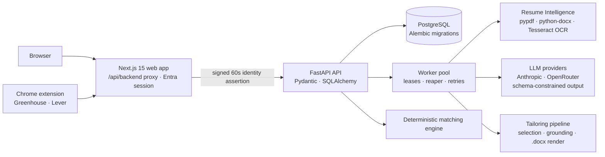

# EasyApply — AI Job-Application Assistant

> Upload a resume once. EasyApply turns it into a structured, versioned profile, matches it against any job posting with **explainable, evidence-graded verdicts**, writes a **grounded tailored resume**, and pre-fills application forms from a Chrome extension. You review everything before it is submitted.

[](https://easyapply-staging.onrender.com)
[](#)
[](#)
[](#)
[](#)
[](#)
[](#testing)

**🔗 Live (staging):** https://easyapply-staging.onrender.com. Independently deployed on Render's free tier with Microsoft sign-in. It is a staging environment, not production.

---

## The problem

Applying for jobs means copying the same resume into dozens of forms, guessing which skills a posting actually requires, and rewriting the resume for each role. AI tools that rewrite resumes tend to invent experience, and their "match scores" can't be checked.

## What EasyApply does differently

| Capability | How it works |
|---|---|
| **Resume Intelligence** | PDF/DOCX upload is validated and extracted page by page (OCR fallback for scans), then structured by an LLM into a **draft profile version** with per-field provenance. The user confirms the draft, and versions are immutable. |
| **Job Intelligence** | A job posting is parsed into required and preferred requirements, each recording where in the posting it was found. |
| **Explainable matching** | A **deterministic** engine with no LLM in the scoring path. Requirements are normalized (skills vocabulary, morphology, negation, geography) and each verdict cites graded evidence: declared, corroborated, or demonstrated in paid work. |
| **Grounded tailoring** | The default generator *selects* sentences from the confirmed profile instead of writing new ones. A grounding validator rejects any claim it can't trace back to the source. Output is a `.docx`. |
| **Chrome extension (MV3)** | Captures Greenhouse and Lever postings, shows the match, starts tailoring, and proposes form answers with a confidence level. It only fills fields the user ticks, and only when they are empty. |
| **Async processing** | Long jobs run on workers with database leases, lease renewal, a reaper and retry classification, so a killed worker costs one attempt and never loses the document. |
| **Security** | Microsoft Entra sign-in (OIDC + PKCE), an HttpOnly session, a short-lived signed assertion from the web tier to the API, loopback-only hosts, and cross-site write refusal on both tiers. |

## Architecture



**Staging topology (Render free tier):** one Docker container runs Next.js on the public port and FastAPI on loopback only. Postgres is reachable only on Render's private network, and documents are stored in Postgres because the free tier has no persistent disk. See [`render.yaml`](render.yaml) and [`docs/staging-deployment.md`](docs/staging-deployment.md).

## Tech stack

| Layer | Technology |
|---|---|
| API | Python, FastAPI, Pydantic, SQLAlchemy, Alembic, PostgreSQL, PyJWT |
| Documents | pypdf, python-docx, pypdfium2, pytesseract |
| AI | Anthropic SDK and an OpenRouter adapter (httpx), JSON-schema-constrained structured output; off by default |
| Web | Next.js 15, React 19, TypeScript, Tailwind CSS 4, OpenAPI-generated types |
| Extension | Chrome Manifest V3, TypeScript |
| Testing | pytest, Vitest, Playwright (+ axe accessibility checks) |
| Deploy | Docker, Render Blueprint |

## Repository layout

```
easyapply/
├── services/api/        # FastAPI: app/api/v1 (profile, resume, jobs, matches, tailoring), services/, models/, alembic/
├── apps/web/            # Next.js web app + Playwright e2e
├── apps/extension/      # Chrome MV3 extension (Greenhouse/Lever adapters, form classifier, autofill)
├── packages/shared/     # OpenAPI-generated TypeScript API types
├── docs/                # design docs: matching, tailoring, auth, async processing, staging
├── Dockerfile           # single-container staging image
└── render.yaml          # Render Blueprint
```

## Quick start

Requires **Python 3, PostgreSQL and Node 20+**. Detailed setup, auth modes and security notes are in [`docs/development.md`](docs/development.md) (the previous README).

```bash
# API
createdb easyapply
cd services/api
python -m venv .venv && source .venv/bin/activate
pip install -r requirements-dev.txt
cp .env.example .env          # set DATABASE_URL
alembic upgrade head
uvicorn app.main:app --reload # http://127.0.0.1:8000/docs

# Web (repo root, second terminal)
npm install
npm run dev                   # http://localhost:3000
```

AI features are disabled by default (`RESUME_AI_ENABLED=false`), so a fresh checkout and the test suite run without an API key.

### Key environment variables

| Variable | Where | Purpose |
|---|---|---|
| `DATABASE_URL` | `services/api/.env` | PostgreSQL connection |
| `AUTH_MODE` | both tiers | `development` · `dev-session` · `entra` |
| `ENVIRONMENT` | API | `development` · `test` · `production` |
| `RESUME_AI_ENABLED`, `JOB_AI_ENABLED`, `TAILORING_AI_ENABLED` | API | Enable the LLM stages |
| `RESUME_AI_PROVIDER` / `_MODEL` | API | `anthropic` or `openrouter`, plus the model ID |
| `SESSION_SECRET` | web | ≥ 32 chars for session modes |

See `services/api/.env.example` and `apps/web/.env.example` for the full lists.

## API overview (`/api/v1`)

| Method | Endpoint | Purpose |
|---|---|---|
| GET / POST | `/profile`, `/profile/versions`, `/profile/versions/current` | Profile and immutable versions |
| POST / GET | `/resumes`, `/resumes/{document_id}`, `/resumes/{document_id}/result` | Upload a resume and follow its processing |
| POST | `/resumes/{document_id}/reprocess` | Re-run the pipeline |
| POST / GET | `/jobs`, `/jobs/{job_id}`, `/jobs/{job_id}/requirements` | Capture a job and read its structured requirements |
| POST / GET | `/jobs/{job_id}/matches`, `/matches/{match_id}` | Explainable match |
| POST / GET | `/jobs/{job_id}/tailored-resumes`, `/tailored-resumes/{run_id}` | Grounded tailoring runs |

Interactive docs: `http://127.0.0.1:8000/docs` (OpenAPI).

## Testing

```bash
cd services/api && pytest                                 # ~1,700 API tests (PostgreSQL required)
npm run test --workspace @easyapply/web                   # Vitest
npm run test:e2e --workspace @easyapply/web               # Playwright against the real stack
npm run test --workspace @easyapply/extension             # extension unit + flow tests
npm run test:browser --workspace @easyapply/extension     # built extension in Chromium
```

## Screenshots

<!-- TODO(Subhash): add 3 screenshots (dashboard, match explanation, extension popup) -->

## Roadmap

- Extension adapters for job sites beyond Greenhouse and Lever.
- A versioned evaluation set for tailoring quality.
- Production infrastructure (Azure, Terraform) after staging validation.
